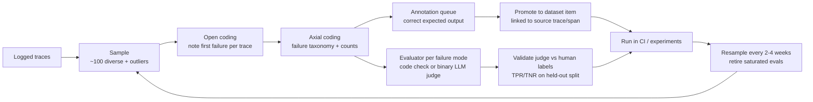
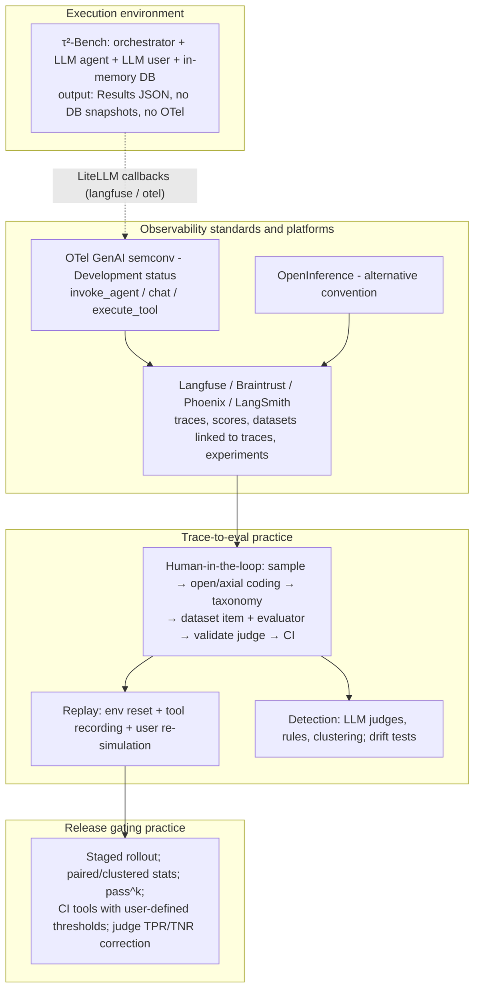

# Research: TraceToGate Foundations

## Research Question

From `02-research-questions-tracetogate-foundations.md`:

1. How does a τ²-Bench Retail run execute end to end, and what does a saved result contain?
2. How does τ²-Bench define and evaluate a task, compute pass^k, and where is it non-deterministic?
3. What failure behavior is publicly documented for τ-bench / τ²-bench Retail, and what trajectory data is published?
4. What do the OpenTelemetry GenAI semantic conventions define for agents, model calls, and tool calls?
5. How do Langfuse and Braintrust model and expose trace and eval data?
6. How do production teams turn traces into eval datasets and regression tests?
7. What makes an agent trace replayable, and how do existing tools handle it?
8. What methods exist for detecting and classifying agent failures from traces, and how accurate are they?
9. How is drift detected for LLM and agent systems?
10. How do teams compare a baseline agent with a candidate before release?
11. How is evaluator reliability measured and accounted for?

## Research Methodology

This document describes the current external landscape TraceToGate will build on. The TraceToGate repo has no code yet. Five parallel research agents investigated:

- the τ²-Bench source at commit `5ade54e` (a shallow clone, read only and never executed), with key claims spot-checked by hand afterwards;
- official specifications and documentation (OTel GenAI semconv, Langfuse, Braintrust, LangSmith, Phoenix, Inspect, promptfoo, deepeval);
- papers (τ-bench, τ²-bench, MAST, TRAIL, Who&When, AgentRx, "Adding Error Bars to Evals", EvalGen, MT-Bench judge biases, and Rogan-Gladen-style judge correction);
- practitioner writing (Hamel Husain and Shreya Shankar, Anthropic, OpenAI).

**Evidence levels.** Unmarked claims were read from source code, an official doc, or a paper's text or abstract. **(search-summary)** means the claim came from search-result snippets and its page was not opened. **(unverified)** means a secondary or single source that was not confirmed. **(inference)** means a researcher's reading, not a quoted claim. Open questions are listed at the end.

No checks were *run*. τ²-Bench was read but not installed or executed.

## Summary

**τ²-Bench is a closed-loop simulator, not a trace producer.** In each Retail run, an LLM agent and an LLM user simulator take turns while tool calls execute against an in-memory JSON database built fresh from `db.json`. The saved `Results` JSON has the full message trajectory, including tool calls and arguments, tool results with error flags, per-message timestamps, cost and usage, and raw LiteLLM responses. It also stores the termination reason and a reward breakdown. It does **not** store initial or final DB state. The evaluator rebuilds both by replaying the trajectory on a fresh environment and comparing DB hashes against a "gold" environment produced by replaying the task's reference actions. τ²-Bench has **no OpenTelemetry instrumentation**, no hook or callback API, and no tool-fault injection. The only built-in observability is a code constant that turns on LiteLLM's Langfuse callback. Retail has 114 tasks, all starting from the same DB. The success signal is effectively the final DB state, since the 72 tasks with no NL assertions automatically score 1.0 on that component. Run-to-run variance is large: current models score about 74–84% pass^1 but only about 52–61% pass^4 on Retail. The original τ-bench and τ²-bench papers publish failure breakdowns and a user-simulator error audit (12% critical simulator errors in Retail), and leaderboard trajectories are downloadable from a public S3 bucket.

**The observability layer is standardized but still unstable.** The OTel GenAI conventions now live in a separate repo (`semantic-conventions-genai`), and every GenAI-specific part is in "Development" status. They define `invoke_agent`, `chat`, and `execute_tool` spans with `gen_ai.*` attributes. Content capture is opt-in and off by default, and they say nothing normative about parallel tool calls beyond the shared parent span and `gen_ai.tool.call.id`. The official Python instrumentations moved to `opentelemetry-python-genai` (1.2b0, beta). OpenInference (Arize) is a competing convention that both Langfuse and Braintrust also accept. **Langfuse** is MIT-licensed (outside `ee/`) and self-hostable (Postgres, ClickHouse, Redis, S3). It accepts OTLP/HTTP, has datasets whose items link to source traces and observations, records every dataset item change as a version, and offers experiments with baseline comparison, annotation queues, and masking hooks. **Braintrust** is commercial SaaS that is self-hostable only on Enterprise. It has a richer review and dataset-snapshot workflow on paid tiers and a free tier of 1 GB/month with 14-day retention.

**Industry trace-to-eval practice is mostly a human-in-the-loop workflow, not an automated pipeline.** Practitioners document the same loop: sample traces, open-code the first failure, axial-code into a failure taxonomy, write a code check or a validated binary LLM judge per failure mode, promote traces to dataset items linked back to their source, run in CI, and resample periodically. Platforms provide "add trace to dataset" buttons and annotation queues, but no first-party company writeup of an automated trace→eval pipeline was found. **Replayability is not standardized**. It is assembled from environment reset (DB fixtures, Docker), recorded tool responses (small, early-stage VCR-style libraries), and re-simulated users. Re-execution diverges once the agent acts differently, which is why benchmarks re-simulate and measure pass^k.

**Automated failure detection is weak at fine grain, and drift tooling does not target agent behavior.** LLM judges classifying whole traces against a known taxonomy reach about 0.80 F1 (MAST, few-shot o1). Locating the failing step is much worse: TRAIL's best joint accuracy is 18% on GAIA and 5% on SWE-Bench, and Who&When's best step-level accuracy is 14.2%. No precision or recall figures exist for rule-based detectors such as loops or repeated calls. Drift tools (Evidently, Arize, Fiddler) offer KS, χ², PSI, JS/Wasserstein, and embedding-drift methods on tabular or embedding data. None documents drift tests on agent-specific signals such as tool-usage distributions or trajectory length, or a noise floor for LLM run-to-run variance. **Release gating** guidance converges on staged rollout (offline regression → simulation → shadow → canary). The statistical guidance is Anthropic's "Adding Error Bars to Evals": use SEM, clustered SEs, paired differences, multiple samples per question, and power analysis. No numeric gate standard exists, and CI tools mostly leave pass/fail thresholds to user scripts. **Judge reliability** is measured by TPR and TNR on a held-out, human-labeled split, and observed pass rates can be corrected with the Rogan-Gladen estimator, which becomes unstable as TPR+TNR−1 → 0.

## Detailed Findings

### 1. A τ²-Bench Retail run is an orchestrated three-party loop over an in-memory database

**Components** (paths relative to the tau2-bench repo at `5ade54e`):

| Component | What it does | Where |
|---|---|---|
| Orchestrator | Runs the turn loop (agent ↔ user ↔ environment), applies the initial state, seeds participants, checks termination, builds the `SimulationRun` | `src/tau2/orchestrator/orchestrator.py`: `initialize()` L483, seeding L525-528, termination L734-750, `_finalize()` L752, `num_errors` L956-962 |
| Agent | `LLMAgent(HalfDuplexAgent)`: system prompt = agent instruction + `<policy>`; calls `generate()` with the tool list | `src/tau2/agent/llm_agent.py`, `src/tau2/agent/base_agent.py` |
| User simulator | LLM following scenario instructions and `simulation_guidelines.md`; ends the conversation with `###STOP###`, `###TRANSFER###`, or `###OUT-OF-SCOPE###` | `src/tau2/user/user_simulator.py`, `user_simulator_base.py:51-53`, `data/tau2/user_simulator/` |
| Environment | Dispatches tool calls; converts any tool exception into `ToolMessage(content="Error: …", error=True)`; DB hash; `set_state()` | `src/tau2/environment/environment.py`: `get_response()` L465, `get_db_hash()` L275, `set_state()` L293 |
| Retail domain | `RetailDB` loaded from `db.json`; `RetailTools`; policy from `policy.md` | `src/tau2/domains/retail/{environment,tools,data_model}.py`, `data/tau2/domains/retail/` |
| LLM access | Every LLM call goes through LiteLLM `completion` with `completion_cost` | `src/tau2/utils/llm_utils.py`: `generate()` L355, `get_cost` L513 |
| Runner | Layered API: `run_simulation()` → `build_*` → `run_domain` / `run_tasks` / `run_single_task` with concurrency, checkpointing, retries, and resume | `src/tau2/runner/__init__.py`, `runner/batch.py` (L1085 / L872 / L344), `runner/checkpoint.py` |

**Retail tools.**
- Read: `find_user_id_by_email`, `find_user_id_by_name_zip`, `get_order_details`, `get_product_details`, `get_item_details`, `get_user_details`, `list_all_product_types`, `calculate`.
- Write: `cancel_pending_order`, `exchange_delivered_order_items`, `modify_pending_order_address`, `modify_pending_order_items`, `modify_pending_order_payment`, `modify_user_address`, `return_delivered_order_items`.
- Other: `transfer_to_human_agents`.

**Defaults** (`src/tau2/config.py`, verified):
- max steps 200, max errors 10, seed 300, 1 trial, concurrency 3;
- agent and user LLM `gpt-4.1-2025-04-14`, both at temperature 0.0.

```mermaid
sequenceDiagram
    participant R as Runner (batch.py)
    participant O as Orchestrator
    participant U as User simulator (LLM)
    participant A as Agent (LLM)
    participant E as Environment (RetailDB + tools)
    R->>O: build(task, agent, user, env, seed)
    O->>E: fresh RetailDB from db.json (+ task.initial_state)
    O->>A: set_seed / get_init_state
    O->>U: set_seed / scenario instructions
    loop until STOP / transfer / max_steps / too_many_errors
        U->>O: user message
        O->>A: generate_next_message
        A-->>O: AssistantMessage (text and/or tool_calls)
        O->>E: execute tool_calls
        E-->>O: ToolMessage (result or "Error: …", error flag)
    end
    O->>R: SimulationRun (messages, termination_reason, costs)
    R->>R: evaluate → reward_info; save Results JSON
```

**Plugging in a custom agent.**
1. Subclass `HalfDuplexAgent`. Implement `get_init_state(message_history)` and `generate_next_message(message, state) -> (AssistantMessage, state)`. The constructor is `(tools, domain_policy, **kwargs)`.
2. Optionally mix in `LLMConfigMixin` (`agent/base/llm_config.py`) for `llm`, `llm_args`, and `set_seed`.
3. Register with `registry.register_agent_factory(...)` (`src/tau2/registry.py`).
4. Run with `--agent <name>` or `run_single_task` / `run_domain`.

Examples live in `examples/agents/` (`minimal_text_agent.py`, `react_agent.py`, `custom_agent_eval.py`). A gym wrapper (`src/tau2/gym/gym_agent.py`) and an HTTP environment server (`src/tau2/environment/server.py`, `orchestrator/environment_manager.py`) also exist.

#### Saved results contain the full trajectory but no DB state

`Results` (`src/tau2/data_model/simulation.py`) holds:
- `timestamp`;
- `info`: git commit, `num_trials`, `max_steps`, `max_errors`, `seed`, `agent_info` / `user_info` (implementation, LLM, args), and `environment_info` (domain, policy text);
- `tasks`: full copies;
- `simulations`.

`SimulationRun` fields (L1294-1380, verified):

```text
SimulationRun
  id, task_id, trial, seed, mode
  timestamp, start_time, end_time, duration
  termination_reason   user_stop | agent_stop | max_steps | timeout | too_many_errors |
                       agent_error | user_error | infrastructure_error |
                       context_window_exceeded | unexpected_error
  agent_cost, user_cost, agent_usage (voice)
  messages[]           System | User | Assistant | Tool | MultiTool
    Assistant/User:    content, tool_calls[{id, name, arguments, requestor}], turn_idx,
                       timestamp, cost, usage, raw_data (LiteLLM response), generation_time_seconds
    Tool:              id, content, requestor, error, turn_idx, timestamp
  reward_info          reward, db_check{db_match, db_reward}, env_assertions, action_checks,
                       nl_assertions, communicate_checks, reward_basis, reward_breakdown, info
  review, user_only_review, hallucination_check, auth_classification   (optional LLM reviews)
  info, policy, provider_session_id, effect_timeline (voice only)
```

- There is **no initial or final DB snapshot field**. `effect_timeline` holds audio-effect events for full-duplex voice only (verified).
- Final state can be recovered after the fact by replaying `messages` through `Environment.set_state()` on a fresh environment. That is what the evaluator does.
- `tau2 evaluate-trajs` (`src/tau2/scripts/evaluate_trajectories.py`) re-grades saved trajectories.
- `--verbose-logs` writes per-task logs under `<save_dir>/artifacts/task_<id>/sim_<id>/task.log`.

#### τ²-Bench has no tracing instrumentation or hook API

- There is no OpenTelemetry in `src/tau2`. The only hits are in a vendored lockfile under `src/experiments/`.
- `USE_LANGFUSE = False` (`config.py:59`, verified) switches `litellm.success_callback = ["langfuse"]` (`llm_utils.py:66-67`, verified). It is a code constant, not a CLI flag.
- LiteLLM callbacks could be set by user code that imports `litellm` **(inference)**.
- There is no orchestrator callback API. The extension points are agent and user subclasses, a custom `Orchestrator`, or calling `run_simulation()` directly.
- Logging uses loguru. LiteLLM caching is optional and off by default (`config.py:47-55`).

#### Testing Patterns

τ²-Bench's own test suite was not investigated. The TraceToGate repo has no code or tests.

### 2. τ²-Bench grades on final DB state, and its randomness comes from the two LLMs

**Task schema** (`src/tau2/data_model/tasks.py`, `Task` at L560):

```text
Task
  id, description, ticket, issues, required_documents, user_tools
  user_scenario.instructions: domain, reason_for_call, known_info, unknown_info, task_instructions
  user_scenario.persona (optional)
  initial_state: initialization_data, initialization_actions, message_history   (null for all retail tasks)
  evaluation_criteria:
    actions[{action_id, requestor, name, arguments, info, compare_args}]   # one reference solution
    env_assertions, communicate_info, nl_assertions
    reward_basis   (default [DB, COMMUNICATE]; retail: 112 tasks [DB, NL_ASSERTION], 2 tasks [DB])
```

Retail has 114 tasks (`tasks.json`). The splits (`split_tasks.json`) are train 74, test 40, and base 114.

**Reward components** (`src/tau2/evaluator/`, documented in `docs/evaluation.md`):

| Component | Mechanism | Used in Retail? |
|---|---|---|
| DB | Replay the agent trajectory on a fresh env (predicted). Replay `evaluation_criteria.actions` on a fresh env (gold). Compare DB hashes → 1.0 / 0.0 | Yes, always |
| NL_ASSERTION | LLM judge (`gpt-4.1`, temp 0) over the trajectory. Labelled experimental | Listed in 112 tasks, but only 40 define assertions. **Tasks with none return reward 1.0 for this component** (`evaluator_nl_assertions.py:37-43`, verified), so the other 72 are graded on DB alone |
| COMMUNICATE | Substring match of `communicate_info` in agent messages | Not in retail `reward_basis` |
| ENV_ASSERTION | Assertions on the predicted env | Not in retail `reward_basis` |
| ACTION | Each reference action must match an agent tool call | Not used in airline, retail, or telecom |

The final reward is the **product** of the components in `reward_basis` (`evaluator.py:222-256`). Because DB is compared by end state, `actions` is one reference path, not a required path. Any trajectory reaching the same final DB passes. The paper notes the converse limit: an agent can violate policy (for example, act without user confirmation) and still pass if the end state matches.

```text
evaluate(simulation, task)
  predicted_env = fresh_env(task.initial_state); replay(simulation.messages)
  gold_env      = fresh_env(task.initial_state); replay(task.evaluation_criteria.actions)
  db_reward     = 1.0 if hash(predicted_env.db) == hash(gold_env.db) else 0.0
  nl_reward     = 1.0 if no nl_assertions else llm_judge(messages, nl_assertions)
  reward        = product(rewards for components in reward_basis)
```

**pass^k** (`src/tau2/metrics/agent_metrics.py:113`, verified) is `C(c,k) / C(n,k)` per task for n trials with c successes, averaged across tasks. It requires n ≥ k. Infrastructure-error simulations are excluded.

**Non-determinism sources.**
- The LLM agent, the LLM user simulator, and the NL-assertion judge are all stochastic.
- Tool code is deterministic (no randomness in `retail/tools.py`).
- Seeding: `batch.py:742-743` derives one seed per trial from `config.seed`. `Orchestrator.initialize` calls `set_seed` on agent and user, which for `LLMConfigMixin` passes `seed` through LiteLLM. Whether providers honor `seed` was not verified.
- Temperature 0 does not guarantee identical outputs. One study found a 120B model matching itself in only about 12.5% of ten deterministic runs (arXiv 2601.19934, search-summary).

**Re-running one task.** Use `tau2 run --domain retail --task-ids <ids> --num-trials N --seed S` (`docs/cli-reference.md`), or `run_single_task(task, trial, seed)`. Resume keys on `(trial, task_id, seed)`. Each run builds a fresh DB from `db.json`. There is no mid-run snapshot API. `Environment.set_state(initialization_data, initialization_actions, message_history)` and `Task.initial_state.message_history` (a conversation prefix) are the only state-restoration mechanisms. The HTTP environment manager exposes `SetStateRequest`.

**Tool errors.** No fault-injection feature was found. Errors occur naturally, as tool exceptions turned into `error=True` messages. Ten errors end a run as `too_many_errors`.

**Replay and extension details** (added during the design step; read from source at `5ade54e`, verified):
- `Environment.set_state()` (`environment.py` L293-411) re-executes **only mutating tools** from the message history. It skips read tools and unknown (hallucinated) tool names. Each tool declares `mutates_state` (`toolkit.py` `tool_mutates_state`, default `True`).
- With `strict=True` (the default), replay **raises** when a replayed mutating tool returns content different from the recorded `ToolMessage`. `evaluate_simulation(..., strict_replay=True)` is the default (`evaluator.py` L96). Only `tau2 evaluate-trajs` uses `strict_replay=False` (`evaluate_trajectories.py` L133).
- Consequence **(inference)**: a run whose recorded write-tool result was altered (for example, an injected error on a write that the real tool would accept) cannot be graded by the default evaluator. It either raises, or with `strict=False` it rebuilds a final state that differs from the live run.
- `registry.register_domain(get_environment, name)` (`registry.py` L177) accepts any environment constructor. `build_environment()` (`runner/build.py` L41) resolves the domain name through this registry. A wrapped Retail environment can therefore be registered under a new domain name without changes to τ²-Bench.
- All tool calls pass through `Environment.get_response(ToolCall)` → `make_tool_call()` → `ToolKitBase.use_tool()` (`environment.py` L142-185, L465-490). This is the single boundary for tool spans and for fault injection.

#### Testing Patterns

Not investigated (see §1).

### 3. τ-bench Retail failures are documented, and trajectories are published

**Original τ-bench paper** (arXiv 2406.12045, June 2024):
- gpt-4o succeeds on under 50% of tasks overall, with retail pass^8 under 25%.
- An analysis of 115 gpt-4o retail trajectories found 40 failures. 4 were caused by user-instruction issues and later fixed. The 36 agent failures break down (Figure 5) as:

| Category | Share of 36 |
|---|---|
| Wrong info | 33.3% |
| Wrong decision (policy/rule following) | 25.0% |
| Wrong argument | 22.2% |
| Partially resolved compound request | 19.4% |

The category-to-percentage mapping comes from one researcher's reading of the PDF; a second researcher could not map them. Failure rises with the number of required write actions. Removing the policy text drops retail pass^1 from 61.2 to 56.8 (airline: 33.2 to 10.8).

**τ-bench repo** (MIT):
- It says its airline and retail tasks are outdated and points to tau2/tau3 for fixed tasks.
- It ships `historical_trajectories/`.
- It includes an LLM-based auto error identification tool that assigns fault to the user, agent, or environment. Its README warns the output may be inaccurate.

**τ²-bench paper** (arXiv 2506.07982, June 2025, CC BY 4.0):
- gpt-4.1 pass^1 is about 74% retail, 56% airline, and 34% telecom.
- User-simulator audit (gpt-4.1 as both agent and user):

| Domain | Conversations | Critical sim errors | Total sim errors |
|---|---|---|---|
| Retail | 50 | 6 (12%) | 20 (40%) |
| Airline | 100 | 13 (13%) | 47 (47%) |
| Telecom | 50 | 3 (6%) | 8 (16%) |

Retail simulator error modes (Appendix E.1, 20 errors): conversation-structure violation 11, missing constraint 4, premature termination (`###STOP###` right after confirming, before the agent acts) 3, ungrounded reference 2.

**Current leaderboard snapshot** (repo `web/leaderboard/public/submissions/*/submission.json`, not checked against the live site):

| Model | Retail pass^1 | Retail pass^4 |
|---|---|---|
| Qwen3.5-397B-A17B | 84.4 | 59.6 |
| RAFT-30B-A3B (custom) | 82.5 | 61.4 |
| GPT-5 | 81.6 | 58.8 |
| GPT-5.2 | 81.6 | 51.8 |
| Claude Opus 4.5 | 79.6 | 51.8 |
| Gemini 3 Flash | 76.8 | 51.8 |
| GPT-4.1 | 74.0 | 52.3 |
| GPT-4.1-mini | 61.4 | 36.9 |

The pass^1 → pass^4 gap is typically 20–30 points.

**Published trajectories.**
- The repo has `data/tau2/results/final/`, with GPT-4.1, GPT-4.1-mini, and Claude 3.7 Sonnet runs × 3 domains × 4 trials, about 590 MB in total. The retail GPT-4.1 file holds 456 simulations (114 × 4).
- Leaderboard trajectories are in the public S3 bucket `sierra-tau-bench-public` under `submissions/<dir>/trajectories/` (`aws s3 sync … --no-sign-request`, from `TrajectoryVisualizer.jsx`), in the same `Results` format. Public access was not tested.
- No separate data license was found. The repo is MIT.

**Known task issues and review tooling.**
- `data/tau2/domains/retail/task_issues/` holds stored simulations for tasks 4, 5, and 7 (contents not read).
- The CHANGELOG has one retail fix (task 21).
- The repo has LLM reviewers that label agent and user errors per simulation: `evaluator/review_llm_judge.py`, `review_llm_judge_user_only.py`, and `hallucination_reviewer.py`, with default model `claude-opus-4-5`.
- `docs/evaluation.md` references issues #224 and #129 on DB-hash versus action-list grading.

### 4. OTel GenAI conventions define agent/model/tool spans, but all of it is still "Development" status

- The spec moved to [open-telemetry/semantic-conventions-genai](https://github.com/open-telemetry/semantic-conventions-genai). The old opentelemetry.io and core-repo pages now say "has moved", and the new repo's schema URL is still "TODO".
- The core semconv release is v1.44.0 (2026-08-04).
- **Every GenAI-specific span, attribute, and event is Development status.** Only borrowed general attributes such as `error.type` and `server.address` are Stable.

**Spans** (agent spans doc, spans doc):

| `gen_ai.operation.name` | Span name | Kind |
|---|---|---|
| `chat` / `generate_content` / `text_completion` | `{op} {gen_ai.request.model}` | CLIENT (INTERNAL if in-process) |
| `invoke_agent` | `invoke_agent {gen_ai.agent.name}` | CLIENT (remote) / INTERNAL (in-process) |
| `create_agent` | `create_agent {name}` | CLIENT |
| `invoke_workflow`, `plan` | `invoke_workflow {name}`, `plan {agent}` | INTERNAL |
| `execute_tool` | `execute_tool {gen_ai.tool.name}` | INTERNAL |
| `embeddings`, `retrieval`, memory ops | … | CLIENT / INTERNAL |

**Key attributes.**
- Required: `gen_ai.operation.name` and `gen_ai.provider.name` (replaces `gen_ai.system`).
- Conditionally required: `gen_ai.request.model`, `error.type`, `gen_ai.conversation.id`, `gen_ai.response.id`.
- Agent: `gen_ai.agent.{id,name,description,version}`. The `id` is meant to be a stable provider id, not a transient instance id.
- Usage: `gen_ai.usage.input_tokens` (includes cached), `output_tokens`, and `cache_read` / `cache_write` variants.
- Tool span: `gen_ai.tool.name` (required); `gen_ai.tool.call.id`, `.type`, `.description` (recommended); `gen_ai.tool.call.arguments` / `.result` (opt-in).

**Content capture.**
- Off by default. Three patterns are described: do not record; record on span attributes (`gen_ai.input.messages`, `gen_ai.output.messages`, `gen_ai.system_instructions`; suggested for pre-production); or upload externally and record references (suggested for production, but the reference convention is TODO).
- Python switch: `OTEL_INSTRUMENTATION_GENAI_CAPTURE_MESSAGE_CONTENT` = `no_content` | `span_only` | `event_only` | `span_and_event`. An fsspec upload hook exists in `opentelemetry-util-genai`.
- Events: `gen_ai.client.inference.operation.details` (DEBUG, carries chat history), `gen_ai.client.operation.exception`, and **`gen_ai.evaluation.result`** (`gen_ai.evaluation.name`, `score.value`, `score.label`, `explanation`). The evaluation event is parented to the evaluated span.

**Structure and parallel tool calls.** The documented tree is shown below. Model and tool spans are children of the agent span, and a `plan` span's resulting tool spans "are typically sibling operations". **No normative text covers parallel tool calls.** They appear as sibling `execute_tool` spans with overlapping times, linked to the model's request only by `gen_ai.tool.call.id`, and no span links are defined.

```text
invoke_agent retail_agent            (INTERNAL)
├── chat gpt-4.1                     (CLIENT)   → response with tool_calls [c1, c2]
├── execute_tool get_order_details   (INTERNAL) gen_ai.tool.call.id=c1
├── execute_tool get_user_details    (INTERNAL) gen_ai.tool.call.id=c2
└── chat gpt-4.1                     (CLIENT)
```

**Stability opt-in.** `OTEL_SEMCONV_STABILITY_OPT_IN=gen_ai_latest_experimental` switches instrumentations to the newest experimental format. The detail comes from LiteLLM docs and a search-summary of older spec text, and was not re-confirmed in the new repo.

**Instrumentations emitting these today.**
- Official Python GenAI instrumentations moved to [opentelemetry-python-genai](https://github.com/open-telemetry/opentelemetry-python-genai), version 1.2b0 (beta). They cover openai, anthropic, bedrock, langchain, llama-index, openai-agents, smolagents, dspy, google-genai, and others. The contrib `openai-v2` is deprecated.
- OpenLLMetry/Traceloop uses `gen_ai.*` plus its own extras.
- **LiteLLM** (which τ²-Bench uses) has an `otel` callback. It emits LiteLLM-style spans by default and spec-form spans with the opt-in flag. A newer `LITELLM_OTEL_V2=true` follows the GenAI conventions, with Langfuse, Phoenix, and Weave presets.

**OpenInference vs OTel GenAI.**

| | OTel GenAI | OpenInference |
|---|---|---|
| Classification | `gen_ai.operation.name` + span kind | `openinference.span.kind` (LLM, TOOL, AGENT, CHAIN, RETRIEVER, EVALUATOR, …) |
| Messages | Structured `gen_ai.input/output.messages` (opt-in) | Flattened `llm.input_messages.N.message.*` |
| Tools | `gen_ai.tool.name`, `.call.id`, `.call.arguments` | `tool.name`, `tool_call.id`, `tool_call.function.arguments` |
| Sessions | `gen_ai.conversation.id` | `session.id`, `user.id` |
| Evals | `gen_ai.evaluation.result` event | `annotation.*` |

OpenInference is used by Phoenix and Arize AX. Arize AX normalizes incoming `gen_ai.*` spans into OpenInference.

### 5. Langfuse and Braintrust both link datasets to source traces, but differ in openness and cost

| | Langfuse | Braintrust |
|---|---|---|
| Data model | Trace → nested observations (`span`, `generation`, `event`, `agent`, `tool`, `chain`, `retriever`, `evaluator`, `embedding`, `guardrail`); sessions; scores on trace, observation, session, or dataset run (numeric, categorical, boolean, text) | Project logs and experiments; traces of spans (`span_attributes.type`: `llm`, `tool`, `task`, `score`, `function`, `review`, full list unconfirmed); per-span 0–1 scores |
| OTel ingest | `/api/public/otel`, OTLP/HTTP only (JSON or protobuf), Basic auth. Maps `langfuse.*`, `gen_ai.*`, OpenInference, MLflow attributes | `https://api.braintrust.dev/otel`, Bearer auth + `x-bt-parent`. Maps GenAI semconv v1.44.0 including `gen_ai.evaluation.*` → scores, OpenInference, `braintrust.*` |
| Datasets | Items `{input, expectedOutput, metadata, sourceTraceId, sourceObservationId, status}`; add from trace or batch from the observations table; CSV import | Records `{input, expected, metadata, tags}`; `input` can reference a logged trace; dataset pipelines transform logs into rows |
| Dataset versioning | Every item add, update, delete, or archive creates a version; fetch at a timestamp. Schema changes are not versioned | Every change tracked; **named snapshots** (pinnable, restorable, assignable to environments) on Pro+ only |
| Experiments | SDK, UI, or OTel-ingested; compare against a baseline with regression drill-down; no public REST endpoint to create runs | Comparison key + baseline (project default) |
| Human review | Annotation queues for traces, observations, sessions with score configs (unlimited queues on Pro cloud) | Review scores; assign rows in logs, experiments, datasets; add reviewed rows to datasets |
| Query / export | Public API (OpenAPI), Observations and Metrics API v2 in SDKs, UI CSV/JSON export, scheduled blob export | SQL (no JOINs, 30 s timeout) via API/CLI; SDKs in TS, Python, Go, Java, Ruby, C# |
| Redaction | SDK-side `mask_otel_spans` before export (also covers third-party OTel spans) | SDK masking and span customizers; server-side PII redaction in private preview |
| Self-host | Docker Compose or Helm. Web + worker; Postgres, ClickHouse, Redis/Valkey, S3/blob | Enterprise only; Braintrust runs the control plane, you run the data plane (API, Postgres, Redis, object storage, Brainstore) |
| License | MIT outside `ee/`; self-host core is free | Commercial SaaS; SDK Apache-2.0; autoevals open source |
| Free tier | Cloud Hobby: 50k units/month, 30-day access, 2 users. Core $29, Pro $199 | Starter: 1 GB/month processed, 10k scores, 14-day retention. Pro $249 (5 GB, 30 days, snapshots) |

**Alternatives.**
- **LangSmith**: OTLP ingest, datasets and experiments, pytest integration; SDK MIT; self-host reportedly Enterprise (unverified).
- **Arize Phoenix**: OpenInference-native, self-hostable, Elastic License 2.0.
- **W&B Weave**: OTLP, datasets and evals; Apache-2.0 SDK.
- **MLflow Tracing**: OTLP/HTTP ingest since 3.6.0; Apache-2.0.

### 6. Production trace-to-eval is a documented human-review loop, and platforms automate only its edges

Sources: Hamel Husain and Shreya Shankar ([evals](https://hamel.dev/blog/posts/evals/) 2024, [field guide](https://hamel.dev/blog/posts/field-guide/) 2025, [evals FAQ](https://hamel.dev/blog/posts/evals-faq/) 2026-09), Anthropic ["Demystifying evals for AI agents"](https://www.anthropic.com/engineering/demystifying-evals-for-ai-agents) (2026-01), OpenAI [trace grading](https://developers.openai.com/api/docs/guides/trace-grading) (search-summary), and LangSmith, Braintrust, Langfuse, and Phoenix docs.



**Documented specifics.**
- **Sampling and saturation.** Start with about 100 diverse traces and annotate at least 30 yourself. Continue until new traces show no new failure modes ("theoretical saturation") (FAQ).
- **Open and axial coding.** One domain expert (the "benevolent dictator") writes free-text notes on the *first* failure, then groups them into a taxonomy. The FAQ calls this the most important step. In the NurtureBoss example, 3 issues were over 60% of problems.
- **Evaluator choice.** Use a code-based check when a deterministic rule exists. Otherwise use one binary pass/fail judge per failure mode. Anthropic adds: grade outcomes, not exact paths; give judges an "Unknown" escape; and accept a task only if "two domain experts would independently reach the same pass/fail verdict", with a reference solution.
- **Starting size.** Anthropic suggests 20–50 tasks drawn from real failures. Braintrust says 10–200 examples.
- **Promotion mechanics.**
  - LangSmith annotation queues add runs or threads (up to 100 per action, including from automation rules); reviewers edit into a reference example and "Add to Dataset". Thread items become one multi-turn example.
  - Langfuse adds any observation, or batch-adds filtered observations, with `sourceTraceId` / `sourceObservationId`.
  - Phoenix creates datasets from spans with `span_id_key` linking (client ≥ 1.28.0).
  - Braintrust has one-click add to dataset (search-summary).
- **Maintenance.** Review 10–20 outlier traces weekly, run a full cycle on 100+ fresh traces every 2–4 weeks, and re-run error analysis after model or prompt changes and incidents. Saturated capability evals "graduate" to regression suites (Anthropic). A 0% pass rate across many trials "is most often a signal of a broken task" (Anthropic).

**Reported pitfalls.**

| Pitfall | Source |
|---|---|
| Synthetic data cannot reveal production failure frequency | Hamel FAQ |
| Raw agreement misleads on imbalanced labels; judges need held-out validation | Hamel 2024 post, FAQ |
| Eval saturation; dataset changes break score comparability | Anthropic, FAQ |
| Criteria drift: graders' definitions change as they see outputs | Field guide, EvalGen |
| Broken or ambiguous tasks; graders rejecting valid solutions | Anthropic |
| Shared state between trials contaminates results | Anthropic |
| Over-automating too early erodes trust; generic metrics and heavy labeling UIs add friction | Field guide |
| Privacy: get permission, use authorized experts, redact before logging (verify redaction), synthetic data as a last resort | FAQ |

No first-party company engineering writeup of an automated trace→eval pipeline was found. The available material is vendor or tooling posts (ZenML Kitaru, a Mastra workshop, the `traceval` package) and Hamel's customer examples.

### 7. Replayability is assembled from environment reset, tool recording, and user re-simulation, and no single standard exists

| Concern | Documented approaches |
|---|---|
| Environment state | τ-bench/τ²: fresh DB from fixture, end-state comparison. **AppWorld** (arXiv 2407.18901): engine controls DB and time, resettable to a fixed start, state-based unit tests including collateral-damage checks. **WebArena**: Docker sites, reset by recreating containers. **Inspect AI**: `sandbox="docker"` per sample, task, or eval. Anthropic: a clean environment per trial |
| Tool responses | HTTP cassettes (VCR.py, pytest-recording); SDK-level (`llmvcr`: prompt or model changes force re-recording); whole-run recorders (`cendor-cassette`, `pytest-agent-check`, `coding-agent-vcr`); model-only replay with real tools (`langchain-replay`). **All are small, early-stage community packages** |
| Simulated tools | AppWorld and τ-bench tools are simulated APIs over a controlled DB, not recordings. No LLM-simulated tool outputs documented in the tools checked |
| User turns | Re-simulate with an LLM user (τ-bench; LangSmith `run_multiturn_simulation` / `create_llm_simulated_user`, which can fix the first N turns). LangSmith says simulation gives broader coverage but is "less consistent" than static inputs. Whole threads can be saved as dataset items |
| Checkpoint "time travel" | LangGraph replay re-executes nodes after a checkpoint and does not read from cache. LLM and API calls may return different results, external actions re-fire, and only graph state (not world state) is restored. Fork creates a branch via `update_state` |

**Replay versus re-simulation limits.** No source names "trajectory divergence after the first differing action" as a formal limit. The evidence is indirect:
- cassette tools fail on mismatched requests;
- LangGraph replay can diverge downstream;
- simulated multi-turn runs are less consistent;
- pass^k exists because repeated trials of the same task are inconsistent.

The resulting picture (fixed user turns break once the agent's behavior differs, and re-simulation adapts but adds variance) is **(inference)**.

### 8. LLM judges classify whole traces reasonably well but locate failing steps poorly

| Work | Scope | Reported performance |
|---|---|---|
| **MAST** (arXiv 2503.13657) | 14 failure modes in 3 categories (system design, inter-agent misalignment, task verification); 1600+ annotated multi-agent traces ([MAST-Data](https://huggingface.co/datasets/mcemri/MAST-Data)) | Human κ 0.88 (0.79 out-of-domain). o1 judge zero-shot: F1 0.64, κ 0.58. Few-shot: precision 0.833, recall 0.77, F1 0.80, κ 0.77. Most frequent mode: step repetition, 15.7% |
| **TRAIL** (arXiv 2505.08638) | 148 traces (GAIA, SWE-Bench), 841 errors, agentic error taxonomy | Best joint (category + location) accuracy: Gemini-2.5-Pro 18% GAIA, 5% SWE-Bench; o3 9%; Claude-3.7-Sonnet 5%; GPT-4.1 3%. Context-handling failures near 0 F1; tool-selection errors 0.00–0.26 F1. 3 of 8 models could not fit the traces in context |
| **Who&When** (arXiv 2505.00212) | 127 multi-agent systems' failure logs; responsible agent + decisive step | Best: 53.5% agent-level, 14.2% step-level; some methods below random |
| **AgentRx** (arXiv 2602.02475) | Synthesized constraints checked per step → violation log → LLM judge names critical step + category | Claims +75% relative step localization. Benchmark size (115 vs 170 trajectories) and taxonomy size (9 vs 10) are inconsistent across sources |
| τ-bench analysis | See §3 | Manual categorization only |
| τ²-Bench reviewers | `review_llm_judge.py`, `hallucination_reviewer.py` | No accuracy figures found |

Newer attribution preprints (AgentScope, FALAT, ReCast) report step-level accuracy of about 28–46% on Who&When-type data (search-summary, unverified).

**Rule-based detectors.** These come only from practitioner sources (OneUptime, OpenClaw loop-detection docs, Arize's agent handbook), and **no precision or recall figures are published**. Documented signals:
- hashing behavior-relevant tool arguments to spot repeats;
- per-run repeat limits plus a global action budget;
- progress markers;
- ping-pong and poll-without-progress patterns;
- distinguishing legitimate repeats (changed query, advancing poll state).

During loops, token use and duration rise while error rates stay low, so error-rate rules alone miss loops. τ-bench shows that outcome checks miss policy violations that still reach the right end state.

**Clustering and "insights" products.**
- Docent (Transluce): rubric-based search and clustering, marked legacy in favor of "Analysis Plans".
- Braintrust Topics: daily facet extraction, label clustering, and a scatterplot.
- LangSmith Insights: hierarchical trace categorization, on Plus/Enterprise plans.
- Langfuse: no first-party clustering found.
- **None publishes accuracy figures.**

### 9. Drift tools offer standard distribution tests, and none targets agent-behavior signals or LLM noise floors

| Method | Applied to | Tool / default |
|---|---|---|
| KS (numeric), χ² (categorical), α = 0.05 | Reference ≤ 1,000 rows | Evidently (old docs, ≤ 0.6.7) |
| Wasserstein 0.1 (numeric), Jensen-Shannon 0.1 (categorical) | Reference > 1,000 rows (avoids large-sample tests flagging trivial shifts) | Evidently |
| Domain classifier ROC AUC > 0.55 | Embeddings, text | Evidently |
| Euclidean distance between embedding centroids | Embedding drift vs. baseline | Arize, Phoenix |
| PSI | Binned distributions; less sample-size sensitive than KS (per Arize) | Arize |
| Embedding clustering → JSD/PSI on cluster shares | NLP/LLM embeddings | Fiddler (arXiv 2312.02337) |
| Golden prompt sets + text metrics over time | LLM behavior | WhyLabs LangKit (current product status unverified) |
| Threshold alerts on latency, cost, scores | Outcome and ops drift | Langfuse (no statistical drift test found) |

**By drift type.**
- **Input drift** has documented methods (embeddings, topics). Braintrust Topics and LangSmith Insights show category counts but document no statistical test.
- **Behavioral drift** has no documented tool support for tool-usage distributions, trajectory length, or refusal and escalation rates. Applying χ² or JSD to them is **(inference)**.
- **Outcome, latency, and cost drift** are covered by threshold alerts.

**Separating change from noise.** Tools compare a reference window against a current window or a configured baseline. **No documentation found** covers window-length selection, multiple-testing correction across many monitored metrics, or a noise floor for LLM run-to-run variance. The research also notes:
- Temperature 0 is not reproducible (arXiv 2508.15503, 2601.19934, search-summary).
- Providers have changed model behavior without changing the model identifier. Chen, Zaharia, and Zou (arXiv 2307.09009) found GPT-4's prime-number accuracy fell from 84% to 51% between the March and June 2023 snapshots, and later work notes such shifts are prompt-specific.

### 10. Release comparison is staged, and statistical rigor means paired, clustered, powered comparisons

**Evaluation modes**, in the order sources describe them:

| Mode | Description | Documented trade-offs |
|---|---|---|
| Offline regression / replay | Historical inputs through the candidate; checks or judge versus baseline | Cheap and safe; inputs reflect the old system's behavior |
| Re-simulation | Both agents against a simulated environment and user (τ-bench style) | Reproducible environment; simulator adds noise |
| Shadow | Candidate gets mirrored live traffic; users see the baseline; side effects sandboxed | Catches distribution gaps; roughly doubles inference cost |
| Canary | About 5–10% of traffic, assigned per user or session, with rollback conditions | User-visible |
| Online A/B | Real outcomes | Slow, traffic-hungry, weak on "why" |

The staged order and practices mostly come from vendor blogs and one survey (arXiv 2605.23989). Anthropic positions automated evals as the CI/CD first line "on each agent change and model upgrade".

**Statistical method.** Anthropic's [statistical approach](https://www.anthropic.com/research/statistical-approach-to-model-evals) is summarized in its post. The full formulas are in the paper (arXiv 2411.00640), which was not read in full.

```text
per-task scores s_i (average multiple samples per task to cut within-task noise)
SEM         = sd(s) / sqrt(n);  95% CI = mean ± 1.96·SEM
clustered SE when tasks share a source (can be >3× naive SE)
paired diff d_i = s_i^cand − s_i^base;  SE_d = sd(d)/sqrt(n)    # correlation 0.3–0.7 between models ⇒ big variance cut
power: n ≈ ((z_{1−α/2} + z_power) · sd_d / δ)²                  # standard formula (background knowledge)
pass^k per task = C(c,k)/C(n,k)                                 # consistency; 75% per-trial ⇒ ~42% at k=3
```

Related work:
- "AI Agents That Matter" (arXiv 2407.01502) argues for cost as a co-equal metric and points to reproducibility gaps.
- HAL (arXiv 2510.11977) ran 21,730 rollouts (about $40k). It found that higher reasoning effort often reduced accuracy, and LLM-aided log inspection surfaced shortcut behavior.
- McNemar's test, bootstrap, and minimum-detectable-effect procedures are standard statistics, but **no fetched agent-eval source prescribes them**.

**Gate criteria.** No numeric standard exists. Documented structural criteria:
- regression suites near 100% (no regressions on graduated cases);
- pass^k for customer-facing consistency;
- cost as a co-equal metric;
- canary rollback conditions (task completion, schema validity, tool choice, token cost).

**CI tools.**

| Tool | Output | How pass/fail is decided |
|---|---|---|
| Braintrust (`bt eval` + GitHub Action) | PR comment with scores and metrics | Non-zero exit on eval exception; custom reporters; no built-in regression threshold documented. Suggests sampled runs on PRs and the full suite on merge |
| LangSmith (pytest / Vitest) | Each test file → dataset, each run → experiment | Normal assertions; `expect` logs binary scores; LLM call caching for CI |
| promptfoo | JSON (`stats.successes/failures`), HTML, JUnit | `--fail-on-error`; pass-rate thresholds are user `jq` scripts |
| deepeval | Local / Confident AI reports | Per-metric thresholds fail `assert_test` |
| Inspect AI | `EvalLog` with accuracy and stderr; epochs | Gating left to the caller |
| τ²-Bench | `Results` JSON, pass^k metrics | No gating |

### 11. Judge reliability is measured with TPR/TNR on held-out labels and can be corrected for in reported rates

**Validation workflow.**

Hamel Husain's [critique shadowing](https://hamel.dev/blog/posts/llm-judge/):
1. One expert gives binary pass/fail plus a critique on diverse examples.
2. The critiques become few-shot examples in the judge prompt.
3. Split the labeled data into train 10–20%, dev 40–45%, and test 40–45%. Iterate on dev, then freeze and run test once.
4. Report **TPR and TNR separately**. Raw agreement misleads: with 5% failures, an always-pass judge scores 95% agreement.
5. Re-validate on material changes such as a model update. The FAQ suggests 100–200 labels per failure mode.

Supporting sources:
- EvalGen (arXiv 2404.12272) documents **criteria drift**: grading changes the grader's own criteria.
- Anthropic recommends calibrating against experts and reading transcripts to catch graders rejecting valid solutions.

**Metrics.** TPR = TP/(TP+FN), TNR = TN/(TN+FP), Cohen's κ = (p_o − p_e)/(1 − p_e), Youden's J = TPR + TNR − 1. Practitioner sources focus on TPR and TNR; κ is used for human inter-annotator agreement (MAST, Hamel's FAQ).

**Known judge biases.** Position, verbosity, and self-preference (MT-Bench, arXiv 2306.05685; arXiv 2404.13076). Strong judges reach over 80% agreement with humans, about the level of human-human agreement.

**Correcting reported rates.** Given an observed judge pass rate p̂, and Se (TPR) and Sp (TNR) estimated on a labeled calibration set:

```text
π̂ = (p̂ + Sp − 1) / (Se + Sp − 1)      # Rogan-Gladen; clip to [0,1]; unstable as J = Se+Sp−1 → 0
```

- Lee et al. (arXiv 2511.21140) give a plug-in correction with confidence intervals covering both test-set and calibration-set uncertainty (abstract).
- Later preprints add delta-method and cluster-bootstrap variants and compare against PPI++ (search-summary).
- Applying the correction per arm in a baseline-versus-candidate comparison assumes equal Se and Sp across arms, which a style shift between versions could violate **(inference)**.

**Evaluator versioning.** No standard practice was found. Related features: Inspect score edit history, LangSmith experiment metadata, deepeval `--official` baselines, and the OTel `gen_ai.evaluation.result` event.

## Code References

**τ²-Bench** (`github.com/sierra-research/tau2-bench` @ `5ade54e`; key files, not exhaustive):
- `src/tau2/data_model/simulation.py`: `Results`, `SimulationRun` (L1294-1380), `RewardInfo`, `TerminationReason`
- `src/tau2/data_model/tasks.py`: `Task` (L560), `EvaluationCriteria`, `Action`, `RewardType`
- `src/tau2/data_model/message.py`: message and tool-call types
- `src/tau2/orchestrator/orchestrator.py`: turn loop, seeding, termination, finalize
- `src/tau2/environment/environment.py`: tool dispatch, error wrapping, `get_db_hash`, `set_state`
- `src/tau2/domains/retail/{tools,environment,data_model}.py`; `data/tau2/domains/retail/{db.json,policy.md,tasks.json,split_tasks.json,task_issues/}`
- `src/tau2/agent/{base_agent,llm_agent}.py`, `agent/base/llm_config.py`, `src/tau2/user/user_simulator*.py`, `src/tau2/registry.py`
- `src/tau2/evaluator/{evaluator,evaluator_env,evaluator_nl_assertions,evaluator_communicate,evaluator_action,review_llm_judge,hallucination_reviewer}.py`
- `src/tau2/metrics/agent_metrics.py`: `pass_hat_k` (L113)
- `src/tau2/utils/llm_utils.py`: LiteLLM `generate` (L355), Langfuse switch (L66), cost
- `src/tau2/config.py`: defaults, `USE_LANGFUSE` (L59)
- `src/tau2/runner/{batch,checkpoint}.py`, `src/tau2/scripts/evaluate_trajectories.py`
- `docs/{evaluation,cli-reference,leaderboard-submission}.md`, `examples/agents/`
- `data/tau2/results/final/`, `web/leaderboard/public/submissions/*/submission.json`

**External sources** (primary):
- Papers: τ-bench [2406.12045](https://arxiv.org/abs/2406.12045), τ²-bench [2506.07982](https://arxiv.org/abs/2506.07982), MAST [2503.13657](https://arxiv.org/abs/2503.13657), TRAIL [2505.08638](https://arxiv.org/abs/2505.08638), Who&When [2505.00212](https://arxiv.org/abs/2505.00212), AgentRx [2602.02475](https://arxiv.org/abs/2602.02475), AppWorld [2407.18901](https://arxiv.org/abs/2407.18901), Error bars [2411.00640](https://arxiv.org/abs/2411.00640), AI Agents That Matter [2407.01502](https://arxiv.org/abs/2407.01502), HAL [2510.11977](https://arxiv.org/abs/2510.11977), EvalGen [2404.12272](https://arxiv.org/abs/2404.12272), MT-Bench judges [2306.05685](https://arxiv.org/abs/2306.05685), LLM-judge correction [2511.21140](https://arxiv.org/abs/2511.21140), ChatGPT drift [2307.09009](https://arxiv.org/abs/2307.09009), Fiddler embeddings [2312.02337](https://arxiv.org/abs/2312.02337)
- OTel: [semantic-conventions-genai](https://github.com/open-telemetry/semantic-conventions-genai), [opentelemetry-python-genai](https://github.com/open-telemetry/opentelemetry-python-genai), [OpenInference spec](https://github.com/Arize-ai/openinference/blob/main/spec/semantic_conventions.md), [LiteLLM OTel](https://docs.litellm.ai/docs/observability/opentelemetry_integration.md)
- Langfuse: [OTel](https://langfuse.com/integrations/native/opentelemetry.md), [data model](https://langfuse.com/docs/observability/data-model.md), [datasets](https://langfuse.com/docs/evaluation/experiments/datasets.md), [experiments data model](https://langfuse.com/docs/evaluation/experiments/data-model.md), [annotation queues](https://langfuse.com/docs/evaluation/evaluation-methods/annotation-queues.md), [masking](https://langfuse.com/docs/observability/features/masking.md), [self-hosting](https://langfuse.com/self-hosting.md), [pricing](https://langfuse.com/pricing.md)
- Braintrust: [OTel](https://www.braintrust.dev/docs/integrations/sdk-integrations/opentelemetry/send-traces-and-logs.md), [datasets](https://www.braintrust.dev/docs/annotate/datasets.md), [human review](https://www.braintrust.dev/docs/annotate/human-review.md), [SQL](https://www.braintrust.dev/docs/reference/sql.md), [self-host architecture](https://www.braintrust.dev/docs/admin/self-hosting/architecture.md), [plans](https://www.braintrust.dev/docs/plans-and-limits.md), [CI](https://www.braintrust.dev/docs/evaluate/run-in-ci)
- Practice: [Hamel evals FAQ](https://hamel.dev/blog/posts/evals-faq/), [field guide](https://hamel.dev/blog/posts/field-guide/), [LLM judge](https://hamel.dev/blog/posts/llm-judge/), [Anthropic demystifying evals](https://www.anthropic.com/engineering/demystifying-evals-for-ai-agents), [Anthropic statistical evals](https://www.anthropic.com/research/statistical-approach-to-model-evals), [LangSmith annotation queues](https://docs.langchain.com/langsmith/annotation-queues.md), [LangSmith pytest](https://docs.langchain.com/langsmith/pytest), [LangGraph time travel](https://docs.langchain.com/oss/python/langgraph/use-time-travel.md), [Phoenix span-linked datasets](https://arize.com/docs/phoenix/datasets-and-experiments/how-to-datasets/linking-examples-to-spans), [Inspect sandboxing](https://inspect.aisi.org.uk/sandboxing.html), [promptfoo CI](https://www.promptfoo.dev/docs/integrations/ci-cd/), [deepeval CI](https://deepeval.com/docs/evaluation-unit-testing-in-ci-cd), [Evidently drift algorithm](https://docs-old.evidentlyai.com/reference/data-drift-algorithm)

## Architecture Documentation

The landscape splits into four layers, each with an established set of practices:



Cross-cutting patterns:
- **Outcome is judged by state, not by the agent's claims.** τ²-Bench and AppWorld grade end-state DB. Anthropic says to grade outcomes, not paths.
- **Repeated trials are standard because single runs are unreliable.** See pass^k, Anthropic's resampling, and the 20–30 point pass^1 → pass^4 gaps.
- **Every automated judgment is validated against humans.** Judges are checked with TPR/TNR on held-out labels, and failure taxonomies with inter-annotator κ.
- **Provenance links are first-class in platforms.** Dataset items keep `sourceTraceId` / `span_id`, and every dataset change is versioned.
- **Content capture is opt-in and redaction happens client-side before export.** This holds for both the OTel spec and the platforms.

## Open Questions

1. Do LLM providers honor the `seed` parameter, and how large is run-to-run variance for τ²-Bench Retail at temperature 0? Nothing measured.
2. Is the public S3 trajectory bucket actually accessible, under what license, and are there per-model retail trajectories beyond the repo's `results/final/`?
3. What do the three retail `task_issues/` files (tasks 4, 5, 7) conclude, and how large are the known issues with retail task correctness?
4. How accurate are τ²-Bench's built-in LLM reviewers (`review_llm_judge`, `hallucination_reviewer`)? No figures found.
5. What exactly does LiteLLM's `otel` callback (v1 vs `LITELLM_OTEL_V2`) emit for τ²-Bench's call pattern, and does it produce `execute_tool` spans? τ²-Bench executes tools itself, outside LiteLLM, so tool spans may be absent **(inference)**.
6. What is the current `OTEL_SEMCONV_STABILITY_OPT_IN` transition plan in the new `semantic-conventions-genai` repo? Not confirmed.
7. What precision and recall do rule-based loop or repeat detectors achieve? No published figures.
8. No documented drift method targets agent-behavior signals (tool-usage mix, trajectory length) or quantifies a noise floor from LLM variance.
9. No published numeric release-gate standard, and no agent-eval source prescribing McNemar, bootstrap, or minimum-detectable-effect procedures. The full Evan Miller paper was not read.
10. τ-bench Figure 5 category-to-percentage mapping comes from one researcher's reading; AgentRx dataset and taxonomy sizes conflict across sources.
