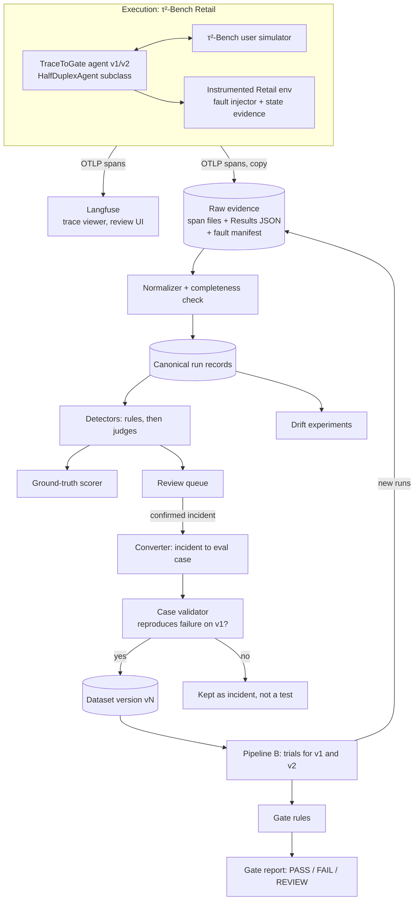

# Design Discussion: TraceToGate Foundations

This document uses ASD-STE100 Simplified Technical English. Section numbers such as "R§2" refer to sections of `03-research-tracetogate-foundations.md`. Section numbers such as "A§5" refer to sections of the addendum `03a-research-addendum-production-trace-to-eval.md`.

## Terms Used in This Document

Each term has one meaning in this document.

| Term | Meaning |
|---|---|
| run | One τ²-Bench simulation of one task, one trial, one seed. |
| trace | The tree of spans that one run produces. |
| span | One timed operation in a trace (agent turn, model call, tool call). |
| state evidence | Recorded data about the Retail database (DB) before and after a write. |
| finding | An automatic flag that a detector puts on a run. |
| incident | One or more findings that a human reviewer has confirmed and labelled. |
| eval case | A reviewed incident in the form of a test that a runner can execute again. |
| dataset version | An immutable, numbered set of eval cases. |
| arm | One agent version in a comparison (baseline v1 or candidate v2). |
| gate | The rules that turn comparison results into PASS, FAIL, or REVIEW. |

## Summary of the Request

The user builds TraceToGate as a learning project with two connected pipelines.

- **Pipeline A (Trace-to-Eval)** collects agent execution traces. It detects failures and drift, supports incident investigation, and converts verified, replayable failures into a versioned evaluation dataset.
- **Pipeline B (Replay and Release Gate)** uses the approved eval cases to compare a baseline agent (v1) with a candidate agent (v2). It recommends PASS, FAIL, or REVIEW for the release.

The user wants to learn how production teams turn traces into eval datasets and regression tests. The user also wants to learn what can fail in that pipeline and how to gate an agent release. The design must teach the production-relevant hard parts. It must also be honest about the differences between τ²-Bench and real production traffic.

## Current State: The Repo Has No Code, and τ²-Bench Gives Only Saved Results

The TraceToGate repo holds a brief, a checkpoint log, and research documents. It holds no code and no tests.

Today the user can run τ²-Bench directly and get these outputs (R§1, R§2):

- A `Results` JSON file per batch, with the full message trajectory of each run. It includes tool calls, tool results with error flags, timestamps, costs, termination reasons, and a reward breakdown.
- pass^k metrics per task.
- No OpenTelemetry (OTel) spans, no hook API, and no fault injection.
- No DB snapshots. The evaluator rebuilds the final state by replaying the trajectory on a fresh DB.

```text
Today
  tau2 run --domain retail ...
    └── results.json        # trajectories + reward_info, no DB state, no spans
  (nothing else: no trace viewer, no failure analysis, no dataset, no gate)
```

### τ²-Bench differs from production in ways the design must expose

The design uses τ²-Bench because it supplies ground truth that production never supplies. The design must not hide the gaps. The table lists each gap and the design response.

| τ²-Bench fact | Production reality | Design response |
|---|---|---|
| Every task has a known initial state and a gold action list (R§2) | A production trace has no fixture and no gold answer | The converter works "fixture-blind" first. It uses the τ²-Bench task only to score its own output (DQ7). |
| All 114 Retail tasks start from the same `db.json` (R§1) | Each customer has different, changing data | State evidence records only the records that a write changes (DQ3). |
| Tools are deterministic Python over an in-memory DB (R§2) | Services time out, fail partly, and return stale data | A fault-injecting environment adds realistic tool failures (DQ5). |
| The user is an LLM simulator with about 12% critical errors in Retail (R§3) | Users are real people | Reviewers label simulator faults. These runs do not become agent eval cases (DQ6). |
| Success is a final-DB-hash match; policy violations can still pass (R§2) | No automatic success signal exists | Detectors check policy behavior separately from outcome (DQ6). |
| Volume is hundreds to low thousands of runs | Volume can be millions of traces | Storage stays file-based and local (DQ4). |

## Desired End State: One Developer Can Go from Raw Runs to a Release Decision

After the change, the user can do these tasks:

1. Run a batch of τ²-Bench Retail tasks with a TraceToGate agent. Optionally enable a fault profile.
2. Open each run as a trace in a trace viewer. Model calls, tool calls, injected faults, and state evidence show as spans.
3. Run the analysis step. It validates trace completeness, applies detectors, and writes a findings report with detector accuracy figures.
4. Review findings in a review queue. Label the first failure in each run, group labels into a failure taxonomy, and confirm or reject incidents.
5. Promote confirmed incidents to eval cases. The case validator checks that each case reproduces its failure. Then a new dataset version is published.
6. Run the release gate for a v1 and v2 pair on a dataset version. Get a report with PASS, FAIL, or REVIEW, the reasons, the statistics, and links to the source traces.
7. Run drift experiments that compare two time windows and report detected shifts against a measured noise floor.

The user also gets **known-answer checks** for every automatic step. Injected faults, τ²-Bench rewards, and planted agent regressions supply the answers. Each report shows how well the step matched them.

## Scope

**Included:**

- Pipeline A: trace capture, trace contract, evidence storage, fault injection, failure detection, human review, eval case creation, and dataset versioning.
- Pipeline B: trial execution for two arms, paired comparison, gate rules, and a gate report.
- Drift experiments on controlled windows.
- Measurement of every automatic component against ground truth.
- The Retail domain of τ²-Bench at commit `5ade54e`.

**Not included:**

- A new trace viewer, a new tracing backend, or a generic metrics dashboard (settled, see Resolved Design Questions).
- Real customer traffic, shadow mode, canary rollout, and online A/B tests. The gate report names these as the next stages a production team would use (R§10).
- Message queues, distributed processing, and managed databases. The data volume does not need them.
- Other τ²-Bench domains (Airline, Telecom) and voice mode.

## Proposed End State Architecture: Two Pipelines Share One Evidence Store

### The draft architecture changes in five places

The brief proposes a Pipeline A architecture. The research supports its main split: reuse observability, build analysis and curation. The research also shows five gaps in the draft.

```diff
 Agent Execution Sources (τ²-Bench)
-Instrumentation Layer
+TraceToGate agent + instrumented Retail environment   # τ²-Bench has no hooks (R§1)
+Fault injector at the tool boundary                    # τ²-Bench has no fault injection (R§2)
+State evidence recorder                                # τ²-Bench saves no DB state (R§1)
 Telemetry Collector
 Trace Platform
 Raw Evidence Storage
 Trace Processor
 Failure Detection
 Drift Detection
 Incident Analysis
 Review
 Trace-to-Eval Converter
+Case validator (reproduction check)                    # replay is not standard (R§7)
 Versioned Evaluation Dataset
+Ground-truth scorer for detectors and converter        # tau2 reward + fault manifest
 Pipeline B
```

### The proposed flow connects capture, analysis, curation, and gating



Pipeline B writes its runs back into the same raw evidence store. Gate runs are therefore traces too. A failure found during a gate run can become a new eval case. This loop is the connection between the two pipelines.

### Three sources of ground truth make every automatic step measurable

| Ground truth | Source | What it scores |
|---|---|---|
| Outcome | τ²-Bench `reward_info` (DB match, NL assertions) (R§2) | Outcome detectors; gate outcome metric |
| Cause | Fault manifest written by the fault injector (DQ5) | Fault detectors; root-cause labels; converter fixture reconstruction |
| Behavior | Human labels from the review step (DQ6) | Policy-violation detectors; LLM judges |

A fourth source applies to Pipeline B. Planted regressions in v2 give the gate a known correct answer (DQ9).

### The repo layout stays small

This tree is a sketch for discussion. The outline step will decide the final layout.

```text
trace-to-gate/
├── ttg/agent/        # TraceToGate agent v1/v2 (HalfDuplexAgent subclasses)
├── ttg/env/          # instrumented Retail env, fault injector, state evidence
├── ttg/telemetry/    # OTel setup, span helpers, file exporter
├── ttg/ingest/       # normalizer, completeness check, canonical records
├── ttg/detect/       # rule detectors, judges, scoring against ground truth
├── ttg/curate/       # review export/import, converter, case validator
├── ttg/dataset/      # dataset versions and manifests
├── ttg/gate/         # trial runner, paired statistics, gate rules, report
├── ttg/drift/        # window comparison experiments
└── evidence/         # local evidence store (not in git, except dataset manifests)
```

### The pipeline core is generic, and τ²-Bench sits behind four adapters

The Pipeline A stages match the vendor and company pattern in the addendum (A§1, A§6). They do not depend on τ²-Bench. τ²-Bench connects to the core at four adapter points:

| Adapter | τ²-Bench Retail implementation | Production implementation |
|---|---|---|
| State evidence | Hash and JSON diff of the in-memory DB per mutating tool call | DB rows, API audit logs, or a side-effect recorder |
| Replay environment | Fresh DB from `db.json` and the LLM user simulator | Sandbox, mocked services, or recorded tool responses |
| Ground truth | `reward_info`, gold DB hash, and the fault manifest | Human labels, user signals, and incident confirmation |
| Fault injection | Wrapped Retail tools with fault profiles | Chaos tests or none |

The outline step must keep these four adapters behind interfaces. Then the same core can run on another τ²-Bench domain or on production traces.

## Design Questions

The questions are in dependency order. An earlier answer unblocks later questions.

### DQ1. How should traces come out of τ²-Bench?

**Question.** τ²-Bench has no OTel spans and no callback API (R§1). Which source should produce the traces?

**Options.**

| Option | Description |
|---|---|
| A. Saved Results JSON only | Run τ²-Bench as it is. Convert each `SimulationRun` into spans after the run. |
| B. LiteLLM callback | Enable LiteLLM's `otel` or `langfuse` callback for model calls (R§4). |
| C. Own agent and instrumented environment | Write a TraceToGate agent (subclass of `HalfDuplexAgent`) that emits `invoke_agent` and `chat` spans. Register a wrapped Retail environment that emits `execute_tool` spans and state evidence. Keep the Results JSON as a separate runner record. |
| D. C plus import of published trajectories | Do C. Also convert published Results JSON (about 590 MB in the repo, more in the S3 bucket) into the same canonical form (R§3). |

**Tradeoffs.**

- Option A is fast and uses existing data. But it teaches no live instrumentation. It cannot show the brief's pipeline failures (dropped spans, collector outage, crash before export), because no live export exists.
- Option B gives model spans only. τ²-Bench executes tools outside LiteLLM, so tool spans are probably absent (R§4, open question 5). Tool spans are the most important spans for this project.
- Option C teaches the production skill: instrument the agent and the tool boundary yourself. All tool calls pass through `Environment.get_response()`, which is one clean boundary (R§2, added fact). `register_domain()` accepts a wrapped environment without changes to τ²-Bench (R§2, added fact). The Results JSON then becomes the independent "runner outcome" that the brief asks for. The normalizer can compare it with the spans to measure span loss.
- Option C costs more work. The agent must be written by the project, so v1 is not a stock τ²-Bench agent. τ²-Bench runs tasks in parallel threads (concurrency 3, R§1). Span context must therefore be set per run, not per process.
- Option D adds volume and other models for free. But imported runs have no live spans, no state evidence, and no fault manifest. They are a different class of evidence.

**Recommendation: C now, D later as an optional data source.** C gives the instrumentation learning and the completeness check. Mark imported runs as `source=imported` so that detectors and drift experiments never mix them with live runs by accident.

```text
run_one(task, trial, seed, agent_version, fault_profile)
  start span "ttg.run"  (task_id, trial, seed, agent.version, fault_profile)
    tau2.run_single_task(...)                 # uses registered agent + domain
      invoke_agent retail_agent
        chat <model>                          # one per agent turn
        execute_tool <name>                   # from the wrapped environment
          event ttg.fault.injected            # only when a fault fires
          event ttg.state.diff                # only for mutating tools
  end span; write Results JSON beside the spans
```

### DQ2. Which trace platform should show the traces?

**Question.** Which platform should store and show traces for humans, and in what role?

**Options.**

| Option | Description |
|---|---|
| A. Langfuse, self-hosted | Docker Compose with Postgres, ClickHouse, Redis, and S3-compatible storage (R§5). |
| B. Langfuse Cloud Hobby | Free tier: 50k units per month, 30-day access (R§5). |
| C. Braintrust Starter | Free tier: 1 GB per month, 14-day retention. Self-hosting needs Enterprise (R§5). |
| D. No platform at first | Write spans to files only. Inspect them with scripts. Add a platform later. |

**Tradeoffs.**

- Langfuse accepts OTLP over HTTP and maps `gen_ai.*` attributes (R§5). Its dataset items keep `sourceTraceId` and `sourceObservationId`. Every item change creates a version. It has annotation queues and client-side masking. These features match Pipeline A closely.
- Self-hosting (A) teaches operation of a real trace backend and keeps data without time limits. It needs four services on the developer's machine.
- Cloud Hobby (B) needs no operation. But one run produces many observations (one per model call and tool call). A batch of 1,000 runs can use a large part of the 50k-unit monthly limit **(inference)**. Data access ends after 30 days.
- Braintrust (C) has a strong review and snapshot workflow, but snapshots need the Pro tier. Data retention of 14 days is too short for drift experiments across weeks. The platform is closed source, so the user cannot inspect its internals.
- Option D removes setup work but removes the review UI. Human review is the center of the industry workflow (R§6).

**Recommendation: A (Langfuse self-hosted), used as a viewer and review tool only.** The pipeline must not depend on Langfuse for its logic (see DQ4). Experiment A-02 from the brief (Langfuse versus Braintrust) becomes optional. The exporter design in DQ3 keeps a later switch cheap, because both platforms accept OTLP.

### DQ3. What is the trace contract, and how does the trace carry state evidence?

**Question.** Which fields must every trace have? τ²-Bench saves no DB state (R§1). How does a trace prove a side effect?

**Part 1: span conventions.**

| Option | Description |
|---|---|
| A. OTel GenAI conventions, pinned, plus a `ttg.*` namespace | Use `invoke_agent`, `chat`, `execute_tool` and `gen_ai.*` attributes. Pin one version. Put project fields under `ttg.*`. |
| B. OpenInference | Use `openinference.span.kind` and its attributes (R§4). |
| C. Own schema only | Define project fields with no external convention. |

All GenAI conventions have "Development" status, and they moved to a new repo with no schema URL (R§4). Langfuse and Braintrust accept both A and B. Option A matches the brief and the official Python instrumentations. Option C teaches less and loses viewer support.

**Recommendation for Part 1: A.** Write the pinned convention version into each trace as `ttg.semconv.version`. Turn on content capture (`gen_ai.input.messages`, `gen_ai.tool.call.arguments`, `.result`), because this is pre-production data with no personal data (R§4).

**Part 2: state evidence.**

| Option | Description |
|---|---|
| A. Rebuild after the run | Use the evaluator's replay (`set_state`) to get the final DB. |
| B. Record a diff per write | The wrapped environment records the DB hash before and after each mutating tool call. It also records the changed records as a JSON diff. |
| C. Full snapshots | Save the full DB at the start and the end of each run. |

- Option A is free, but it fails for faulted runs. Strict replay raises an error when a recorded write result differs from the real tool result (R§2, added fact). It also gives no per-step evidence.
- Option B gives the per-step evidence that the brief's refund example needs ("two refund records found"). It works with injected faults, because it records what happened, not what replay predicts. The cost is small, because tools already mark themselves as mutating (`tool_mutates_state`).
- Option C is simple but stores the full Retail DB twice per run. It still gives no per-step evidence.

**Recommendation for Part 2: B, plus the hash of `db.json` as the initial-state identity.** All Retail tasks start from the same DB (R§1). The `db.json` hash plus the task ID therefore identifies the initial state fully.

**Proposed minimum trace contract.**

```text
trace (root span "ttg.run")
  required: ttg.run.id, ttg.task.id, ttg.trial, ttg.seed, ttg.source (live|imported),
            gen_ai.agent.name, gen_ai.agent.version, ttg.semconv.version,
            ttg.tau2.commit, ttg.env.db_hash_initial, ttg.fault_profile.id
  at end:   ttg.termination_reason, ttg.env.db_hash_final, ttg.span_count
span chat
  required: gen_ai.operation.name, gen_ai.provider.name, gen_ai.request.model,
            gen_ai.usage.input_tokens, gen_ai.usage.output_tokens, ttg.turn_idx
span execute_tool
  required: gen_ai.tool.name, gen_ai.tool.call.id, ttg.tool.mutates_state, ttg.tool.error
  if mutating: ttg.state.hash_before, ttg.state.hash_after, event ttg.state.diff
  if faulted:  event ttg.fault.injected (fault_id, kind, committed: true|false)
```

The root span records `ttg.span_count`. The normalizer compares this count with the spans it receives. This comparison detects dropped spans, which is a failure mode in the brief.

### DQ4. Where do evidence and datasets live, and how are they versioned?

**Question.** Which component is the system of record for raw evidence, canonical run records, and dataset versions?

**Options.**

| Option | Description |
|---|---|
| A. Langfuse is the system of record | Read traces from the Langfuse API. Keep datasets as Langfuse datasets with their built-in item versioning (R§5). |
| B. Local files are the system of record; Langfuse mirrors | Raw spans (OTLP JSON files), Results JSON, and fault manifests are immutable files. A normalizer writes canonical run records to Parquet and queries them with DuckDB. Dataset versions are JSONL manifests in git. The pipeline mirrors each dataset version to a Langfuse dataset with `sourceTraceId` links. |
| C. A Postgres database for everything | Store spans, records, and cases in one relational database. |

**Tradeoffs.**

- Option A uses features that already exist. But Langfuse does not version dataset schema changes, and it has no public REST endpoint to create experiment runs (R§5). The pipeline logic then depends on one vendor API. A switch to another platform would break the pipeline.
- Option B keeps the logic independent of the platform. A dataset version becomes a git commit, which is easy to diff and review. DuckDB over files fits hundreds to low thousands of runs. The cost is one extra sync step to Langfuse.
- Option C adds a service to operate and gives no benefit at this volume.

**Recommendation: B.** Each dataset version is immutable after publication. A new version gets a new number. A gate report always names the dataset version and its manifest hash. Anthropic and Hamel both warn that dataset changes break score comparability (R§6).

```text
evidence/
├── raw/<run_id>/spans.otlp.json      # copy of every exported span
├── raw/<run_id>/fault_manifest.json  # what the injector did
├── raw/<batch_id>/results.json       # τ²-Bench runner record
└── canonical/runs.parquet            # one row per run + nested steps
datasets/
└── retail-regression/v3/manifest.jsonl   # in git; one line per eval case
```

### DQ5. How does the project create realistic failures?

**Question.** τ²-Bench has no fault injection, and its tools are deterministic (R§2). Natural failures are mostly wrong decisions and wrong arguments (R§3). How does the project get production-like tool failures and pipeline failures?

**Options.**

| Option | Description |
|---|---|
| A. Natural failures only | Use weaker models (for example, GPT-4.1-mini at 61.4% pass^1, R§3) to get more failures. |
| B. Tool fault injector in the wrapped environment | A fault profile defines faults per tool: error before commit, timeout after commit, added latency, partial or malformed result, stale read. The injector writes a fault manifest. |
| C. B plus telemetry-pipeline faults | Also inject faults into the trace pipeline: dropped spans, duplicate spans, out-of-order delivery, collector outage, crash before flush. |
| D. LLM-simulated tool faults | An LLM writes realistic error text. No tool checked in the research does this (R§7). |

**Tradeoffs.**

- Option A gives real agent failures, which are the main failure class in τ-bench (R§3). But it gives no infrastructure failures and no known root cause.
- Option B gives realistic failures with a known cause. The "timeout after commit" fault reproduces the brief's duplicate-refund example. But faulted runs cannot use the default τ²-Bench grade. Strict replay raises an error when a recorded write result differs from the real result (R§2, added fact). Faulted runs need their grade from live state evidence (DQ3) and the gold DB hash.
- Option C teaches the brief's "Where can Pipeline A fail?" table directly. Each pipeline fault has a known expected effect, so the completeness check can be scored. It adds work to the exporter.
- Option D gives realistic text but no reproducible cause.

**Recommendation: A plus B for the first build. Add C after the normalizer exists.** Keep a share of runs with no faults (profile `none`) as the control group. Grade faulted runs with this rule:

```text
grade(run)
  if run.fault_profile == none:
    use tau2 reward_info                      # default evaluator, strict replay
  else:
    db_ok = (run.db_hash_final == gold_db_hash(task))   # gold from task actions
    use db_ok, plus NL assertions if the task has them
    record grade_source = "live_state"
```

### DQ6. How are failures detected, labelled, and checked for accuracy?

> **Revised on 2026-10-19 after the research addendum (`03a`).** The user asked if an LLM can replace human review, and asked for a mix of automatic rules and human review. The revised design is in "DQ6 revision: layered reviewer and router" below. The promotion rule (Part 2) is resolved. See "Resolved Design Questions". The original options stay below for the record.

**Question.** Which methods find failures, who decides the label, and how does the project measure detector and judge accuracy?

**Options.**

| Option | Description |
|---|---|
| A. Rules only | Code checks on canonical runs: tool error, repeated identical call, write without confirmation, `max_steps`, duplicate side effect from state diff, τ²-Bench reward = 0. |
| B. LLM judge over the whole trace | One prompt classifies the failure type. |
| C. Human review only | A reviewer reads every run. |
| D. Layered | Rules and τ²-Bench reward for triage. Human open coding and axial coding on a sample to build the taxonomy and labels. One binary LLM judge per failure mode only where no rule works. Every detector and judge is scored against ground truth. |

**Tradeoffs.**

- Rules (A) are cheap and exact for clear signals. No published precision or recall exists for rule detectors such as loop checks (R§8). The project can measure this itself against the fault manifest. Rules miss policy violations that reach the correct end state (R§2, R§8).
- A whole-trace judge (B) reaches about 0.80 F1 on a known taxonomy in MAST (R§8). Step localization is weak: 5–18% in TRAIL and 14.2% in Who&When (R§8). A judge alone cannot be trusted to find the failing step.
- Human-only review (C) is the industry source of truth (R§6), but it does not scale to all runs.
- The layered method (D) follows the documented industry loop (R§6). It also adds the project's main learning value: an accuracy table for each detector.

**Recommendation: D.** The review step also labels **user-simulator faults** (about 12% critical in Retail, R§3) and **task defects** (R§3, `task_issues/`). These runs stay as incidents but never become agent eval cases.

**Measurement plan.**

| Detector type | Scored against | Metrics |
|---|---|---|
| Fault detectors (timeout, duplicate write) | Fault manifest | TPR, TNR, step localization accuracy |
| Outcome detectors | τ²-Bench reward | TPR, TNR |
| Policy-behavior judges | Human labels, split train 10–20% / dev 40–45% / test 40–45% (R§11) | TPR, TNR on the frozen test split |
| Pipeline completeness check | Telemetry fault manifest (DQ5 option C) | Detection rate per pipeline fault kind |

Report TPR and TNR separately. Raw agreement misleads when failures are rare (R§11). Reported failure rates from a judge use the Rogan-Gladen correction when TPR + TNR − 1 is not close to 0 (R§11).

#### DQ6 revision: layered reviewer and router

The research addendum (A§) shows four facts:

- No primary source lets an LLM replace human review of open-ended agent work (A§2, A§3).
- Vendors run rules on all traces, run judges on a sample, and send a capped stream to human queues (A§1).
- An LLM labeller with a fixed taxonomy reaches κ 0.77 (MAST). Step localization stays at 14–46% (A§3, A§4).
- No source promotes an LLM-judged failure into a blocking suite with no human (A§5).

**Reviewer layers (recommendation).**

| Layer | Reviewer | Job | Accuracy check |
|---|---|---|---|
| L1 | Deterministic rules | Schema error, unknown ID, write without confirmation, duplicate write, second modify, state-diff checks, τ²-Bench reward = 0. A rule that fires wins over the LLM label. | TPR and TNR against the fault manifest and τ²-Bench reward |
| L2 | LLM classifier | One primary label for the first failure. It uses the fixed taxonomy, few-shot examples, the L1 evidence, and an `other` option. It also gives a confidence value. | TPR, TNR, and κ per failure mode, on a frozen set of human labels |
| L3 | Human reviewer | Labels `other` items, low-confidence items, conflicts, suspected simulator faults, and the audit sample. | Agreement between two reviewers on a sample |
| L4 | Human taxonomy owner | Builds the first taxonomy by open coding and axial coding on about 100 failing traces. Approves each new taxonomy version, with a map from old codes to new codes. | Saturation: no new mode in the last 20 traces |

**Router (recommendation).**

```text
route(run)
  if all L1 checks pass and reward == 1 and no judge flag     -> AUTO_REJECT   (no case)
  if (L1 hard evidence or validated L2 judge with high confidence on a known mode)
     and failure reproduces on v1 in >= 2 of 4 trials          -> AUTO_CANDIDATE
  else                                                         -> HUMAN_QUEUE
  also: a random audit sample from AUTO_REJECT and AUTO_CANDIDATE -> HUMAN_QUEUE
```

- `HUMAN_QUEUE` gets `other` labels, new clusters, low-confidence labels, conflicts between rule, judge, and reward, and suspected simulator faults or task defects.
- An L2 judge is "validated" only after it passes a TPR and TNR threshold on held-out human labels. Until then, the router sends its items to `HUMAN_QUEUE`.
- At the start, no taxonomy and no validated judge exist. So the first failing traces all go to `HUMAN_QUEUE`. The automatic share grows as judges pass validation.
- Auto-accept uses a stricter threshold than auto-reject, because a false pass hides a failure (A§5, inference).
- Human labels go back into judge calibration and router thresholds. The project reports the automatic share and the audit error rate per lane.

**Dataset tiers.** The dataset has two tiers: `candidate` (non-blocking) and `blocking`. The promotion rule is resolved (see "Resolved Design Questions"). Pipeline B reports candidate results but does not use them for FAIL.

### DQ7. What does an eval case contain, and what does "replayable" mean?

**Question.** How does a reviewed incident become a test that runs again? What must the test contain? How much τ²-Bench knowledge may the converter use?

**Part 1: replay method.**

| Option | Description |
|---|---|
| A. Re-simulation | The case keeps the task scenario, initial-state identity, and fault profile. The runner starts a new conversation with the LLM user simulator. |
| B. Fixed prefix, then live continuation | The case keeps the conversation up to the step before the failure. τ²-Bench `initial_state.message_history` loads this prefix (R§2). The agent continues live from that point. |
| C. Recorded tools (cassette replay) | Replay recorded tool results. |

- Re-simulation (A) is the τ²-Bench method. It adapts when the agent acts differently. It adds simulator variance, so it needs several trials (R§7).
- A fixed prefix (B) aims the test at the exact failure point. It costs fewer turns. But a prefix from v1 may not match what v2 would say earlier in the conversation. The prefix tests "recovery from this state", not "avoids this state" **(inference)**. Tool results in the prefix also replay through `set_state`, so faulted prefixes need the same live-state grading as DQ5.
- Cassette replay (C) breaks when the agent sends a request that differs from the recording (R§7). Retail tools are already deterministic and simulated, so recording adds no value here.

**Recommendation for Part 1: A as the default, B as a second case kind.** Each case records its kind. Pipeline B reports results per kind.

**Part 2: converter information boundary.**

| Option | Description |
|---|---|
| A. Privileged | The converter copies the τ²-Bench task (scenario, gold actions) into the case. |
| B. Fixture-blind, then scored | The converter builds the case from the trace only. It writes a user scenario, an expected outcome, and case checks. A scorer then compares the result with the τ²-Bench task. |

- Option A always gives a valid case, but it teaches nothing about production. Production traces have no fixture and no gold answer.
- Option B shows the real difficulty. The scorer measures how often the converter reconstructs the correct goal and outcome. This answers the brief's question "How many traces become valid evaluation cases?"

**Recommendation for Part 2: B for learning, with A as a fallback.** A case that fails the score can still enter the dataset in privileged form. It gets the label `fixture_source=privileged`.

**Proposed eval case content and the definition of "replayable".**

```text
EvalCase
  case_id, dataset_version, kind (resimulate | prefix)
  source: run_id, trace_id, incident_id, failure_mode (from taxonomy)
  setup:  tau2_task_id, db_hash_initial, fault_profile, message_prefix (prefix kind only)
  user:   scenario (fixture-blind or privileged), fixture_source
  checks: outcome (gold DB hash or expected state diff)
          behavior (rule ids, judge ids + judge versions)
  validation: reproduced_on_v1 = c/n trials, gold_path_passes = true
  tier:   candidate | blocking, promoted_by (rule | human), promoted_at
```

A case is **replayable** when all three conditions are true:

1. The runner can rebuild the setup from the case alone.
2. The gold path passes all case checks. This proves the checks accept a correct solution (R§6, Anthropic).
3. The failure reproduces on v1 in at least c of n trials (proposed: at least 2 of 4).

A case that fails condition 3 stays an incident. It does not enter the dataset. A case that every agent fails in every trial is probably broken (R§6, Anthropic).

### DQ8. How much drift work belongs in this project?

**Question.** No drift tool targets agent behavior signals or measures an LLM noise floor (R§9). What scope gives useful learning at this data volume?

**Options.**

| Option | Description |
|---|---|
| A. No drift work now | Build Pipeline A and B first. Add drift later. |
| B. Controlled window experiments | Create two windows of runs. The second window has one known shift: task mix, fault rate, user persona, or a silent model change. A/A windows (same setup, new seeds) set the noise floor. |
| C. Continuous time-based monitoring | Run a scheduled batch every day for weeks. Watch for natural provider changes (R§9, Chen et al.). |

**Tradeoffs.**

- Option A is cheapest, but the user loses a stated learning goal.
- Option B gives known answers, so detection power and false alarm rate can be measured. Signals and tests come from R§9: χ² or Jensen-Shannon divergence (JSD) on tool-usage mix and termination reasons, Kolmogorov-Smirnov (KS) on trajectory length and latency, and a two-proportion test on failure rate. Applying these tests to agent signals is new **(inference, R§9)**. A/A windows measure the false alarm rate directly.
- Option C is closest to production but costs money every day. Natural drift may not happen in the observation period, so the result can be empty.

**Recommendation: B, built after the first Pipeline B gate works.** Apply a multiple-testing correction across all monitored signals, because the research found no tool guidance on this (R§9).

### DQ9. What are agent v1 and v2 in the experiments?

**Question.** The gate needs agent pairs. Which v1 and v2 pairs teach the most and give a known correct answer?

**Options.**

| Option | Description |
|---|---|
| A. Model swap only | v1 and v2 differ only in the model (for example, GPT-4.1 versus GPT-4.1-mini). |
| B. Fix pair | v2 adds a fix for a failure found in Pipeline A. Example: check order state before a write is retried after a timeout. |
| C. Planted regression pair | v2 contains a deliberate defect. Example: skip the user confirmation before a write. |
| D. Null pair (A/A) | v2 equals v1 with a cosmetic change, or only a new seed. |

**Tradeoffs.**

- A model swap (A) is realistic, but the correct gate answer is unknown.
- A fix pair (B) closes the loop from Pipeline A to Pipeline B. The gate should PASS. Regressions elsewhere can still occur, which is realistic.
- A planted regression (C) has a known answer: FAIL. The skip-confirmation defect is useful, because τ²-Bench outcome grading may not catch it (R§2). Only behavior checks can catch it.
- A null pair (D) has a known answer: no difference. It measures the false alarm rate of the gate.

**Recommendation: a fixed suite of B, C, and D, plus one A pair as the "unknown answer" case.** Report the gate accuracy on B, C, and D. Define each agent version by a version string, model, prompt hash, and code commit. Write these values to `gen_ai.agent.version` and the run root span.

### DQ10. How does Pipeline B compare v1 with v2, and what are the gate rules?

**Question.** Single runs are unreliable. Retail pass^1 and pass^4 differ by 20–30 points (R§3). How many trials does each case need? Which statistics apply? Which rules give PASS, FAIL, or REVIEW?

**Part 1: comparison method.**

| Option | Description |
|---|---|
| A. One run per case per arm | Compare pass rates directly. |
| B. Fixed n trials per case per arm, paired analysis | Run n trials (for example, 4) per case per arm with the same seeds. Average per case. Compute paired differences, a clustered standard error (SE) by τ²-Bench task, and pass^k per arm (R§10). |
| C. Adaptive trials | Start with B at a small n. Add trials only for cases where the arms disagree or the result is near a threshold. |

- Option A is cheap, but noise is larger than most real effects (R§3, R§10).
- Option B follows Anthropic's "error bars" guidance: paired differences, clustered SEs, and several samples per question (R§10). Several eval cases can come from one τ²-Bench task, so clustering by task is required. A power analysis sets n from a pilot run. As an illustration, with an assumed per-case SD of the difference of 0.3 and 114 cases, the minimum detectable effect (MDE) is about 8 points at 80% power **(inference, standard formula in R§10)**.
- Option C saves cost, but repeated looks at the data increase the false alarm rate. The analysis must correct for this.

**Recommendation for Part 1: B.** Run two suites per gate:

- The **regression suite**: the current dataset version from Pipeline A.
- The **capability suite**: the τ²-Bench Retail test split (40 tasks, R§2). It catches regressions that the regression suite does not cover.

Use a paired bootstrap over clusters for confidence intervals. McNemar's test is a cross-check on per-case pass/fail. No agent-eval source prescribes these two methods (R§10, open question 9). The report therefore states them as a project choice.

**Part 2: gate rules.** No numeric gate standard exists (R§10). The proposed rules use structural criteria from the research: no regressions on graduated cases, pass^k for consistency, and cost as a co-equal metric.

```text
gate(v1, v2, dataset_version)
  if evidence incomplete (missing spans, failed runs > limit)        -> REVIEW
  if any hard-safety check fails on v2 in any trial                 -> FAIL
  if paired diff upper bound < -margin on either suite              -> FAIL
  if a graduated regression case falls below its pass threshold    -> FAIL
  if pass^k drop on regression suite > k_margin                     -> FAIL
  if cost or latency ratio > limit                                  -> REVIEW
  if a decisive metric depends on an LLM judge                      -> REVIEW
  if confidence interval crosses -margin (inconclusive)             -> REVIEW
  else                                                              -> PASS
```

Every rule writes its reason and links to the source traces into the gate report. The margins (`margin`, `k_margin`) and limits are configuration. DQ9's null pair and planted pair set them by experiment. The report also lists the production stages that the gate does not cover: shadow, canary, and online A/B (R§10).

## Resolved Design Questions

### τ²-Bench Retail is the primary environment

- **Decision:** Use τ²-Bench Retail at commit `5ade54e` as the execution environment.
- **Rationale:** It has tasks, policies, tools, a resettable DB, a user simulator, and an outcome grader (R§1, R§2). Published failure studies and trajectories exist (R§3). The brief and the checkpoint log record this decision.
- **Alternatives set aside:** Other τ²-Bench domains and other benchmarks (AppWorld, WebArena) are out of scope for this phase.

### The project follows the RPI design-discussion flow

- **Decision:** Steps are questions → research → design → outline → worktree → implement → pull request. The user reviews after each step.
- **Rationale:** The user asked for this flow and for no code before the research and design are complete (checkpoint log).

### The project builds analysis, curation, and gating, and reuses the trace viewer

- **Decision:** Reuse OTel and an existing trace platform for capture and viewing. Build trace validation, detection, review workflow, conversion, dataset versioning, and gating.
- **Rationale:** The brief makes this recommendation. The research shows that platforms automate only the edges of the trace-to-eval loop (R§6). The hard parts are the curation and judgment steps, which are the learning goal.
- **Alternatives set aside:** A custom tracing backend or trace viewer teaches little about evaluation and repeats existing tools.

### The design covers both pipelines

- **Decision:** This design covers Pipeline A and Pipeline B and their connection.
- **Rationale:** The value of Pipeline A is visible only when Pipeline B uses its dataset to make a release decision. Pipeline B runs also feed new traces back into Pipeline A.

### DQ6 Part 2: promotion from the candidate tier to the blocking suite (user decision, 2026-10-19)

- **Decision (option B):** A case moves from `candidate` to `blocking` automatically only when two conditions are true. First, a deterministic L1 rule found the failure. Second, the failure reproduces on v1 in at least 2 of 4 trials. All other cases need a human to confirm the promotion.
- **Rationale:** L1 rule evidence is exact and can be measured against the fault manifest. LLM-judged failures stay human-gated, which matches all sources in the addendum (A§5). The rule gives more automation than the industry default and tests whether automatic promotion is safe.
- **Note:** No source uses this rule. It is a project research choice. The project measures it with an audit sample of auto-promoted cases.
- **Alternatives set aside:** A: a human confirms every promotion (the industry default, less automation). C: all candidates promote automatically, with an audit after promotion (highest risk of a bad case in the gate).

## Patterns to Follow

The TraceToGate repo has no code and no tests. The patterns below come from τ²-Bench at `5ade54e` and from external sources in the research.

### τ²-Bench custom agent: subclass `HalfDuplexAgent` and register a factory

- **Role:** v1 and v2 agents that emit their own spans.
- **Source:** `src/tau2/agent/base_agent.py`, `src/tau2/agent/llm_agent.py`, `src/tau2/registry.py`, `examples/agents/` (R§1).
- **Shape:**

```python
class TtgAgent(HalfDuplexAgent):                 # constructor: (tools, domain_policy, **kwargs)
    def get_init_state(self, message_history): ...
    def generate_next_message(self, message, state):   # -> (AssistantMessage, state)
        ...

registry.register_agent_factory(...)             # then: tau2 run --agent ttg_v1
```

- **How the design follows it:** The agent wraps each model call in a `chat` span and each turn in the `invoke_agent` span. Mix in `LLMConfigMixin` to keep τ²-Bench seeding (R§1).

### τ²-Bench environment: wrap the tool boundary and register a new domain

- **Role:** Tool spans, state evidence, and fault injection.
- **Source:** `src/tau2/environment/environment.py` `get_response()` L465, `make_tool_call()` L158, `get_db_hash()` L275, `set_state()` L293; `src/tau2/environment/toolkit.py` `tool_mutates_state()`; `src/tau2/registry.py` `register_domain()` L177 (R§2, added facts).
- **Shape (current behavior):**

```python
def get_response(self, message: ToolCall) -> ToolMessage:
    try:
        resp = self.make_tool_call(message.name, requestor=message.requestor, **message.arguments)
        self.sync_tools()
    except Exception as e:
        resp = f"Error: {e}"; error = True
    return ToolMessage(id=message.id, content=..., error=error)
```

- **How the design follows it:** A subclass overrides `get_response()`. It starts an `execute_tool` span, applies the fault profile, records hashes and diffs for mutating tools, and then calls the parent method. It is registered as a new domain name, for example `retail_ttg`. The Retail tasks are registered again under that name with `register_tasks()` (`registry.py` L191).

### τ²-Bench runner and grader: `run_single_task`, `evaluate`, and `pass_hat_k`

- **Role:** Trial execution for Pipeline A and Pipeline B, and outcome ground truth.
- **Source:** `src/tau2/runner/batch.py` `run_single_task` L344; `src/tau2/evaluator/evaluator.py` L96; `src/tau2/metrics/agent_metrics.py` `pass_hat_k` L113 (R§1, R§2).
- **How the design follows it:** The trial runner calls `run_single_task(task, trial, seed)` with fixed seeds per trial, so that both arms get the same seeds. It reuses `pass_hat_k` for consistency (C(c,k)/C(n,k)). Faulted runs use the live-state grade from DQ5.

### OTel GenAI span tree

- **Role:** The trace contract (DQ3).
- **Source:** `semantic-conventions-genai` repo (R§4).
- **Shape:**

```text
invoke_agent retail_agent            (INTERNAL)
├── chat gpt-4.1                     (CLIENT)   → response with tool_calls [c1, c2]
├── execute_tool get_order_details   (INTERNAL) gen_ai.tool.call.id=c1
└── execute_tool get_user_details    (INTERNAL) gen_ai.tool.call.id=c2
```

- **How the design follows it:** Tool spans are siblings under the agent span. They link to the model call through `gen_ai.tool.call.id`, not through timestamps. Evaluation results use the `gen_ai.evaluation.result` event, parented to the evaluated span (R§4).

### Langfuse dataset items keep links to source traces

- **Role:** Mirror of dataset versions and the review UI (DQ2, DQ4).
- **Source:** Langfuse datasets and annotation queues documentation (R§5, R§6).
- **Shape:** `{input, expectedOutput, metadata, sourceTraceId, sourceObservationId, status}`.
- **How the design follows it:** Each mirrored eval case sets `sourceTraceId` to the run that produced the incident. The git manifest stays the system of record.

### Industry trace-to-eval loop (Hamel Husain and Shreya Shankar, Anthropic)

- **Role:** The review and curation workflow (DQ6, DQ7).
- **Source:** R§6, R§11.
- **Shape:** sample about 100 traces → open coding of the first failure → axial coding into a taxonomy → one code check or binary judge per failure mode → validate the judge with TPR and TNR on a held-out split → promote to dataset items linked to source → run in CI → resample every 2–4 weeks.
- **How the design follows it:** The review queue and taxonomy follow this loop. The project adds machine ground truth (fault manifest, τ²-Bench reward) as a second check on human labels.

### Anthropic "error bars" statistics

- **Role:** Pipeline B comparison (DQ10).
- **Source:** Anthropic statistical approach post and arXiv 2411.00640 (R§10).
- **Shape:**

```text
per-case score s_i = mean over trials
paired diff d_i = s_i^v2 − s_i^v1;  SE_d = sd(d)/sqrt(n), clustered by tau2 task
power: n ≈ ((z_{1−α/2} + z_power) · sd_d / δ)²
```

- **How the design follows it:** The gate uses paired, clustered differences and a power analysis from a pilot run.

### Testing approach

No tests exist in the TraceToGate repo. The τ²-Bench test suite was not investigated (R§1). The design adds known-answer checks as its main verification method: the fault manifest, the τ²-Bench reward, the null agent pair, and the planted regression pair. The outline step will define unit tests and fixtures.
