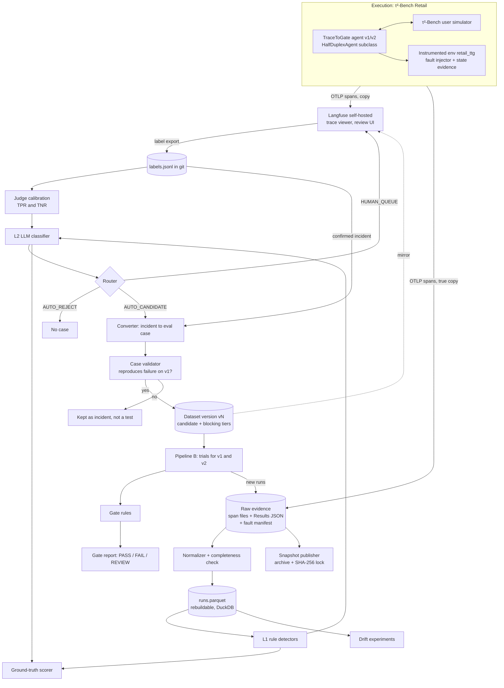

# Design Discussion: TraceToGate Foundations

This document uses ASD-STE100 Simplified Technical English. Section numbers such as "R§2" refer to sections of `03-research-tracetogate-foundations.md`. Section numbers such as "A§5" refer to sections of the addendum `03a-research-addendum-production-trace-to-eval.md`. The explainer `04a-dq4-explainer-where-data-lives.md` gives the background for DQ4. The final architecture is in `04b-final-architecture-tracetogate-foundations.md`.

**Status (2026-10-19):** The user decided all design questions on 2026-10-19 and accepted every recommendation. All decisions are in "Resolved Design Questions". The other sections show the resolved design.

## Terms Used in This Document

Each term has one meaning in this document.

| Term | Meaning |
|---|---|
| run | One τ²-Bench simulation of one task, one trial, one seed. |
| trace | The tree of spans that one run produces. |
| span | One timed operation in a trace (agent turn, model call, tool call). |
| state evidence | Recorded data about the Retail database (DB) before and after a write. |
| finding | An automatic flag that a detector puts on a run. |
| incident | One or more findings that a human reviewer has confirmed and labelled. |
| eval case | A reviewed incident in the form of a test that a runner can execute again. |
| dataset version | An immutable, numbered set of eval cases. |
| tier | The status of an eval case in a dataset: `candidate` (non-blocking) or `blocking`. |
| arm | One agent version in a comparison (baseline v1 or candidate v2). |
| gate | The rules that turn comparison results into PASS, FAIL, or REVIEW. |
| system of record | The one true copy of a kind of data. All other places hold copies. |
| evidence snapshot | One versioned archive of the raw evidence of one experiment, published outside git. |
| demo sample | A small set of about 30–50 runs with their raw files, kept in git. |

## Summary of the Request

The user builds TraceToGate as a learning project with two connected pipelines.

- **Pipeline A (Trace-to-Eval)** collects agent execution traces. It detects failures and drift, supports incident investigation, and converts verified, replayable failures into a versioned evaluation dataset.
- **Pipeline B (Replay and Release Gate)** uses the approved eval cases to compare a baseline agent (v1) with a candidate agent (v2). It recommends PASS, FAIL, or REVIEW for the release.

The user wants to learn how production teams turn traces into eval datasets and regression tests. The user also wants to learn what can fail in that pipeline and how to gate an agent release. The design must teach the production-relevant hard parts. It must also be honest about the differences between τ²-Bench and real production traffic.

## Current State: The Repo Has No Code, and τ²-Bench Gives Only Saved Results

The TraceToGate repo holds a brief, a checkpoint log, and research documents. It holds no code and no tests.

Today the user can run τ²-Bench directly and get these outputs (R§1, R§2):

- A `Results` JSON file per batch, with the full message trajectory of each run. It includes tool calls, tool results with error flags, timestamps, costs, termination reasons, and a reward breakdown.
- pass^k metrics per task.
- No OpenTelemetry (OTel) spans, no hook API, and no fault injection.
- No DB snapshots. The evaluator rebuilds the final state by replaying the trajectory on a fresh DB.

```text
Today
  tau2 run --domain retail ...
    └── results.json        # trajectories + reward_info, no DB state, no spans
  (nothing else: no trace viewer, no failure analysis, no dataset, no gate)
```

### τ²-Bench differs from production in ways the design must expose

The design uses τ²-Bench because it supplies ground truth that production never supplies. The design must not hide the gaps. The table lists each gap and the design response.

| τ²-Bench fact | Production reality | Design response |
|---|---|---|
| Every task has a known initial state and a gold action list (R§2) | A production trace has no fixture and no gold answer | The converter works "fixture-blind" first. It uses the τ²-Bench task only to score its own output (DQ7). |
| All 114 Retail tasks start from the same `db.json` (R§1) | Each customer has different, changing data | State evidence records only the records that a write changes (DQ3). |
| Tools are deterministic Python over an in-memory DB (R§2) | Services time out, fail partly, and return stale data | A fault-injecting environment adds realistic tool failures (DQ5). |
| The user is an LLM simulator with about 12% critical errors in Retail (R§3) | Users are real people | Reviewers label simulator faults. These runs do not become agent eval cases (DQ6). |
| Success is a final-DB-hash match; policy violations can still pass (R§2) | No automatic success signal exists | Detectors check policy behavior separately from outcome (DQ6). |
| Volume is hundreds to low thousands of runs | Volume can be millions of traces | Storage stays file-based and local (DQ4). |
| τ²-Bench data is synthetic and MIT-licensed | Production traces contain personal data | Content capture is on, and evidence snapshots can be published. Check again if real production traces are ever used (DQ4). |

## Desired End State: One Developer Can Go from Raw Runs to a Release Decision

After the change, the user can do these tasks:

1. Run a batch of τ²-Bench Retail tasks with a TraceToGate agent. Optionally enable a fault profile.
2. Open each run as a trace in a trace viewer (self-hosted Langfuse). Model calls, tool calls, injected faults, and state evidence show as spans.
3. Run the analysis step. It validates trace completeness, applies L1 rule detectors and the L2 classifier, and writes a findings report with detector accuracy figures.
4. Review the runs that the router sends to the human queue. Label the first failure in each run, group labels into a failure taxonomy, and confirm or reject incidents. Export the labels to git.
5. Promote confirmed incidents to eval cases in the `candidate` tier. The case validator checks that each case reproduces its failure. Promote cases to the `blocking` tier by the promotion rule. Then publish a new dataset version.
6. Run the release gate for a v1 and v2 pair on a dataset version. Get a report with PASS, FAIL, or REVIEW, the reasons, the statistics, and links to the source traces.
7. Run drift experiments that compare two time windows and report detected shifts against a measured noise floor.
8. Share the work. Another person clones the repo and runs the pipeline on the demo sample with no API keys. That person can also download the evidence snapshot of an experiment, check its hash, and load it into any Langfuse instance.

The user also gets **known-answer checks** for every automatic step. Injected faults, τ²-Bench rewards, human labels, and planted agent regressions supply the answers. Each report shows how well the step matched them.

## Scope

**Included:**

- Pipeline A: trace capture, trace contract, evidence storage, fault injection, failure detection, routing, human review, label export, eval case creation, and dataset versioning.
- Pipeline B: trial execution for two arms, paired comparison, gate rules, and a gate report.
- Drift experiments on controlled windows.
- Measurement of every automatic component against ground truth.
- Sharing and reproducibility: demo sample in git, evidence snapshots with a lock file, rebuild scripts, and a Langfuse loader.
- The Retail domain of τ²-Bench at commit `5ade54e`.

**Not included:**

- A new trace viewer, a new tracing backend, or a generic metrics dashboard (settled, see Resolved Design Questions).
- Real customer traffic, shadow mode, canary rollout, and online A/B tests. The gate report names these as the next stages a production team would use (R§10).
- Message queues, distributed processing, and managed databases. The data volume does not need them.
- Other τ²-Bench domains (Airline, Telecom) and voice mode.
- The hosting choice for the demo app. The outline step decides it.

## Proposed End State Architecture: Two Pipelines Share One Evidence Store

### The draft architecture changes in ten places

The brief proposes a Pipeline A architecture. The research supports its main split: reuse observability, build analysis and curation. The research and the design decisions add these components to the draft.

```diff
 Agent Execution Sources (τ²-Bench)
-Instrumentation Layer
+TraceToGate agent v1/v2 + instrumented Retail env `retail_ttg`  # τ²-Bench has no hooks (R§1, DQ1)
+Fault injector at the tool boundary                             # τ²-Bench has no fault injection (R§2, DQ5)
+State evidence recorder                                         # τ²-Bench saves no DB state (R§1, DQ3)
 Telemetry Collector
-Trace Platform
+Trace Platform: Langfuse self-hosted, viewer and review only     # DQ2
-Raw Evidence Storage
+Raw Evidence Storage: local files, system of record, immutable   # DQ4
 Trace Processor
+Completeness check: span count, runner record cross-check        # DQ3
 Failure Detection
+  L1 rules + L2 LLM classifier + router                          # DQ6, A§4, A§5
 Drift Detection
 Incident Analysis
 Review
+  L3 human queue + L4 taxonomy owner + label export to git       # DQ4, DQ6
 Trace-to-Eval Converter
+Case validator (reproduction check)                             # replay is not standard (R§7, DQ7)
 Versioned Evaluation Dataset
+  candidate and blocking tiers, promotion rule                   # DQ6
+Ground-truth scorer for detectors and converter                  # tau2 reward + fault manifest
 Pipeline B
+Snapshot publisher, Langfuse loader, demo app                    # DQ4 Part 3
```

### The flow connects capture, analysis, curation, gating, and sharing



Pipeline B writes its runs back into the same raw evidence store. Gate runs are therefore traces too. A failure found during a gate run can become a new eval case. This loop is the connection between the two pipelines.

### Four sources of ground truth make every automatic step measurable

| Ground truth | Source | What it scores |
|---|---|---|
| Outcome | τ²-Bench `reward_info` (DB match, NL assertions) (R§2), or the live-state grade for faulted runs (DQ5) | Outcome detectors; gate outcome metric |
| Cause | Fault manifest written by the fault injector (DQ5) | Fault detectors; root-cause labels; converter fixture reconstruction |
| Behavior | Human labels from the review step, exported to `datasets/labels/labels.jsonl` (DQ4, DQ6) | Policy-violation detectors; L2 classifier and judges; router audit |
| Gate answer | Planted regression pair and null pair (DQ9) | Gate accuracy; margin calibration |

### The repo layout stays small

This tree is the resolved layout at the design level. The outline step can change module names, but it keeps the stores and the git rules.

```text
trace-to-gate/
├── ttg/agent/        # TraceToGate agent v1/v2 (HalfDuplexAgent subclasses)
├── ttg/env/          # instrumented Retail env retail_ttg, fault injector, state evidence
├── ttg/telemetry/    # OTel setup, span helpers, file exporter, Langfuse exporter
├── ttg/ingest/       # normalizer, completeness check, canonical records
├── ttg/detect/       # L1 rules, L2 classifier, router, scoring against ground truth
├── ttg/curate/       # label export, converter, case validator, promotion
├── ttg/dataset/      # dataset versions, manifests, Langfuse mirror
├── ttg/gate/         # trial runner, paired statistics, gate rules, report
├── ttg/drift/        # window comparison experiments
├── ttg/share/        # snapshot publisher, Langfuse loader, rebuild scripts
├── evidence/                              # NOT in git (large); system of record for raw evidence
│   ├── raw/<run_id>/spans.otlp.json           # Rule 2: never changed
│   ├── raw/<run_id>/fault_manifest.json       # Rule 2: never changed
│   ├── raw/<batch_id>/results.json            # Rule 2: never changed
│   └── canonical/runs.parquet                 # Rule 3: can be rebuilt at any time
├── datasets/                              # in git
│   ├── retail-regression/v3/manifest.jsonl    # Rule 4: never changed after publication
│   └── labels/labels.jsonl                    # Rule 4: only new lines are added
├── taxonomy/                              # in git
│   └── v2.yaml                                # Rule 4: with a map from v1 codes to v2 codes
├── reports/gates/                         # in git; gate reports name dataset version + hash
├── demo/                                  # in git; 30–50 runs with raw files (a few MB)
│   └── raw/<run_id>/...                       # pipeline runs with no API keys
└── snapshots.lock                         # in git; snapshot name, URL, SHA-256
```

### The pipeline core is generic, and τ²-Bench sits behind four adapters

The Pipeline A stages match the vendor and company pattern in the addendum (A§1, A§6). They do not depend on τ²-Bench. τ²-Bench connects to the core at four adapter points:

| Adapter | τ²-Bench Retail implementation | Production implementation |
|---|---|---|
| State evidence | Hash and JSON diff of the in-memory DB per mutating tool call | DB rows, API audit logs, or a side-effect recorder |
| Replay environment | Fresh DB from `db.json` and the LLM user simulator | Sandbox, mocked services, or recorded tool responses |
| Ground truth | `reward_info`, gold DB hash, and the fault manifest | Human labels, user signals, and incident confirmation |
| Fault injection | Wrapped Retail tools with fault profiles | Chaos tests or none |

The outline step must keep these four adapters behind interfaces. Then the same core can run on another τ²-Bench domain or on production traces.

## Design Questions

All design questions are resolved (user decision, 2026-10-19). See "Resolved Design Questions".

## Resolved Design Questions

### τ²-Bench Retail is the primary environment

- **Decision:** Use τ²-Bench Retail at commit `5ade54e` as the execution environment.
- **Rationale:** It has tasks, policies, tools, a resettable DB, a user simulator, and an outcome grader (R§1, R§2). Published failure studies and trajectories exist (R§3). The brief and the checkpoint log record this decision.
- **Alternatives set aside:** Other τ²-Bench domains and other benchmarks (AppWorld, WebArena) are out of scope for this phase.

### The project follows the RPI design-discussion flow

- **Decision:** Steps are questions → research → design → outline → worktree → implement → pull request. The user reviews after each step.
- **Rationale:** The user asked for this flow and for no code before the research and design are complete (checkpoint log).

### The project builds analysis, curation, and gating, and reuses the trace viewer

- **Decision:** Reuse OTel and an existing trace platform for capture and viewing. Build trace validation, detection, review workflow, conversion, dataset versioning, and gating.
- **Rationale:** The brief makes this recommendation. The research shows that platforms automate only the edges of the trace-to-eval loop (R§6). The hard parts are the curation and judgment steps, which are the learning goal.
- **Alternatives set aside:** A custom tracing backend or trace viewer teaches little about evaluation and repeats existing tools.

### The design covers both pipelines

- **Decision:** This design covers Pipeline A and Pipeline B and their connection.
- **Rationale:** The value of Pipeline A is visible only when Pipeline B uses its dataset to make a release decision. Pipeline B runs also feed new traces back into Pipeline A.

### The pipeline core is generic, with four τ²-Bench adapters

- **Decision:** Keep the Pipeline A and Pipeline B core generic. Put τ²-Bench behind four adapters: state evidence, replay environment, ground truth, and fault injection.
- **Rationale:** The stages match the vendor and company pattern (A§1, A§6). Only the four adapter points depend on τ²-Bench.
- **Alternatives set aside:** A τ²-Bench-specific pipeline is faster to write, but it cannot move to another domain or to production traces.

### DQ1. Traces come from the project's own agent and an instrumented environment (user decision, 2026-10-19)

- **Question:** τ²-Bench has no OTel spans and no callback API (R§1). Which source produces the traces?
- **Decision (option C now, D later):** Write a TraceToGate agent as a subclass of `HalfDuplexAgent`. It emits `invoke_agent` and `chat` spans. Register a wrapped Retail environment as the domain `retail_ttg`. It emits `execute_tool` spans and state evidence. Keep the τ²-Bench Results JSON as an independent runner record. Later, import published Results JSON (option D) as an optional data source with the tag `source=imported`.
- **Rationale:**
  - Option C teaches the production skill: instrument the agent and the tool boundary yourself.
  - All tool calls pass through `Environment.get_response()`, which is one clean boundary (R§2, added fact). `register_domain()` accepts a wrapped environment without changes to τ²-Bench (R§2, added fact).
  - The Results JSON becomes the independent "runner outcome" that the brief asks for. The normalizer compares it with the spans to measure span loss.
  - Live export makes the brief's pipeline failures visible: dropped spans, collector outage, crash before export.
  - The `source=imported` tag stops detectors and drift experiments from mixing imported runs with live runs by accident.
- **Costs accepted:** v1 is not a stock τ²-Bench agent, because the project writes it. τ²-Bench runs tasks in parallel threads (concurrency 3, R§1). Span context is therefore set per run, not per process.
- **Alternatives set aside:**
  - A (saved Results JSON only): fast, and uses existing data. But it teaches no live instrumentation and cannot show export failures, because no live export exists.
  - B (LiteLLM callback): gives model spans only. τ²-Bench executes tools outside LiteLLM, so tool spans are probably absent (R§4, open question 5). Tool spans are the most important spans for this project.
  - D now: published trajectories (about 590 MB in the repo, more in the S3 bucket, R§3) have no live spans, no state evidence, and no fault manifest. They are a different class of evidence, so they come later and carry a tag.

```text
run_one(task, trial, seed, agent_version, fault_profile)
  start span "ttg.run"  (task_id, trial, seed, agent.version, fault_profile)
    tau2.run_single_task(...)                 # uses registered agent + domain retail_ttg
      invoke_agent retail_agent
        chat <model>                          # one per agent turn
        execute_tool <name>                   # from the wrapped environment
          event ttg.fault.injected            # only when a fault fires
          event ttg.state.diff                # only for mutating tools
  end span; write Results JSON beside the spans
```

### DQ2. Langfuse self-hosted is the trace viewer and review tool (user decision, 2026-10-19)

- **Question:** Which platform stores and shows traces for humans, and in what role?
- **Decision (option A):** Use Langfuse self-hosted (Docker Compose with Postgres, ClickHouse, Redis, and S3-compatible storage, R§5). Use it as a viewer and review tool only. The pipeline logic never depends on Langfuse (DQ4). Experiment A-02 from the brief (Langfuse versus Braintrust) is optional.
- **Rationale:**
  - Langfuse accepts OTLP over HTTP and maps `gen_ai.*` attributes (R§5).
  - Its dataset items keep `sourceTraceId` and `sourceObservationId`. Every item change creates a version. It has annotation queues and client-side masking. These features match Pipeline A closely.
  - Self-hosting teaches operation of a real trace backend and keeps data with no time limit.
  - Both Langfuse and Braintrust accept OTLP, so the DQ3 exporter keeps a later switch cheap.
- **Costs accepted:** Four services run on the developer's machine.
- **Alternatives set aside:**
  - B (Langfuse Cloud Hobby): no operation, but 50k units per month and 30-day access (R§5). One run produces many observations, so a batch of 1,000 runs can use a large part of the monthly limit **(inference)**. Data access ends after 30 days.
  - C (Braintrust Starter): strong review and snapshot workflow, but snapshots need the Pro tier. Retention of 14 days is too short for drift experiments across weeks. The platform is closed source, and self-hosting needs Enterprise.
  - D (no platform at first): removes setup work but removes the review UI. Human review is the center of the industry workflow (R§6).

### DQ3. The trace contract uses pinned OTel GenAI conventions and records state evidence per write (user decision, 2026-10-19)

- **Question:** Which fields must every trace have? τ²-Bench saves no DB state (R§1). How does a trace prove a side effect?
- **Decision, Part 1 (option A):** Use the OTel GenAI conventions (`invoke_agent`, `chat`, `execute_tool`, `gen_ai.*` attributes). Pin one version and write it to each trace as `ttg.semconv.version`. Put project fields under the `ttg.*` namespace. Turn on content capture (`gen_ai.input.messages`, `gen_ai.tool.call.arguments`, `.result`).
- **Decision, Part 2 (option B):** The wrapped environment records the DB hash before and after each mutating tool call, and the changed records as a JSON diff. The hash of `db.json` is the initial-state identity. The root span records `ttg.span_count`.
- **Decision, contract:** Keep the minimum trace contract below.
- **Rationale, Part 1:**
  - All GenAI conventions have "Development" status, and they moved to a new repo with no schema URL (R§4). A pinned version and the `ttg.semconv.version` field keep traces comparable.
  - Option A matches the brief and the official Python instrumentations. Langfuse and Braintrust accept it.
  - Content capture is safe here. The data is pre-production, synthetic, and has no personal data (R§4).
- **Rationale, Part 2:**
  - Per-write diffs give the per-step evidence that the brief's refund example needs ("two refund records found").
  - They work with injected faults, because they record what happened, not what replay predicts.
  - The cost is small, because tools already mark themselves as mutating (`tool_mutates_state`).
  - All Retail tasks start from the same DB (R§1). The `db.json` hash plus the task ID therefore identifies the initial state fully.
  - The normalizer compares `ttg.span_count` with the spans it receives. This comparison detects dropped spans, which is a failure mode in the brief.
- **Alternatives set aside:**
  - Part 1 B (OpenInference): viewer support is similar, but it does not match the brief or the official instrumentations.
  - Part 1 C (own schema only): teaches less and loses viewer support.
  - Part 2 A (rebuild after the run): free, but it fails for faulted runs. Strict replay raises an error when a recorded write result differs from the real tool result (R§2, added fact). It also gives no per-step evidence.
  - Part 2 C (full snapshots): simple, but stores the full Retail DB twice per run and still gives no per-step evidence.

**Minimum trace contract.**

```text
trace (root span "ttg.run")
  required: ttg.run.id, ttg.task.id, ttg.trial, ttg.seed, ttg.source (live|imported),
            gen_ai.agent.name, gen_ai.agent.version, ttg.semconv.version,
            ttg.tau2.commit, ttg.env.db_hash_initial, ttg.fault_profile.id
  at end:   ttg.termination_reason, ttg.env.db_hash_final, ttg.span_count
span chat
  required: gen_ai.operation.name, gen_ai.provider.name, gen_ai.request.model,
            gen_ai.usage.input_tokens, gen_ai.usage.output_tokens, ttg.turn_idx
span execute_tool
  required: gen_ai.tool.name, gen_ai.tool.call.id, ttg.tool.mutates_state, ttg.tool.error
  if mutating: ttg.state.hash_before, ttg.state.hash_after, event ttg.state.diff
  if faulted:  event ttg.fault.injected (fault_id, kind, committed: true|false)
```

### DQ4. Local files are the system of record, labels are exported to git, and experiments are shared in three layers (user decision, 2026-10-19)

- **Question:** Which component is the system of record for raw evidence, run records, dataset versions, and labels? How do other people get the data and reproduce the results?
- **Decision, Part 1 (option B):**
  - Local files are the system of record. Langfuse holds copies only.
  - Raw evidence (OTLP JSON span files, Results JSON, fault manifests) is written once and never changed.
  - A normalizer writes canonical run records to `evidence/canonical/runs.parquet`. DuckDB queries it. The file can be rebuilt at any time.
  - Dataset versions are JSONL manifests in git, each with a hash. The pipeline mirrors each version to a Langfuse dataset with `sourceTraceId` links.
  - The six storage rules from the 04a explainer (section 5) apply. See the table below.
- **Decision, Part 2 (label export, yes):** An export step copies human labels from Langfuse to `datasets/labels/labels.jsonl`. The file is append-only. Each line has the trace ID, the label, the reviewer, the time, and the taxonomy version. Taxonomy versions live in `taxonomy/vN.yaml`, each with a map from old codes to new codes.
- **Decision, Part 3 (sharing and reproducibility, three layers):**
  1. **Git.** Manifests, labels, taxonomy, gate reports, and a demo sample of about 30–50 runs with raw files (a few MB). The pipeline runs on the demo sample with no API keys.
  2. **Evidence snapshot per experiment.** One versioned archive, for example `evidence-2026-11-v1.tar.zst`, on Hugging Face Datasets or as a GitHub Release asset. Its SHA-256 is in a lock file in git. Gate reports name the snapshot.
  3. **Rebuild scripts.** They run τ²-Bench again with the same seeds. The results are similar, not identical, because LLMs are not deterministic.
  - A load script replays raw OTLP files into any Langfuse instance.
  - A demo app can read the published Parquet and gate reports, for example a static site with DuckDB-WASM. The outline step decides the hosting.
  - τ²-Bench data is synthetic and MIT-licensed, so published content capture is safe. Check this again if real production traces are ever used.
- **Rationale:**
  - Option B follows all six storage rules with the least extra work (04a section 6).
  - The logic stays independent of the platform. A switch to another platform changes only the exporter and the sync.
  - A dataset version becomes a git commit, which is easy to diff and review.
  - DuckDB over Parquet fits hundreds to low thousands of runs and needs no server.
  - A gate report always names the dataset version, its manifest hash, and the evidence snapshot. Anthropic and Hamel both warn that dataset changes break score comparability (R§6).
  - Without the export, labels exist only in Langfuse. Then the judge check reads a vendor API, which breaks Rule 1 and Rule 6 (04a section 7).
  - Raw evidence is too large for git: about 50–200 KB per run, so 10,000 runs are about 0.5–2 GB **(inference)**. Hence the snapshot layer.
- **Alternatives set aside:**
  - A (Langfuse as system of record): Langfuse does not version dataset schema changes, and it has no public REST endpoint to create experiment runs (R§5). All logic then depends on one vendor API. A collector failure loses the true copy.
  - C (one Postgres database): adds a service to operate and gives no benefit at this volume.
  - No label export: breaks Rule 1 and Rule 6.
  - All raw evidence in git: the repo grows to gigabytes. Git LFS adds a service and quotas with no benefit over a hashed archive.

**The six storage rules (from 04a section 5).**

| Rule | Text |
|---|---|
| **Rule 1** | Each kind of data has one true copy (the system of record). All other places hold copies. When copies disagree, the true copy wins. |
| **Rule 2** | Raw evidence is written once and never changed or deleted. It has no time limit. |
| **Rule 3** | Run records come only from raw evidence. We can delete them and build them again at any time. |
| **Rule 4** | Curated data (eval cases, datasets, labels, taxonomy) changes only by a new numbered version. Each version has a hash. Gate reports name the version and the hash. |
| **Rule 5** | Each item keeps the IDs of its sources: case → incident → trace → raw files. |
| **Rule 6** | The pipeline logic reads only the true copy. A trace platform is a viewer and a review tool. |

**Storage layout.**

```text
evidence/                              # not in git (large); published as snapshots
├── raw/<run_id>/spans.otlp.json           # Rule 2: never changed
├── raw/<run_id>/fault_manifest.json       # Rule 2: never changed
├── raw/<batch_id>/results.json            # Rule 2: never changed
└── canonical/runs.parquet                 # Rule 3: can be rebuilt at any time
datasets/                              # in git
├── retail-regression/v3/manifest.jsonl    # Rule 4: one line per eval case; never changed
└── labels/labels.jsonl                    # Rule 4: only new lines are added
taxonomy/                              # in git
└── v2.yaml                                # Rule 4: with a map from v1 codes to v2 codes
reports/gates/                         # in git; names dataset version, hash, snapshot
demo/                                  # in git; 30–50 runs with raw files
snapshots.lock                         # in git; snapshot name, URL, SHA-256
```

**Label line.**

```text
{trace_id, run_id, label, reviewer, labelled_at, taxonomy_version}
```

### DQ5. Failures come from natural agent errors and a tool fault injector, then telemetry faults (user decision, 2026-10-19)

- **Question:** τ²-Bench has no fault injection, and its tools are deterministic (R§2). Natural failures are mostly wrong decisions and wrong arguments (R§3). How does the project get production-like tool failures and pipeline failures?
- **Decision (A + B for the first build, C after the normalizer exists):**
  - A: natural failures, also from weaker models (for example GPT-4.1-mini at 61.4% pass^1, R§3).
  - B: a tool fault injector in the wrapped environment. A fault profile defines faults per tool: error before commit, timeout after commit, added latency, partial or malformed result, stale read. The injector writes a fault manifest.
  - C, later: telemetry-pipeline faults (dropped spans, duplicate spans, out-of-order delivery, collector outage, crash before flush).
  - The control profile is `none`. A share of runs always uses it.
  - Faulted runs are graded by live state against the gold DB hash (rule below).
- **Rationale:**
  - Natural failures are the main failure class in τ-bench (R§3), but they give no infrastructure failures and no known root cause.
  - The injector gives realistic failures with a known cause. The "timeout after commit" fault reproduces the brief's duplicate-refund example.
  - Faulted runs cannot use the default τ²-Bench grade. Strict replay raises an error when a recorded write result differs from the real result (R§2, added fact). So they use live state evidence (DQ3) and the gold DB hash.
  - Telemetry faults teach the brief's "Where can Pipeline A fail?" table. Each fault has a known expected effect, so the completeness check can be scored. They need the normalizer first.
- **Alternatives set aside:**
  - A only: no infrastructure failures and no known cause.
  - C in the first build: adds exporter work before the normalizer can measure its effect.
  - D (LLM-simulated tool faults): realistic text, but no reproducible cause. No tool checked in the research does this (R§7).

```text
grade(run)
  if run.fault_profile == none:
    use tau2 reward_info                      # default evaluator, strict replay
  else:
    db_ok = (run.db_hash_final == gold_db_hash(task))   # gold from task actions
    use db_ok, plus NL assertions if the task has them
    record grade_source = "live_state"
```

### DQ6. A layered reviewer and a router detect and label failures, and humans gate promotion (user decision, 2026-10-19)

- **Question:** Which methods find failures, who decides the label, how does the project measure detector and judge accuracy, and when does a case become blocking?
- **Decision, Part 1 (option D, layered, revised after the addendum):** Four reviewer layers (L1–L4) and a router, as below. An L2 judge is "validated" only after it passes a TPR and TNR check on held-out human labels. At the start, all failing runs go to the human queue.
- **Decision, Part 2 (option B, promotion rule):** A case moves from `candidate` to `blocking` automatically only when two conditions are true. First, a deterministic L1 rule found the failure. Second, the failure reproduces on v1 in at least 2 of 4 trials. All other cases need a human to confirm the promotion.
- **Rationale, Part 1:**
  - No primary source lets an LLM replace human review of open-ended agent work (A§2, A§3).
  - Vendors run rules on all traces, run judges on a sample, and send a capped stream to human queues (A§1).
  - An LLM labeller with a fixed taxonomy reaches κ 0.77 (MAST). Whole-trace judges reach about 0.80 F1 on a known taxonomy (R§8). Step localization stays at 5–46% (TRAIL, Who&When, AgenTracer; R§8, A§3, A§4).
  - Rules are cheap and exact for clear signals. No published precision or recall exists for rule detectors such as loop checks (R§8). The project measures this itself against the fault manifest.
  - Rules miss policy violations that reach the correct end state (R§2, R§8). The L2 classifier covers these.
  - The layered method follows the documented industry loop (R§6). It adds the project's main learning value: an accuracy table for each detector.
  - The review step also labels **user-simulator faults** (about 12% critical in Retail, R§3) and **task defects** (R§3, `task_issues/`). These runs stay as incidents but never become agent eval cases.
- **Rationale, Part 2:**
  - L1 rule evidence is exact and can be measured against the fault manifest.
  - LLM-judged failures stay human-gated. This matches all sources in the addendum (A§5).
  - The rule gives more automation than the industry default and tests whether automatic promotion is safe.
  - **Note:** No source uses this rule. It is a project research choice. The project measures it with an audit sample of auto-promoted cases.
- **Alternatives set aside, Part 1:**
  - A (rules only): misses policy violations with a correct end state.
  - B (one LLM judge over the whole trace): step localization is weak, 5–18% in TRAIL and 14.2% in Who&When (R§8). A judge alone cannot be trusted to find the failing step.
  - C (human review only): the industry source of truth (R§6), but it does not scale to all runs.
- **Alternatives set aside, Part 2:**
  - A (a human confirms every promotion): the industry default, with less automation.
  - C (all candidates promote automatically, with an audit after promotion): highest risk of a bad case in the gate.

**Reviewer layers.**

| Layer | Reviewer | Job | Accuracy check |
|---|---|---|---|
| L1 | Deterministic rules | Schema error, unknown ID, write without confirmation, duplicate write, second modify, state-diff checks, τ²-Bench reward = 0. A rule that fires wins over the LLM label. | TPR and TNR against the fault manifest and τ²-Bench reward |
| L2 | LLM classifier | One primary label for the first failure. It uses the fixed taxonomy, few-shot examples, the L1 evidence, and an `other` option. It also gives a confidence value. | TPR, TNR, and κ per failure mode, on a frozen set of human labels |
| L3 | Human reviewer | Labels `other` items, low-confidence items, conflicts, suspected simulator faults, and the audit sample. | Agreement between two reviewers on a sample |
| L4 | Human taxonomy owner | Builds the first taxonomy by open coding and axial coding on about 100 failing traces. Approves each new taxonomy version, with a map from old codes to new codes. | Saturation: no new mode in the last 20 traces |

**Router.**

```text
route(run)
  if all L1 checks pass and reward == 1 and no judge flag     -> AUTO_REJECT   (no case)
  if (L1 hard evidence or validated L2 judge with high confidence on a known mode)
     and failure reproduces on v1 in >= 2 of 4 trials          -> AUTO_CANDIDATE
  else                                                         -> HUMAN_QUEUE
  also: a random audit sample from AUTO_REJECT and AUTO_CANDIDATE -> HUMAN_QUEUE
```

- `HUMAN_QUEUE` gets `other` labels, new clusters, low-confidence labels, conflicts between rule, judge, and reward, and suspected simulator faults or task defects.
- Until an L2 judge is validated, the router sends its items to `HUMAN_QUEUE`.
- At the start, no taxonomy and no validated judge exist. So the first failing traces all go to `HUMAN_QUEUE`. The automatic share grows as judges pass validation.
- Auto-accept uses a stricter threshold than auto-reject, because a false pass hides a failure (A§5, inference).
- Human labels go back into judge calibration and router thresholds. The project reports the automatic share and the audit error rate per lane.

**Dataset tiers.** The dataset has two tiers: `candidate` (non-blocking) and `blocking`. Pipeline B reports candidate results but does not use them for FAIL.

**Measurement plan.**

| Detector type | Scored against | Metrics |
|---|---|---|
| Fault detectors (timeout, duplicate write) | Fault manifest | TPR, TNR, step localization accuracy |
| Outcome detectors | τ²-Bench reward or live-state grade | TPR, TNR |
| Policy-behavior judges (L2) | Human labels, split train 10–20% / dev 40–45% / test 40–45% (R§11) | TPR, TNR, κ on the frozen test split |
| Router lanes | Human labels on the audit sample | Audit error rate per lane, automatic share |
| Pipeline completeness check | Telemetry fault manifest (DQ5 option C) | Detection rate per pipeline fault kind |

Report TPR and TNR separately. Raw agreement misleads when failures are rare (R§11). Reported failure rates from a judge use the Rogan-Gladen correction when TPR + TNR − 1 is not close to 0 (R§11).

### DQ7. An eval case re-simulates by default, is built fixture-blind, and must reproduce on v1 (user decision, 2026-10-19)

- **Question:** How does a reviewed incident become a test that runs again? What must the test contain? How much τ²-Bench knowledge may the converter use?
- **Decision, Part 1 (A default, B as a second kind):** Re-simulation (`resimulate`) is the default case kind. The case keeps the task scenario, the initial-state identity, and the fault profile, and the runner starts a new conversation with the LLM user simulator. The fixed-prefix kind (`prefix`) is a second case kind: the conversation up to the step before the failure loads through τ²-Bench `initial_state.message_history` (R§2), and the agent continues live. Pipeline B reports results per kind.
- **Decision, Part 2 (B, then A as fallback):** The converter builds the case from the trace only (fixture-blind). It writes a user scenario, an expected outcome, and case checks. A scorer then compares the result with the τ²-Bench task. A case that fails the score can still enter the dataset in privileged form, with the label `fixture_source=privileged`.
- **Decision, Part 3 (replayable):** A case is replayable when the runner can rebuild it from the case alone, the gold path passes all case checks, and the failure reproduces on v1 in at least 2 of 4 trials.
- **Rationale:**
  - Re-simulation is the τ²-Bench method. It adapts when the agent acts differently. It adds simulator variance, so it needs several trials (R§7).
  - A fixed prefix aims the test at the exact failure point and costs fewer turns. It tests "recovery from this state", not "avoids this state" **(inference)**. Hamel describes the same "first N−1 turns" method (A§2.4).
  - Tool results in a prefix replay through `set_state`, so faulted prefixes need the live-state grade from DQ5.
  - Fixture-blind conversion shows the real difficulty, because production traces have no fixture and no gold answer. The scorer answers the brief's question "How many traces become valid evaluation cases?"
  - The gold-path condition proves that the checks accept a correct solution (R§6, Anthropic).
- **Alternatives set aside:**
  - Part 1 C (recorded tools, cassette replay): breaks when the agent sends a request that differs from the recording (R§7). Retail tools are already deterministic and simulated, so recording adds no value here.
  - Part 1 B as the only kind: a prefix from v1 may not match what v2 would say earlier in the conversation.
  - Part 2 A only (privileged): always gives a valid case, but teaches nothing about production.

**Eval case content.**

```text
EvalCase
  case_id, dataset_version, kind (resimulate | prefix)
  source: run_id, trace_id, incident_id, failure_mode (from taxonomy)
  setup:  tau2_task_id, db_hash_initial, fault_profile, message_prefix (prefix kind only)
  user:   scenario (fixture-blind or privileged), fixture_source
  checks: outcome (gold DB hash or expected state diff)
          behavior (rule ids, judge ids + judge versions)
  validation: reproduced_on_v1 = c/n trials, gold_path_passes = true
  tier:   candidate | blocking, promoted_by (rule | human), promoted_at
```

A case is **replayable** when all three conditions are true:

1. The runner can rebuild the setup from the case alone.
2. The gold path passes all case checks. This proves the checks accept a correct solution (R§6, Anthropic).
3. The failure reproduces on v1 in at least 2 of 4 trials.

A case that fails condition 3 stays an incident. It does not enter the dataset. A case that every agent fails in every trial is probably broken (R§6, Anthropic).

### DQ8. Drift work uses controlled window experiments after the first gate works (user decision, 2026-10-19)

- **Question:** No drift tool targets agent behavior signals or measures an LLM noise floor (R§9). What scope gives useful learning at this data volume?
- **Decision (option B):** Create two windows of runs. The second window has one known shift: task mix, fault rate, user persona, or a silent model change. A/A windows (same setup, new seeds) set the noise floor. Build this after the first Pipeline B gate works. Apply a multiple-testing correction across all monitored signals.
- **Rationale:**
  - Known shifts give known answers, so detection power and the false alarm rate can be measured. A/A windows measure the false alarm rate directly.
  - Signals and tests come from R§9: χ² or Jensen-Shannon divergence (JSD) on tool-usage mix and termination reasons, Kolmogorov-Smirnov (KS) on trajectory length and latency, and a two-proportion test on failure rate. Applying these tests to agent signals is new **(inference, R§9)**.
  - The research found no tool guidance on multiple testing (R§9), so the project adds the correction.
- **Alternatives set aside:**
  - A (no drift work now): cheapest, but the user loses a stated learning goal.
  - C (continuous daily monitoring): closest to production, but costs money every day. Natural drift (R§9, Chen et al.) may not happen in the observation period, so the result can be empty.

### DQ9. The gate is tested on a fixed suite of agent pairs with known answers (user decision, 2026-10-19)

- **Question:** The gate needs agent pairs. Which v1 and v2 pairs teach the most and give a known correct answer?
- **Decision:** A fixed suite of three known-answer pairs plus one unknown-answer pair:

| Pair | v2 change | Expected gate answer |
|---|---|---|
| Fix pair (B) | Adds a fix for a failure found in Pipeline A, for example: check order state before a write is retried after a timeout | PASS |
| Planted regression pair (C) | Skips the user confirmation before a write | FAIL |
| Null pair (D, A/A) | Cosmetic change, or only a new seed | No difference (PASS) |
| Model swap pair (A) | Only the model changes, for example GPT-4.1 versus GPT-4.1-mini | Unknown |

- Define each agent version by a version string, model, prompt hash, and code commit. Write these values to `gen_ai.agent.version` and the run root span. Report the gate accuracy on the fix, planted, and null pairs.
- **Rationale:**
  - The fix pair closes the loop from Pipeline A to Pipeline B. Regressions elsewhere can still occur, which is realistic.
  - The skip-confirmation defect is useful, because τ²-Bench outcome grading may not catch it (R§2). Only behavior checks can catch it.
  - The null pair measures the false alarm rate of the gate.
  - The model swap is realistic, but its correct answer is unknown. It shows how the gate acts when nobody knows the answer.
- **Alternatives set aside:** A model swap only gives no known answer, so gate accuracy cannot be measured.

### DQ10. Pipeline B uses paired trials, clustered statistics, and a fixed list of gate rules (user decision, 2026-10-19)

- **Question:** Single runs are unreliable. Retail pass^1 and pass^4 differ by 20–30 points (R§3). How many trials does each case need? Which statistics apply? Which rules give PASS, FAIL, or REVIEW?
- **Decision, Part 1 (option B):**
  - n = 4 trials per case per arm, with matched seeds.
  - Average per case. Compute paired differences and a standard error (SE) clustered by τ²-Bench task. Compute pass^k per arm (R§10).
  - Confidence intervals come from a cluster bootstrap. McNemar's test is a cross-check on per-case pass/fail.
  - Two suites per gate: the **regression suite** (the current dataset version from Pipeline A) and the **capability suite** (the τ²-Bench Retail test split, 40 tasks, R§2).
  - A power analysis from a pilot run checks n.
- **Decision, Part 2 (option A):** Use the gate rule list below. Calibrate the margins on the null pair and the planted pair (DQ9). Every rule writes its reason and links to the source traces into the gate report.
- **Rationale, Part 1:**
  - Option B follows Anthropic's "error bars" guidance: paired differences, clustered SEs, and several samples per question (R§10).
  - Several eval cases can come from one τ²-Bench task, so clustering by task is required.
  - Illustration: with an assumed per-case SD of the difference of 0.3 and 114 cases, the minimum detectable effect (MDE) is about 8 points at 80% power **(inference, standard formula in R§10)**.
  - The capability suite catches regressions that the regression suite does not cover.
  - No agent-eval source prescribes the cluster bootstrap or McNemar's test (R§10, open question 9). The report states them as a project choice.
- **Rationale, Part 2:**
  - No numeric gate standard exists (R§10). The rules use structural criteria from the research: no regressions on graduated cases, pass^k for consistency, and cost as a co-equal metric.
  - The brief separates telemetry availability from release-evidence completeness. Incomplete evidence therefore gives REVIEW, never PASS.
- **Alternatives set aside:**
  - Part 1 A (one run per case per arm): noise is larger than most real effects (R§3, R§10).
  - Part 1 C (adaptive trials): saves cost, but repeated looks at the data increase the false alarm rate. It can come later with a correction.

```text
gate(v1, v2, dataset_version)
  if evidence incomplete (missing spans, failed runs > limit)        -> REVIEW
  if any hard-safety check fails on v2 in any trial                 -> FAIL
  if paired diff upper bound < -margin on either suite              -> FAIL
  if a graduated regression case falls below its pass threshold    -> FAIL
  if pass^k drop on regression suite > k_margin                     -> FAIL
  if cost or latency ratio > limit                                  -> REVIEW
  if a decisive metric depends on an LLM judge                      -> REVIEW
  if confidence interval crosses -margin (inconclusive)             -> REVIEW
  else                                                              -> PASS
```

The margins (`margin`, `k_margin`) and limits are configuration. The report names the dataset version, its manifest hash, and the evidence snapshot. It also lists the production stages that the gate does not cover: shadow, canary, and online A/B (R§10).

## Patterns to Follow

The TraceToGate repo has no code and no tests. The patterns below come from τ²-Bench at `5ade54e` and from external sources in the research.

### τ²-Bench custom agent: subclass `HalfDuplexAgent` and register a factory

- **Role:** v1 and v2 agents that emit their own spans.
- **Source:** `src/tau2/agent/base_agent.py`, `src/tau2/agent/llm_agent.py`, `src/tau2/registry.py`, `examples/agents/` (R§1).
- **Shape:**

```python
class TtgAgent(HalfDuplexAgent):                 # constructor: (tools, domain_policy, **kwargs)
    def get_init_state(self, message_history): ...
    def generate_next_message(self, message, state):   # -> (AssistantMessage, state)
        ...

registry.register_agent_factory(...)             # then: tau2 run --agent ttg_v1
```

- **How the design follows it:** The agent wraps each model call in a `chat` span and each turn in the `invoke_agent` span. Mix in `LLMConfigMixin` to keep τ²-Bench seeding (R§1).

### τ²-Bench environment: wrap the tool boundary and register a new domain

- **Role:** Tool spans, state evidence, and fault injection.
- **Source:** `src/tau2/environment/environment.py` `get_response()` L465, `make_tool_call()` L158, `get_db_hash()` L275, `set_state()` L293; `src/tau2/environment/toolkit.py` `tool_mutates_state()`; `src/tau2/registry.py` `register_domain()` L177 (R§2, added facts).
- **Shape (current behavior):**

```python
def get_response(self, message: ToolCall) -> ToolMessage:
    try:
        resp = self.make_tool_call(message.name, requestor=message.requestor, **message.arguments)
        self.sync_tools()
    except Exception as e:
        resp = f"Error: {e}"; error = True
    return ToolMessage(id=message.id, content=..., error=error)
```

- **How the design follows it:** A subclass overrides `get_response()`. It starts an `execute_tool` span, applies the fault profile, records hashes and diffs for mutating tools, and then calls the parent method. It is registered as the domain `retail_ttg`. The Retail tasks are registered again under that name with `register_tasks()` (`registry.py` L191).

### τ²-Bench runner and grader: `run_single_task`, `evaluate`, and `pass_hat_k`

- **Role:** Trial execution for Pipeline A and Pipeline B, and outcome ground truth.
- **Source:** `src/tau2/runner/batch.py` `run_single_task` L344; `src/tau2/evaluator/evaluator.py` L96; `src/tau2/metrics/agent_metrics.py` `pass_hat_k` L113 (R§1, R§2).
- **How the design follows it:** The trial runner calls `run_single_task(task, trial, seed)` with fixed seeds per trial, so that both arms get the same seeds. It reuses `pass_hat_k` for consistency (C(c,k)/C(n,k)). Faulted runs use the live-state grade from DQ5.

### OTel GenAI span tree

- **Role:** The trace contract (DQ3).
- **Source:** `semantic-conventions-genai` repo (R§4).
- **Shape:**

```text
invoke_agent retail_agent            (INTERNAL)
├── chat gpt-4.1                     (CLIENT)   → response with tool_calls [c1, c2]
├── execute_tool get_order_details   (INTERNAL) gen_ai.tool.call.id=c1
└── execute_tool get_user_details    (INTERNAL) gen_ai.tool.call.id=c2
```

- **How the design follows it:** Tool spans are siblings under the agent span. They link to the model call through `gen_ai.tool.call.id`, not through timestamps. Evaluation results use the `gen_ai.evaluation.result` event, parented to the evaluated span (R§4).

### Langfuse dataset items keep links to source traces

- **Role:** Mirror of dataset versions and the review UI (DQ2, DQ4).
- **Source:** Langfuse datasets and annotation queues documentation (R§5, R§6).
- **Shape:** `{input, expectedOutput, metadata, sourceTraceId, sourceObservationId, status}`.
- **How the design follows it:** Each mirrored eval case sets `sourceTraceId` to the run that produced the incident. The git manifest stays the system of record. Labels come back to git through the label export.

### Industry trace-to-eval loop (Hamel Husain and Shreya Shankar, Anthropic)

- **Role:** The review and curation workflow (DQ6, DQ7).
- **Source:** R§6, R§11, A§2, A§4.
- **Shape:** sample about 100 traces → open coding of the first failure → axial coding into a taxonomy → one code check or binary judge per failure mode → validate the judge with TPR and TNR on a held-out split → promote to dataset items linked to source → run in CI → resample every 2–4 weeks.
- **How the design follows it:** The review queue and taxonomy follow this loop. The project adds machine ground truth (fault manifest, τ²-Bench reward) as a second check on human labels.

### Anthropic "error bars" statistics

- **Role:** Pipeline B comparison (DQ10).
- **Source:** Anthropic statistical approach post and arXiv 2411.00640 (R§10).
- **Shape:**

```text
per-case score s_i = mean over trials
paired diff d_i = s_i^v2 − s_i^v1;  SE_d = sd(d)/sqrt(n), clustered by tau2 task
power: n ≈ ((z_{1−α/2} + z_power) · sd_d / δ)²
```

- **How the design follows it:** The gate uses paired, clustered differences and a power analysis from a pilot run.

### Testing approach

No tests exist in the TraceToGate repo. The τ²-Bench test suite was not investigated (R§1). The design adds known-answer checks as its main verification method: the fault manifest, the τ²-Bench reward, human labels, the null agent pair, and the planted regression pair. The demo sample in git gives a fixture that runs with no API keys. The outline step will define unit tests and fixtures.
