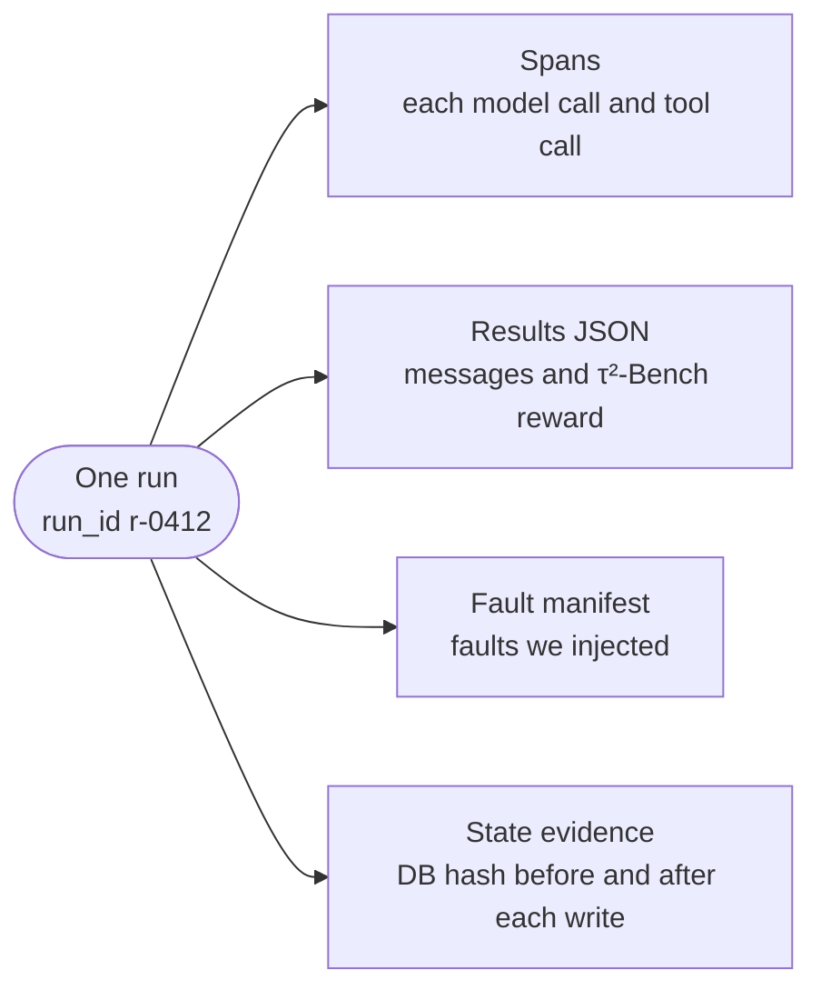
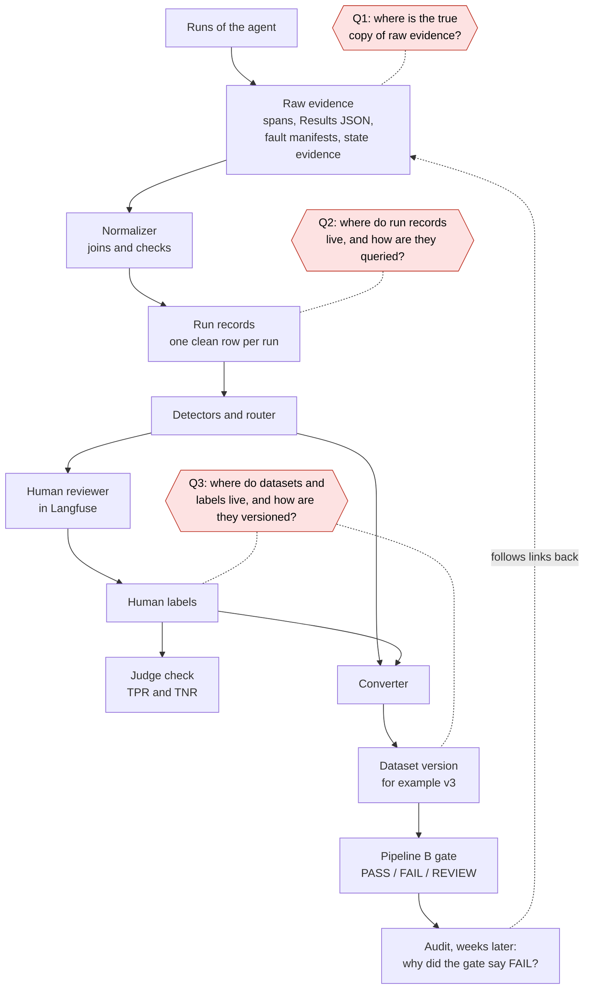
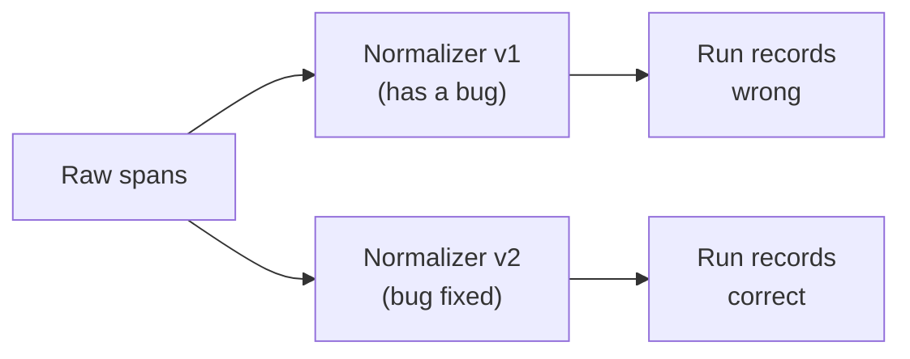
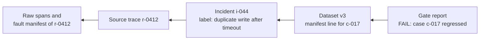
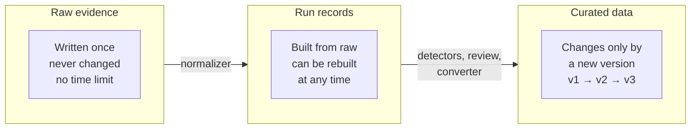
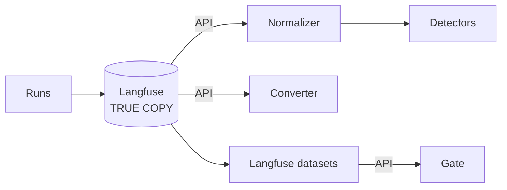
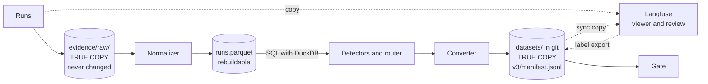
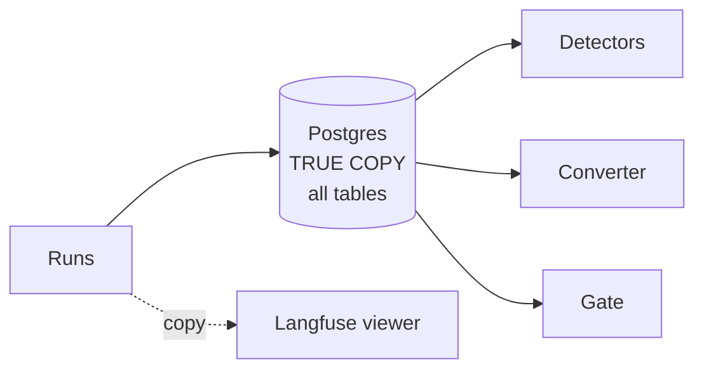

# DQ4 Explained: Where Does the Data Live?

This document uses ASD-STE100 Simplified Technical English. It explains the problem behind design question 4 (DQ4). It does not make the decision. You make the decision after you read it.

Read the sections in order:

1. What DQ4 decides.
2. The data that one run makes.
3. The data flow today, with the open questions.
4. Seven problems. Each problem comes from one storage choice.
5. Six storage rules that prevent the problems.
6. The three options, checked against the rules.
7. The human-label gap.
8. Your decision.

## 1. What DQ4 decides

DQ4 decides two things for each kind of data in the pipeline:

- **Where the true copy lives.** For example: in Langfuse, in local files, or in a database.
- **How the data can change.** For example: never, by a rebuild, or only by a new version.

DQ4 is not about code. It is a set of storage rules. All later steps depend on these rules. If the rules are wrong, the gate decision at the end can be wrong, and nobody can find out why.

## 2. The data that one run makes

The agent handles one customer conversation in τ²-Bench. We call this a **run**. One run makes four items:



The exporter sends the spans to two places at the same time: to a local file and to Langfuse. So the same facts exist in two copies from the first second.

```text
                         ┌──────────────────────────────┐
                    ┌───►│ local file: spans.otlp.json  │   copy 1
 agent + exporter ──┤    └──────────────────────────────┘
                    │    ┌──────────────────────────────┐
                    └───►│ Langfuse (trace viewer)      │   copy 2
                         └──────────────────────────────┘

 Question: when copy 1 and copy 2 disagree, which one is true?
```

## 3. The data flow today, with the open questions

This diagram shows all pipeline steps. Each step reads data that an earlier step wrote. The red shapes are the open questions of DQ4.



Two facts make DQ4 necessary:

1. **The data is read many times, over many weeks.** A drift experiment in week 6 reads runs from week 1. An audit reads the gate report and follows links back to raw spans.
2. **Each step trusts the step before it.** A wrong or changed input in one step makes every later step wrong. The error does not show at the end.

## 4. Seven problems, and the storage choice that causes each one

Each problem below is the result of one storage choice. DQ4 chooses storage that prevents these problems. Each problem has a "without a rule" picture and a "with a rule" picture.

### Problem 1: Two copies disagree

```text
Without a rule                                   With a rule
──────────────                                   ───────────
local file: 15 spans for r-0412                  local file: 15 spans   ◄── TRUE COPY
Langfuse:   14 spans for r-0412                  Langfuse:   14 spans   (only a copy)
detector A reads the file  -> "tool error"       all detectors read the true copy
detector B reads Langfuse  -> "no error"         difference = 1 dropped span, reported
=> two answers for one run                       => one answer, and the loss is measured
```

**Cause:** Two copies, and no rule says which one wins.
**Prevented by:** Rule 1 (one true copy) and Rule 6 (logic reads only the true copy).

### Problem 2: Data disappears

```text
week 1          week 2   ...   week 6
runs saved ──────────────────► drift experiment needs week 1 runs
in a platform with 14- or 30-day retention
                 day 14 or 30: deleted ✗
```

**Cause:** The true copy lives in a place with a time limit. Braintrust Starter keeps data 14 days. Langfuse Cloud Hobby gives access for 30 days (R§5).
**Prevented by:** Rule 2 (raw evidence lives in our own storage with no time limit).

### Problem 3: We cannot fix a bug



In week 3, we find a bug in the normalizer. The fix is easy only if the raw spans still exist and did not change. If we kept only the processed records, the bug stays in the data for ever.

**Cause:** Only processed data was kept, or the raw data was changed in place.
**Prevented by:** Rule 2 (raw evidence is written once and never changed) and Rule 3 (run records can be deleted and built again).

### Problem 4: The dataset changes silently

```text
Monday:    dataset = 27 cases        v2 pass rate = 70%
Tuesday:   someone deletes 3 hard cases (no record of it)
Wednesday: dataset = 24 cases        v2 pass rate = 79%   -> gate says PASS
           The agent did not change. Only the test changed.
```

**Cause:** The dataset can change in place, with no version.
**Prevented by:** Rule 4 (a dataset version never changes; a change makes a new version).

### Problem 5: Results cannot be compared

```text
Week 1 gate report: v1 vs v2, pass 72% vs 75%, dataset = "retail-regression"
Week 5 gate report: v2 vs v3, pass 75% vs 71%, dataset = "retail-regression"
                                              ▲
             same name, but week 1 had 27 cases and week 5 had 31 cases.
             Is v3 worse, or are the 4 new cases harder? Nobody can tell.
```

**Cause:** The gate report names a dataset, but not a fixed version.
**Prevented by:** Rule 4 (each gate report names the dataset version and its hash, for example `v3`, `sha256:9f2c…`).

### Problem 6: We cannot explain a decision

The gate said FAIL. A person asks "which traces caused this?". The answer needs a chain of links from the gate report back to the raw spans:



If one link is missing, or if a linked item was changed or deleted, the chain breaks.

**Cause:** Items do not keep the IDs of their sources, or a source was deleted.
**Prevented by:** Rule 5 (each item keeps links to its sources) and Rule 2 (sources are never deleted).

### Problem 7: One vendor controls the pipeline

```text
Logic reads the vendor API                 Logic reads our own files
──────────────────────────                 ─────────────────────────
detectors ──► Langfuse API                 detectors ──► local files
converter ──► Langfuse API                 converter ──► local files
gate      ──► Langfuse API                 gate      ──► local files
                                           exporter  ──► Langfuse (copy only)
Change to Braintrust:                      Change to Braintrust:
  rewrite detectors, converter, gate         change the exporter and the sync only
```

**Cause:** The pipeline logic reads from the vendor, not from our true copy.
**Prevented by:** Rule 6 (logic reads only the true copy; the platform is a viewer).

### Summary: problem to rule

| Problem | Storage choice that causes it | Rule that prevents it |
|---|---|---|
| 1. Two copies disagree | No true copy is named | Rule 1, Rule 6 |
| 2. Data disappears | True copy in a place with a time limit | Rule 2 |
| 3. Cannot fix a bug | Raw data not kept, or changed | Rule 2, Rule 3 |
| 4. Dataset changes silently | Dataset changes in place | Rule 4 |
| 5. Results cannot be compared | No fixed version in the report | Rule 4 |
| 6. Cannot explain a decision | No links to sources | Rule 5, Rule 2 |
| 7. One vendor controls the pipeline | Logic reads the vendor API | Rule 6 |

## 5. Six storage rules

These rules are the real content of DQ4. Each option in section 6 either follows a rule or breaks it.

| Rule | Text |
|---|---|
| **Rule 1** | Each kind of data has one true copy (the **system of record**). All other places hold copies. When copies disagree, the true copy wins. |
| **Rule 2** | Raw evidence is written once and never changed or deleted. It has no time limit. |
| **Rule 3** | Run records come only from raw evidence. We can delete them and build them again at any time. |
| **Rule 4** | Curated data (eval cases, datasets, labels, taxonomy) changes only by a new numbered version. Each version has a hash. Gate reports name the version and the hash. |
| **Rule 5** | Each item keeps the IDs of its sources: case → incident → trace → raw files. |
| **Rule 6** | The pipeline logic reads only the true copy. A trace platform is a viewer and a review tool. |

The three kinds of data follow these rules in a fixed order:



## 6. The three options, checked against the rules

### Option A: Langfuse is the system of record



### Option B: Local files are the system of record, and Langfuse is a copy



### Option C: One Postgres database for everything



### Check against the rules

| Rule | A: Langfuse | B: Local files + git | C: Postgres |
|---|---|---|---|
| 1. One true copy | Yes | Yes | Yes |
| 2. Raw evidence never changes, no time limit | Depends on the plan. Self-hosted has no limit. A collector failure loses the true copy. | Yes. Files are written once. | Yes, if we add rules to stop updates |
| 3. Run records can be rebuilt | Only through the API | Yes. Delete `runs.parquet` and run the normalizer again. | Yes |
| 4. Versions with a hash | Item versions only. No versions for schema changes (R§5). | Yes. One commit per version. `git diff v3 v4` shows the changes. | Possible, with extra version tables that we build |
| 5. Links to sources | Yes (`sourceTraceId`) | Yes (IDs in each manifest line) | Yes, with foreign keys |
| 6. Logic reads only the true copy, not a vendor | No. All logic uses the Langfuse API. | Yes | Yes |
| Extra work | Least at the start | One sync step to Langfuse | One more service to install and operate |

**Recommendation: option B.** It follows all six rules with the least extra work. A Postgres database (option C) gives no benefit at a few thousand runs. DuckDB queries Parquet files with SQL and needs no server.

### Three scenarios

| Scenario | Option A | Option B | Option C |
|---|---|---|---|
| Week 3: a normalizer bug | Read all traces again through the API, if they still exist | Run the normalizer again on `evidence/raw/` | Possible, if raw data is in a separate table that never changes |
| The collector stops for 10 minutes | Those spans are lost from the true copy | The local file still has them. The difference measures the loss. | Depends on how spans reach the database |
| "Why did the gate say FAIL in week 5?" | Find the Langfuse dataset and hope that it did not change | The report names `v3` and its hash. Git shows the cases. Each case links to its source trace. | Possible, with the extra version tables |

## 7. The human-label gap

A reviewer writes labels in the Langfuse annotation queue (DQ2, DQ6). So, in every option, a label starts in Langfuse. But labels are curated data. They are the ground truth for the judge checks (Rule 4).

```text
Without export                            With export
──────────────                            ───────────
reviewer ──► Langfuse label (only copy)   reviewer ──► Langfuse label
                                                         │ export step (only adds lines)
judge check ──► Langfuse API               ▼
(breaks Rule 1 and Rule 6)                datasets/labels/labels.jsonl  (git, TRUE COPY)
                                           judge check ──► labels.jsonl
```

Each exported line has the trace ID, the label, the reviewer, the time, and the taxonomy version.

## 8. Your decision

Answer two questions:

1. **Which option is the system of record: A, B, or C?** The recommendation is B.
2. **Does an export step copy human labels from Langfuse to `datasets/labels/labels.jsonl`?** The recommendation is yes.

If you choose B, the folder layout is:

```text
evidence/                              # not in git (large); keep a backup
├── raw/<run_id>/spans.otlp.json           # Rule 2: never changed
├── raw/<run_id>/fault_manifest.json       # Rule 2: never changed
├── raw/<batch_id>/results.json            # Rule 2: never changed
└── canonical/runs.parquet                 # Rule 3: can be rebuilt at any time
datasets/                              # in git
├── retail-regression/v3/manifest.jsonl    # Rule 4: never changed after publication
└── labels/labels.jsonl                    # Rule 4: only new lines are added
taxonomy/                              # in git
└── v2.yaml                                # Rule 4: with a map from v1 codes to v2 codes
```

Size estimate (inference): one run with content capture is about 50–200 KB of spans. So 10,000 runs are about 0.5–2 GB. This is why `evidence/` stays out of git.
