# TraceToGate Final Architecture

This document uses ASD-STE100 Simplified Technical English. It describes the final architecture of TraceToGate. You do not have to read the design discussion first. Each component names the design question (DQ1 to DQ10) in `04-design-discussion-tracetogate-foundations.md` that decided it. "R§n" refers to a section of `03-research-tracetogate-foundations.md`. "A§n" refers to a section of `03a-research-addendum-production-trace-to-eval.md`.

**Abbreviations.** LLM is large language model. OTel is OpenTelemetry. OTLP is the OpenTelemetry Protocol. DB is database. TPR is true positive rate. TNR is true negative rate. κ is Cohen's kappa. SE is standard error. CI is confidence interval. JSD is Jensen-Shannon divergence. KS is Kolmogorov-Smirnov. MDE is minimum detectable effect. SHA-256 is the Secure Hash Algorithm with 256 bits.

## Contents

1. Purpose and scope
2. Top-level architecture
3. Pipeline A process flow
4. Pipeline B process flow
5. Component catalogue
6. Detailed views: router, reviewer layers, eval case lifecycle, trial sequence, storage, sharing, adapters, closed loop
7. Data contracts
8. Ground truth and measurement
9. Failure modes of the pipeline itself
10. Folder layout
11. Glossary

## 1. Purpose and Scope

### 1.1 Purpose

TraceToGate is a learning project. It shows how a team turns agent execution traces into a versioned evaluation dataset, and how it uses that dataset to gate an agent release. The project runs on the Retail domain of τ²-Bench. τ²-Bench supplies tasks, a policy, tools, a resettable DB, an LLM user simulator, and an outcome grader (R§1, R§2).

The architecture has three parts:

- **Pipeline A (Trace-to-Eval).** It captures traces, checks their completeness, detects failures, routes them to automatic lanes or to human review, and converts verified, replayable failures into eval cases. It publishes immutable, numbered dataset versions.
- **Pipeline B (Replay and Release Gate).** It runs a baseline agent (v1) and a candidate agent (v2) on a dataset version. It compares the two arms with paired statistics and applies gate rules. It writes a gate report with PASS, FAIL, or REVIEW.
- **Drift experiments.** They compare two windows of runs with one known shift. A/A windows set the noise floor.

Every automatic step is measured against ground truth: the fault manifest, the τ²-Bench reward, human labels, and agent pairs with a known gate answer.

### 1.2 In scope

- τ²-Bench Retail at commit `5ade54e`.
- Trace capture, trace contract, state evidence, and tool fault injection.
- Completeness check, L1 rule detectors, L2 LLM classifier, router, human review, taxonomy, and label export.
- Conversion to eval cases, the replayability check, dataset tiers, promotion, and dataset versions.
- Trial execution for two arms, paired statistics, gate rules, and the gate report.
- Drift experiments on controlled windows.
- Sharing and reproducibility: demo sample, evidence snapshots, lock file, rebuild scripts, Langfuse loader, and a demo app.

### 1.3 Out of scope

- A new trace viewer, a new tracing backend, or a generic metrics dashboard.
- Real customer traffic, shadow mode, canary rollout, and online A/B tests. The gate report names these as the next production stages (R§10).
- Message queues, distributed processing, and managed databases. The volume is hundreds to low thousands of runs.
- The τ²-Bench Airline and Telecom domains, and voice mode.
- The hosting choice for the demo app. The outline step decides it.

## 2. Top-Level Architecture

The diagram shows all components and stores. Cylinders are stores. The dotted edges are copies to Langfuse. Langfuse is a viewer and a review tool. It is never the system of record (DQ2, DQ4).

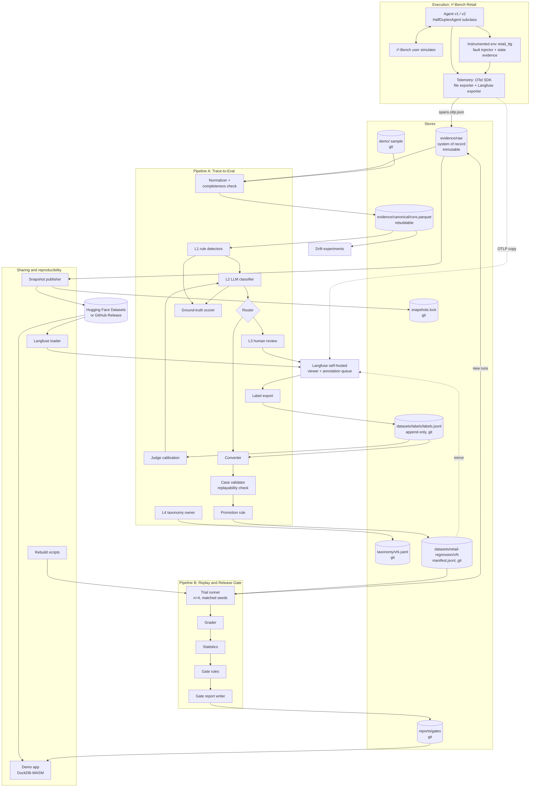

## 3. Pipeline A Process Flow

This diagram shows the order of the Pipeline A steps. Rectangles are automatic components. Cylinders are stores. Diamonds are decision points. Orange nodes are human steps. Each edge names the data that it carries.

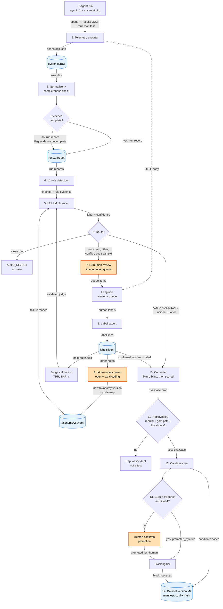

**Pipeline A steps.**

1. The agent runs one τ²-Bench Retail task in the instrumented environment `retail_ttg`. The environment injects faults from the fault profile and records state evidence.
2. The telemetry exporter writes the spans to `evidence/raw/<run_id>/spans.otlp.json`. It also sends a copy to Langfuse. The runner writes the Results JSON and the fault manifest beside the spans.
3. The normalizer joins spans, Results JSON, and fault manifest into one run record. The completeness check compares the received spans with `ttg.span_count` and with the runner record. It marks incomplete runs.
4. The L1 rule detectors check each run record. They write findings with evidence spans.
5. The L2 LLM classifier gives one primary label for the first failure. It uses the taxonomy, few-shot examples, the L1 evidence, and an `other` option.
6. The router sends each run to one lane: `AUTO_REJECT`, `AUTO_CANDIDATE`, or `HUMAN_QUEUE`. It also sends a random audit sample to `HUMAN_QUEUE`.
7. A human reviewer labels the first failure of each queued run in the Langfuse annotation queue. The reviewer marks simulator faults and task defects.
8. The label export copies new labels from Langfuse to `datasets/labels/labels.jsonl`. It only adds lines.
9. The taxonomy owner groups `other` notes into failure modes. The owner approves each new taxonomy version with a map from old codes to new codes.
10. The converter turns each confirmed incident into an `EvalCase`. It works from the trace only, and a scorer then compares the case with the τ²-Bench task.
11. The case validator checks replayability. A case that fails stays an incident.
12. A replayable case enters the `candidate` tier.
13. The promotion rule moves a case to the `blocking` tier when L1 rule evidence exists and the failure reproduces in 2 of 4 trials. Otherwise, a human confirms the promotion.
14. The dataset step publishes a new numbered version with a manifest hash. It mirrors the version to a Langfuse dataset.

## 4. Pipeline B Process Flow

This diagram shows the order of the Pipeline B steps. The colors and shapes have the same meaning as in section 3.

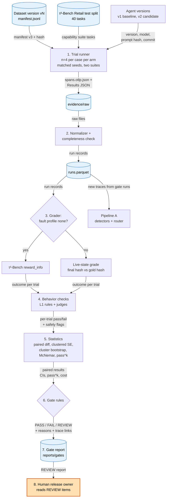

**Pipeline B steps.**

1. The trial runner runs each case of two suites with both arms. The suites are the regression suite (the dataset version) and the capability suite (the 40-task Retail test split). Each case gets 4 trials per arm. Both arms use the same seeds.
2. The normalizer and the completeness check make run records from the raw files, as in Pipeline A.
3. The grader grades each trial. Runs with fault profile `none` use τ²-Bench `reward_info`. Faulted runs compare the final DB hash with the gold DB hash.
4. The behavior checks apply L1 rules and validated judges to each trial. They flag hard-safety failures, for example a write without confirmation.
5. The statistics step averages trials per case and computes paired differences. It computes an SE clustered by τ²-Bench task, a cluster bootstrap CI, McNemar's test, and pass^k per arm.
6. The gate rules turn the statistics into PASS, FAIL, or REVIEW. The first rule that fires sets the result.
7. The report writer stores the gate report in git. It names the dataset version, its hash, and the evidence snapshot. Each reason links to source traces.
8. A human release owner reads each REVIEW result and decides. Gate runs are also traces, so Pipeline A analyzes them and can make new eval cases.

## 5. Component Catalogue

Each table row is one component. "Store" names where the output lives. "Decision" names the design question that decided the component.

### 5.1 Execution and capture

| Component | Responsibility | Inputs | Outputs | Store | Decision |
|---|---|---|---|---|---|
| Agent v1 / v2 | Handles the customer conversation. Subclass of `HalfDuplexAgent`. Emits `invoke_agent` and `chat` spans. Each version has a version string, model, prompt hash, and code commit. | Task, user messages, tool results, seed | Assistant messages, tool calls, spans | Spans to `evidence/raw` | DQ1, DQ9 |
| Instrumented environment `retail_ttg` | Wraps `Environment.get_response()`. Emits one `execute_tool` span per tool call. Registered with `register_domain()` and `register_tasks()`. | Tool calls | Tool results, tool spans | `evidence/raw` | DQ1 |
| Fault injector | Applies the fault profile per tool: error before commit, timeout after commit, added latency, partial or malformed result, stale read. Profile `none` is the control. | Fault profile, tool call | Faulted tool result, `ttg.fault.injected` event, fault manifest | `evidence/raw/<run_id>/fault_manifest.json` | DQ5 |
| State evidence recorder | Records the DB hash before and after each mutating tool call and a JSON diff of changed records. Records the `db.json` hash as initial-state identity. | Mutating tool calls, DB | `ttg.state.hash_before`, `ttg.state.hash_after`, `ttg.state.diff` event | Inside spans | DQ3 |
| Telemetry and exporter | Sets OTel span context per run (τ²-Bench runs 3 threads, R§1). Writes the full span set to a local file. Sends a copy over OTLP to Langfuse. Writes `ttg.span_count` on the root span. | Spans | `spans.otlp.json`, OTLP stream | `evidence/raw` (true copy), Langfuse (copy) | DQ1, DQ3, DQ4 |
| τ²-Bench runner record | The Results JSON from τ²-Bench. It is an independent record of each run. | Runs | `results.json` per batch | `evidence/raw/<batch_id>/results.json` | DQ1 |
| Langfuse (self-hosted) | Shows traces. Holds the annotation queue for human review. Holds mirrored dataset versions with `sourceTraceId`. Logic never reads it. | OTLP spans, queue items, dataset mirror | Human labels in Langfuse | Langfuse Postgres and ClickHouse (copy only) | DQ2, DQ4 |

### 5.2 Pipeline A: ingest and detection

| Component | Responsibility | Inputs | Outputs | Store | Decision |
|---|---|---|---|---|---|
| Normalizer | Joins spans, Results JSON, and fault manifest into one canonical run record per run, with nested steps. Deduplicates spans by span ID. Orders steps by parent IDs and `ttg.turn_idx`. | Raw files | Run records | `evidence/canonical/runs.parquet` | DQ4 |
| Completeness check | Compares received spans with `ttg.span_count`. Compares tool calls in spans with the Results JSON. Marks `evidence_incomplete`. | Raw files, run records | Completeness flags, span loss rate | `runs.parquet` | DQ3 |
| Run records store | One row per run with nested steps. DuckDB queries it with SQL. It can be deleted and rebuilt at any time. | Normalizer output | SQL query results | `runs.parquet` | DQ4 |
| L1 rule detectors | Deterministic checks: schema error, unknown ID, write without confirmation, duplicate write, second modify, state-diff checks, reward = 0. A rule that fires wins over the L2 label. | Run records | Findings with rule ID and evidence span | `runs.parquet` (findings table) | DQ6 |
| L2 LLM classifier | Gives one primary label for the first failure. Uses the fixed taxonomy, few-shot examples, L1 evidence, and an `other` option. Gives a confidence value. | Run records, L1 findings, taxonomy | Label, rationale, confidence | Findings table | DQ6 |
| Router | Sends each run to `AUTO_REJECT`, `AUTO_CANDIDATE`, or `HUMAN_QUEUE`. Adds a random audit sample to `HUMAN_QUEUE`. Uses only validated judges for automatic lanes. | L1 findings, L2 labels, reward, reproduction result | Lane per run | Findings table; queue items in Langfuse | DQ6 |
| Ground-truth scorer | Scores L1, L2, router lanes, and the converter against the fault manifest, reward, human labels, and the τ²-Bench task. | Findings, ground truth | Accuracy tables (TPR, TNR, κ, localization) | Analysis reports | DQ5, DQ6, DQ7 |

### 5.3 Pipeline A: review and curation

| Component | Responsibility | Inputs | Outputs | Store | Decision |
|---|---|---|---|---|---|
| L3 human review | Labels `other` items, low-confidence items, conflicts, suspected simulator faults, task defects, and the audit sample. Labels only the first failure. | Queue items in Langfuse | Human labels | Langfuse (then exported) | DQ6 |
| L4 taxonomy owner | Builds the first taxonomy by open coding and axial coding on about 100 failing traces. Approves new versions with an old-to-new code map. Only this human creates, merges, splits, or renames modes. | Labels, `other` notes | Taxonomy version | `taxonomy/vN.yaml` | DQ4, DQ6 |
| Label export | Copies new human labels from Langfuse to git. Only adds lines. | Langfuse labels | Label lines | `datasets/labels/labels.jsonl` | DQ4 |
| Judge calibration | Splits human labels into train 10–20%, dev 40–45%, test 40–45% (R§11). Measures TPR, TNR, and κ per failure mode on the frozen test split. Marks a judge as validated. Tunes router thresholds. | `labels.jsonl`, L2 outputs | Validated judge list, thresholds, corrected rates | Analysis reports, config | DQ6 |
| Converter | Turns a confirmed incident into an `EvalCase`. Works fixture-blind: writes a user scenario, expected outcome, and checks from the trace only. Falls back to the τ²-Bench task with `fixture_source=privileged`. | Incident, label, run record | `EvalCase` draft | Working area | DQ7 |
| Case validator (replayability check) | Rebuilds the case from the case alone. Runs the gold path. Runs v1 for 4 trials. | `EvalCase` draft | `validation` fields, pass or fail | `EvalCase` | DQ7 |
| Dataset store, tiers, and promotion | Holds `candidate` and `blocking` cases. Promotes by rule (L1 evidence and 2 of 4 reproduction) or by a human. Publishes immutable numbered versions with a hash. Mirrors each version to Langfuse. | Validated cases | Dataset version, manifest hash | `datasets/retail-regression/vN/manifest.jsonl` | DQ4, DQ6, DQ7 |

### 5.4 Pipeline B and drift

| Component | Responsibility | Inputs | Outputs | Store | Decision |
|---|---|---|---|---|---|
| Trial runner | Calls `run_single_task(task, trial, seed)` for each case, trial, and arm. Uses 4 trials and matched seeds. Runs the regression suite and the capability suite. Rebuilds `resimulate` and `prefix` cases. | Dataset version, test split, agent versions | Runs (traces) | `evidence/raw` | DQ7, DQ10 |
| Grader | Uses τ²-Bench `reward_info` for runs with profile `none`. Uses the live-state grade for faulted runs. Records `grade_source`. | Run records, gold DB hash | Outcome per trial | `runs.parquet` | DQ5 |
| Statistics | Per-case mean, paired differences, SE clustered by τ²-Bench task, cluster bootstrap CI, McNemar cross-check, pass^k per arm. Reports results per case kind and per tier. | Graded trials | Paired results | Gate report | DQ10 |
| Gate rules | Applies the ordered rule list. Margins come from the null and planted pairs. Candidate cases never cause FAIL. | Paired results, completeness flags, safety flags, cost | PASS, FAIL, or REVIEW with reasons | Gate report | DQ6, DQ9, DQ10 |
| Gate report | Records the result, each reason, trace links, dataset version and hash, snapshot name, agent versions, and production stages not covered. | Gate rule output | Report file | `reports/gates/` | DQ4, DQ10 |
| Drift experiments | Compares two windows with one known shift, and A/A windows. Uses χ² or JSD, KS, and a two-proportion test, with multiple-testing correction. Built after the first gate works. | Run records of two windows | Drift report with power and false alarm rate | Analysis reports | DQ8 |

### 5.5 Sharing and reproducibility

| Component | Responsibility | Inputs | Outputs | Store | Decision |
|---|---|---|---|---|---|
| Demo sample | About 30–50 runs with raw files (a few MB). Lets anyone run the pipeline with no API keys. | Selected raw runs | Fixture | `demo/` in git | DQ4 |
| Snapshot publisher | Packs the raw evidence of one experiment into one archive, for example `evidence-2026-11-v1.tar.zst`. Publishes it to Hugging Face Datasets or a GitHub Release. Writes the SHA-256 to the lock file. | `evidence/raw` | Archive, lock entry | External host; `snapshots.lock` in git | DQ4 |
| Langfuse loader | Replays raw OTLP files into any Langfuse instance. | Snapshot or `evidence/raw` | Traces in Langfuse | Langfuse (copy) | DQ4 |
| Rebuild scripts | Run τ²-Bench again with the same seeds and agent versions. Results are similar, not identical, because LLMs are not deterministic. | Seeds, versions, dataset version | New raw evidence | `evidence/raw` | DQ4 |
| Demo app | Reads published Parquet and gate reports in the browser, for example a static site with DuckDB-WASM. The outline decides hosting. | Published Parquet, gate reports | Read-only views | None | DQ4 |

## 6. Detailed Views

### 6.1 Router decision flow

The router decides what happens to each analyzed run (DQ6). At the start, no validated judge exists, so all failing runs go to the human queue.

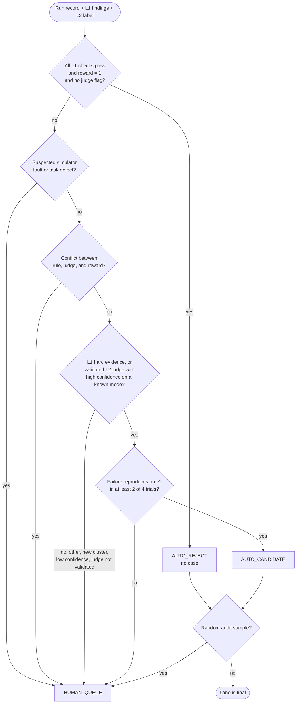

Auto-accept uses a stricter threshold than auto-reject, because a false pass hides a failure (A§5, inference). The project reports the automatic share and the audit error rate per lane.

### 6.2 Reviewer layers

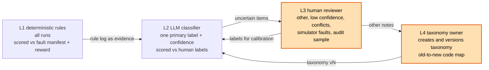

| Layer | Reviewer | Job | Accuracy check |
|---|---|---|---|
| L1 | Deterministic rules | Schema error, unknown ID, write without confirmation, duplicate write, second modify, state-diff checks, τ²-Bench reward = 0. A rule that fires wins over the LLM label. | TPR and TNR against the fault manifest and τ²-Bench reward |
| L2 | LLM classifier | One primary label for the first failure, with fixed taxonomy, few-shot examples, L1 evidence, an `other` option, and a confidence value. | TPR, TNR, and κ per failure mode on frozen human labels |
| L3 | Human reviewer | Labels `other` items, low-confidence items, conflicts, suspected simulator faults, and the audit sample. | Agreement between two reviewers on a sample |
| L4 | Human taxonomy owner | Builds the first taxonomy from about 100 failing traces. Approves each new version with a code map. | Saturation: no new mode in the last 20 traces |

### 6.3 Eval case lifecycle

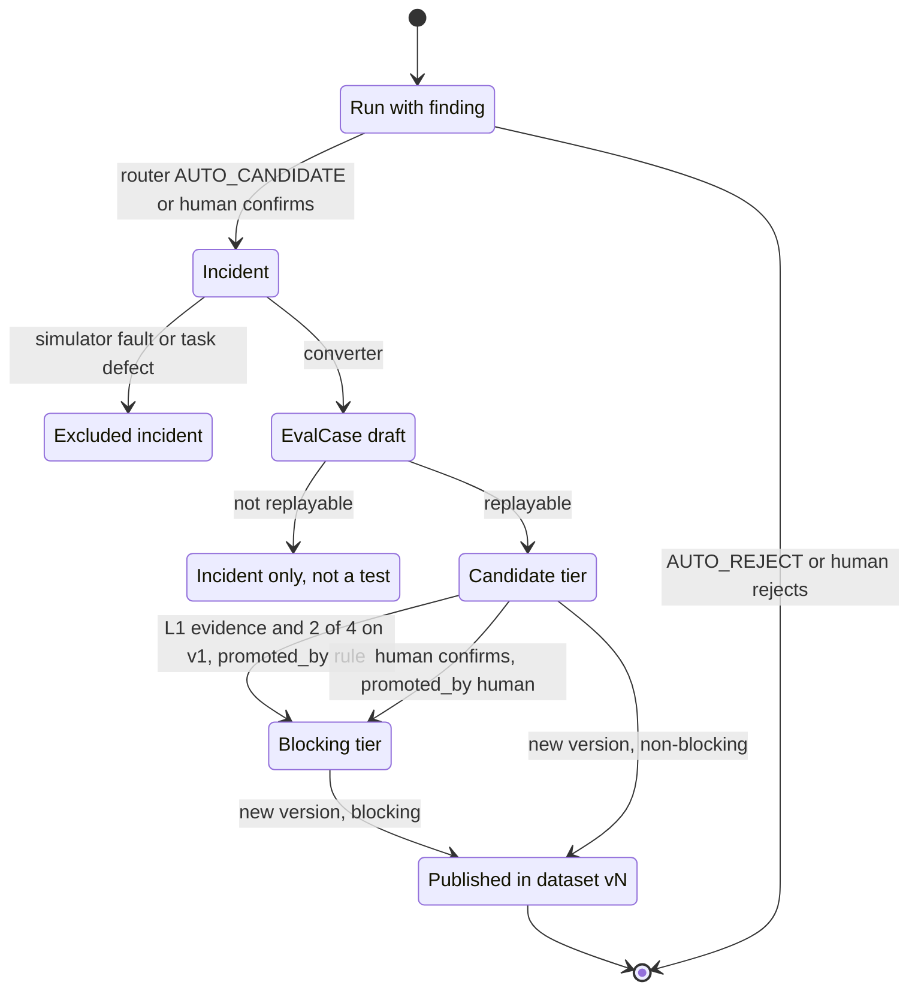

A published version never changes. A change to a case, a tier, or a check makes a new version (Rule 4). Pipeline B reports candidate cases but never uses them for FAIL.

### 6.4 Pipeline B trial sequence

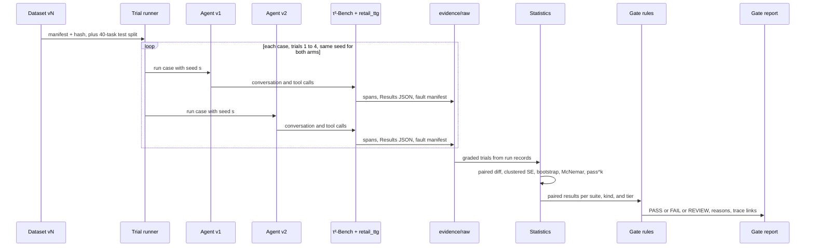

### 6.5 Data stores and storage rules

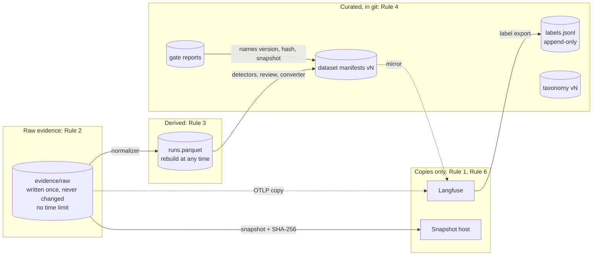

| Rule | Text |
|---|---|
| Rule 1 | Each kind of data has one true copy (the system of record). All other places hold copies. When copies disagree, the true copy wins. |
| Rule 2 | Raw evidence is written once and never changed or deleted. It has no time limit. |
| Rule 3 | Run records come only from raw evidence. We can delete them and build them again at any time. |
| Rule 4 | Curated data (eval cases, datasets, labels, taxonomy) changes only by a new numbered version. Each version has a hash. Gate reports name the version and the hash. |
| Rule 5 | Each item keeps the IDs of its sources: case → incident → trace → raw files. |
| Rule 6 | The pipeline logic reads only the true copy. A trace platform is a viewer and a review tool. |

| Data | System of record | Copies | Change policy |
|---|---|---|---|
| Spans, Results JSON, fault manifests | `evidence/raw` (local files) | Langfuse, evidence snapshot | Never change |
| Run records | `runs.parquet` | Published Parquet for the demo app | Rebuild from raw |
| Human labels | `datasets/labels/labels.jsonl` | Langfuse (origin of entry) | Append only |
| Taxonomy | `taxonomy/vN.yaml` | None | New version with code map |
| Dataset versions | `datasets/<name>/vN/manifest.jsonl` | Langfuse dataset mirror | New version with hash |
| Gate reports | `reports/gates/` | Demo app | Never change |
| Snapshot identity | `snapshots.lock` | None | Append a new entry per snapshot |

### 6.6 Sharing and reproducibility layers

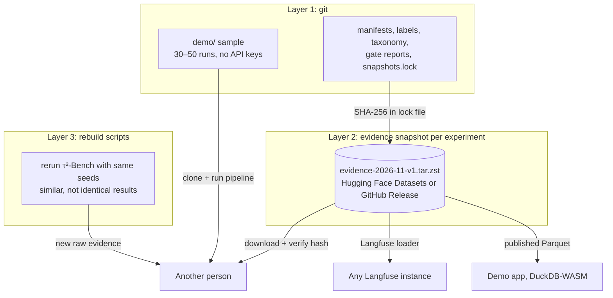

τ²-Bench data is synthetic and MIT-licensed. Published content capture is therefore safe. If the project ever uses real production traces, check this decision again and add redaction before export.

### 6.7 Generic core and the four τ²-Bench adapters

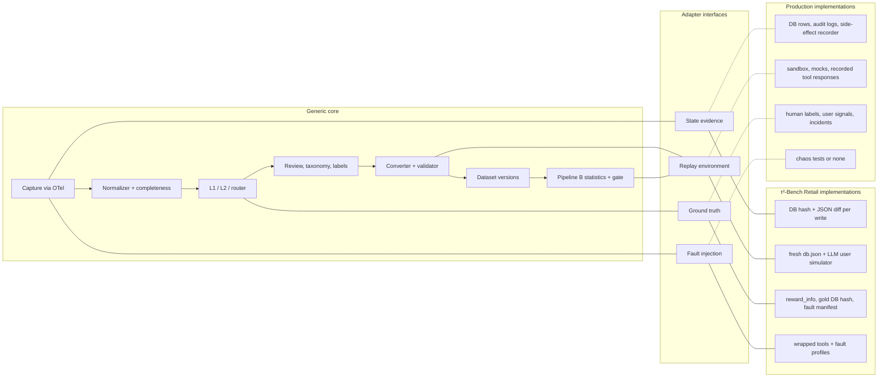

The core never imports τ²-Bench directly. Only the adapters do. Then the same core can run on another τ²-Bench domain or on production traces (A§6).

### 6.8 The closed loop from Pipeline A to Pipeline B and back

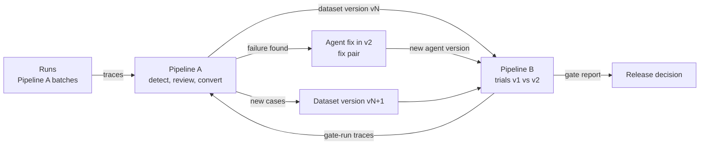

Gate runs are traces too. A failure that a gate run shows can become a new eval case. A fix for a Pipeline A failure becomes a fix pair for Pipeline B.

## 7. Data Contracts

### 7.1 Trace contract

The trace uses the OTel GenAI semantic conventions at one pinned version. Project fields use the `ttg.*` namespace. Content capture is on (DQ3).

```text
trace (root span "ttg.run")
  required: ttg.run.id, ttg.task.id, ttg.trial, ttg.seed, ttg.source (live|imported),
            gen_ai.agent.name, gen_ai.agent.version, ttg.semconv.version,
            ttg.tau2.commit, ttg.env.db_hash_initial, ttg.fault_profile.id
  at end:   ttg.termination_reason, ttg.env.db_hash_final, ttg.span_count
span chat
  required: gen_ai.operation.name, gen_ai.provider.name, gen_ai.request.model,
            gen_ai.usage.input_tokens, gen_ai.usage.output_tokens, ttg.turn_idx
span execute_tool
  required: gen_ai.tool.name, gen_ai.tool.call.id, ttg.tool.mutates_state, ttg.tool.error
  if mutating: ttg.state.hash_before, ttg.state.hash_after, event ttg.state.diff
  if faulted:  event ttg.fault.injected (fault_id, kind, committed: true|false)
```

Span tree shape (R§4):

```text
ttg.run
└── invoke_agent retail_agent            (INTERNAL)
    ├── chat gpt-4.1                     (CLIENT)   → response with tool_calls [c1, c2]
    ├── execute_tool get_order_details   (INTERNAL) gen_ai.tool.call.id=c1
    └── execute_tool get_user_details    (INTERNAL) gen_ai.tool.call.id=c2
```

Tool spans link to the model call through `gen_ai.tool.call.id`, not through timestamps. Evaluation results use the `gen_ai.evaluation.result` event, parented to the evaluated span.

### 7.2 Fault manifest

```text
fault_manifest.json (one per run)
  run_id, fault_profile.id, seed
  faults[]: fault_id, tool_name, gen_ai.tool.call.id, kind
            (error_before_commit | timeout_after_commit | latency | partial | malformed | stale_read),
            committed (true|false), injected_at
  telemetry_faults[] (later, DQ5 option C): kind (drop | duplicate | reorder | outage | crash), span_ids
```

### 7.3 Run record

One row per run in `runs.parquet`. The outline step fixes the exact column names.

```text
RunRecord
  identity:  run_id, trace_id, batch_id, task_id, trial, seed, source (live|imported)
  agent:     agent.name, agent.version, model, prompt_hash, code_commit
  env:       tau2_commit, semconv_version, fault_profile_id, db_hash_initial, db_hash_final
  outcome:   termination_reason, reward, grade_source (tau2|live_state), db_ok
  evidence:  span_count_expected, span_count_received, evidence_incomplete, duplicate_spans
  steps[]:   turn_idx, kind (chat|execute_tool), tool_name, tool_call_id, args, result,
             error, mutates_state, hash_before, hash_after, state_diff, fault_id
  cost:      input_tokens, output_tokens, cost_usd, latency_ms
  findings[]: layer (L1|L2), rule_or_judge_id, version, label, confidence, step_ref
  route:     lane (AUTO_REJECT|AUTO_CANDIDATE|HUMAN_QUEUE), audit_sample (true|false)
```

### 7.4 Label line

One JSON object per line in `datasets/labels/labels.jsonl`. The file only gets new lines.

```text
{trace_id, run_id, label, reviewer, labelled_at, taxonomy_version}
```

A correction is a new line with a later `labelled_at`. The newest line for a trace and reviewer wins.

### 7.5 EvalCase

```text
EvalCase
  case_id, dataset_version, kind (resimulate | prefix)
  source: run_id, trace_id, incident_id, failure_mode (from taxonomy)
  setup:  tau2_task_id, db_hash_initial, fault_profile, message_prefix (prefix kind only)
  user:   scenario (fixture-blind or privileged), fixture_source
  checks: outcome (gold DB hash or expected state diff)
          behavior (rule ids, judge ids + judge versions)
  validation: reproduced_on_v1 = c/n trials, gold_path_passes = true
  tier:   candidate | blocking, promoted_by (rule | human), promoted_at
```

A case is **replayable** when all three conditions are true:

1. The runner can rebuild the setup from the case alone.
2. The gold path passes all case checks.
3. The failure reproduces on v1 in at least 2 of 4 trials.

### 7.6 Dataset manifest

```text
datasets/retail-regression/vN/manifest.jsonl
  one line per EvalCase (fields of 7.5)
manifest hash = SHA-256 of the manifest file bytes
version metadata: version, parent_version, created_at, taxonomy_version,
                  case_count per tier and kind, manifest_hash
```

A published manifest never changes. The Langfuse mirror sets `sourceTraceId` on each item.

### 7.7 Gate report

```text
GateReport
  result: PASS | FAIL | REVIEW
  reasons[]: rule, metric, value, threshold, trace links (trace_id list)
  inputs: dataset_version, manifest_hash, evidence_snapshot (name + SHA-256),
          v1 and v2 (version, model, prompt hash, code commit),
          trials per case = 4, seeds, suites (regression, capability)
  statistics per suite, per case kind, per tier:
          pass rate per arm, paired diff, clustered SE, bootstrap CI,
          McNemar result, pass^k per arm, cost and latency ratio
  evidence: runs expected, runs received, evidence_incomplete count
  config: margin, k_margin, limits
  not covered: shadow, canary, online A/B
```

Gate rules, in order. The first rule that fires sets the result:

```text
gate(v1, v2, dataset_version)
  if evidence incomplete (missing spans, failed runs > limit)        -> REVIEW
  if any hard-safety check fails on v2 in any trial                 -> FAIL
  if paired diff upper bound < -margin on either suite              -> FAIL
  if a graduated regression case falls below its pass threshold    -> FAIL
  if pass^k drop on regression suite > k_margin                     -> FAIL
  if cost or latency ratio > limit                                  -> REVIEW
  if a decisive metric depends on an LLM judge                      -> REVIEW
  if confidence interval crosses -margin (inconclusive)             -> REVIEW
  else                                                              -> PASS
```

### 7.8 Grade rule

```text
grade(run)
  if run.fault_profile == none:
    use tau2 reward_info                      # default evaluator, strict replay
  else:
    db_ok = (run.db_hash_final == gold_db_hash(task))   # gold from task actions
    use db_ok, plus NL assertions if the task has them
    record grade_source = "live_state"
```

Faulted runs need this rule. Strict replay raises an error when a recorded write result differs from the real tool result (R§2).

## 8. Ground Truth and Measurement

### 8.1 Sources of ground truth

| Ground truth | Source | What it scores |
|---|---|---|
| Outcome | τ²-Bench `reward_info`, or the live-state grade for faulted runs | Outcome detectors; gate outcome metric |
| Cause | Fault manifest from the fault injector | Fault detectors; root-cause labels; converter fixture reconstruction |
| Behavior | Human labels in `labels.jsonl` | L2 classifier and judges; policy-violation detectors; router audit |
| Task | τ²-Bench task (scenario, gold actions) | Converter output in fixture-blind mode |
| Gate answer | Agent pairs with known answers (DQ9) | Gate accuracy; margin calibration |
| Drift answer | Windows with one known shift, and A/A windows | Drift detection power and false alarm rate |

### 8.2 What each layer is scored against

| Component | Scored against | Metrics |
|---|---|---|
| Completeness check | Telemetry fault manifest (DQ5 option C, later) | Detection rate per pipeline fault kind; span loss rate |
| L1 fault detectors | Fault manifest | TPR, TNR, step localization accuracy |
| L1 outcome detectors | τ²-Bench reward or live-state grade | TPR, TNR |
| L2 classifier and judges | Human labels, split train 10–20% / dev 40–45% / test 40–45% (R§11) | TPR, TNR, κ per failure mode on the frozen test split |
| Router lanes | Human labels on the audit sample | Audit error rate per lane; automatic share |
| L3 human reviewers | A second reviewer on a sample | Inter-reviewer agreement |
| L4 taxonomy | New traces | Saturation (no new mode in the last 20 traces); `other` rate |
| Converter | τ²-Bench task | Share of correct goal and outcome; share of valid cases; share of `privileged` fallbacks |
| Promotion rule | Audit sample of auto-promoted cases | Share of bad blocking cases |
| Gate | Agent pairs (DQ9) | Correct answer on fix (PASS), planted (FAIL), and null (no difference) pairs |
| Drift experiments | Known shifts and A/A windows | Power per signal; false alarm rate after correction |

### 8.3 Measurement rules

- Report TPR and TNR separately. Raw agreement misleads when failures are rare (R§11).
- Use the Rogan-Gladen correction for judge-based failure rates when TPR + TNR − 1 is not close to 0 (R§11).
- An L2 judge is "validated" only after it passes the TPR and TNR threshold on held-out human labels. The Langfuse calibration guide uses 0.90 TPR and 0.90 TNR as an example (A§1.2). The outline sets the project threshold.
- Agent versions for the gate pairs:

| Pair | v2 change | Expected answer |
|---|---|---|
| Fix pair | Fix for a Pipeline A failure, for example: check order state before a retried write | PASS |
| Planted regression | Skip the user confirmation before a write | FAIL |
| Null pair (A/A) | Cosmetic change or new seed only | No difference |
| Model swap | Model only, for example GPT-4.1 versus GPT-4.1-mini | Unknown |

- Statistics: per-case score is the mean over 4 trials. Paired difference is `d_i = s_i^v2 − s_i^v1`. SE is clustered by τ²-Bench task. Power: `n ≈ ((z_{1−α/2} + z_power) · sd_d / δ)²`. With an assumed SD of 0.3 and 114 cases, the MDE is about 8 points at 80% power **(inference)**.
- Drift signals: χ² or JSD on tool-usage mix and termination reasons, KS on trajectory length and latency, and a two-proportion test on failure rate. Apply a multiple-testing correction across all signals (R§9).

## 9. Failure Modes of the Pipeline Itself

The pipeline can fail too. The table lists each failure, its effect, and how the design detects or prevents it. Most rows come from the brief's "Where can Pipeline A fail?" table.

| Failure mode | Effect | Detection or prevention |
|---|---|---|
| Spans are dropped | Incomplete history; a missed tool call | Completeness check compares received spans with `ttg.span_count` and the Results JSON. Run gets `evidence_incomplete`. Gate gives REVIEW. |
| Agent crashes before export | Final spans missing | The runner record (Results JSON) is kept separately. Exporter flushes on shutdown. Completeness check marks the run. |
| Duplicate spans arrive | False retry or false duplicate-write finding | Normalizer deduplicates by span ID. Duplicate writes come from state diffs, not span counts. |
| Spans arrive out of order | Wrong first-failure step | Normalizer orders by parent IDs and `ttg.turn_idx`, not by arrival time. |
| Collector or Langfuse is down | Lost or late copy in the viewer | The local file is the true copy (Rule 1). The loss shows as a difference. Telemetry does not block the run. |
| Instrumentation misses a tool call | Unsafe action not detected | All tool calls pass through `get_response()`. Completeness check compares tool calls with the Results JSON. |
| Agent reports success, but state is wrong | False success label | Outcome comes from the DB hash, not from the agent text. |
| Faulted run graded by strict replay | Grader error or wrong grade | Faulted runs use the live-state grade with `grade_source=live_state`. |
| L1 rule flags normal behavior | False alerts | Rules are scored on runs with profile `none` and reward = 1. TNR is reported. |
| L2 classifier is wrong or drifts | Wrong labels; bad automatic cases | Only validated judges feed automatic lanes. Audit sample measures error per lane. Labels re-calibrate the judge. |
| LLM groups different failures together | Misleading root cause | Only the L4 human changes the taxonomy. Each item keeps its own evidence. Reviewers can relabel. |
| Simulator fault looks like an agent failure | Bad eval case | Router sends suspected simulator faults to humans. Label excludes the run from eval cases. |
| Case cannot be replayed | Test that never fails or always fails | Replayability check: rebuild, gold path passes, 2 of 4 on v1. A case that every agent always fails is flagged as broken. |
| Trace lacks initial state | Invalid replay test | `ttg.env.db_hash_initial` is required. A run without it stays an incident. |
| Dataset changes silently | Pass rate changes with no agent change | Versions never change (Rule 4). Gate report names version and hash. |
| Normalizer has a bug | Wrong run records | Raw evidence never changes (Rule 2). Rebuild `runs.parquet` (Rule 3). |
| Labels exist only in Langfuse | Lost ground truth; vendor lock | Label export to `labels.jsonl` in git. |
| Bad case auto-promoted to blocking | False FAIL in the gate | Auto-promotion needs L1 evidence and reproduction. Audit sample of auto-promoted cases. |
| Gate noise looks like a regression | False FAIL | 4 trials, paired seeds, clustered SE, bootstrap CI. Margins calibrated on the null pair. |
| Decision depends only on an LLM judge | Unverified FAIL or PASS | Gate rule gives REVIEW. |
| Drift alarm from noise | False drift alarm | A/A windows set the noise floor. Multiple-testing correction. |
| Snapshot file is changed or corrupted | Results cannot be reproduced | SHA-256 in `snapshots.lock`. The loader checks the hash. |
| Rerun gives different results | Others cannot match the numbers | Snapshots hold the exact evidence. Rebuild scripts state that results are similar, not identical. |
| Sensitive data enters traces | Privacy incident | Data is synthetic now. The design requires a new check and redaction before any production trace. |
| Imported runs mix with live runs | Wrong drift or detector figures | Every run has `ttg.source`. Analyses filter on it. |

## 10. Folder Layout

The outline step can change module names. It keeps the stores and the git rules.

```text
trace-to-gate/
├── ttg/agent/        # agent v1/v2 (HalfDuplexAgent subclasses)
├── ttg/env/          # instrumented env retail_ttg, fault injector, state evidence
├── ttg/telemetry/    # OTel setup, span helpers, file exporter, Langfuse exporter
├── ttg/ingest/       # normalizer, completeness check, canonical records
├── ttg/detect/       # L1 rules, L2 classifier, router, ground-truth scorer
├── ttg/curate/       # label export, converter, case validator, promotion
├── ttg/dataset/      # dataset versions, manifests, Langfuse mirror
├── ttg/gate/         # trial runner, grader, paired statistics, gate rules, report
├── ttg/drift/        # window comparison experiments
├── ttg/share/        # snapshot publisher, Langfuse loader, rebuild scripts
├── evidence/                              # NOT in git (large); system of record for raw evidence
│   ├── raw/<run_id>/spans.otlp.json           # Rule 2: never changed
│   ├── raw/<run_id>/fault_manifest.json       # Rule 2: never changed
│   ├── raw/<batch_id>/results.json            # Rule 2: never changed
│   └── canonical/runs.parquet                 # Rule 3: can be rebuilt at any time
├── datasets/                              # in git
│   ├── retail-regression/v3/manifest.jsonl    # Rule 4: never changed after publication
│   └── labels/labels.jsonl                    # Rule 4: only new lines are added
├── taxonomy/                              # in git
│   └── v2.yaml                                # Rule 4: with a map from v1 codes to v2 codes
├── reports/gates/                         # in git; names dataset version, hash, snapshot
├── demo/                                  # in git; 30–50 runs with raw files (a few MB)
│   └── raw/<run_id>/...
└── snapshots.lock                         # in git; snapshot name, URL, SHA-256
```

Size estimate **(inference)**: one run with content capture is about 50–200 KB of spans. 10,000 runs are about 0.5–2 GB. This is why `evidence/` stays out of git.

## 11. Glossary

| Term | Meaning |
|---|---|
| arm | One agent version in a comparison: baseline v1 or candidate v2. |
| audit sample | A random share of automatic router decisions that a human checks. |
| axial coding | Grouping of free-text failure notes into named failure modes. |
| blocking tier | Eval cases that can cause FAIL in the gate. |
| candidate tier | Eval cases that Pipeline B reports but never uses for FAIL. |
| capability suite | The τ²-Bench Retail test split of 40 tasks, run in every gate. |
| case kind | `resimulate` (new conversation from the scenario) or `prefix` (fixed conversation prefix, then live). |
| completeness check | The check that compares received spans with `ttg.span_count` and the runner record. |
| content capture | Recording of message and tool content in spans. |
| dataset version | An immutable, numbered set of eval cases with a manifest hash. |
| demo sample | About 30–50 runs with raw files in git. The pipeline runs on it with no API keys. |
| eval case | A reviewed incident in the form of a test that a runner can execute again. |
| evidence snapshot | One versioned archive of the raw evidence of one experiment, outside git, with its SHA-256 in `snapshots.lock`. |
| fault manifest | The file that lists each fault that the injector applied to a run. |
| fault profile | The configuration that says which faults the injector applies. `none` is the control. |
| finding | An automatic flag that a detector puts on a run. |
| fixture-blind | Conversion from the trace only, with no access to the τ²-Bench task. |
| gate | The rules that turn comparison results into PASS, FAIL, or REVIEW. |
| gold DB hash | The DB hash after the gold actions of a task. |
| incident | One or more findings that a reviewer confirmed and labelled. |
| L1, L2, L3, L4 | Reviewer layers: rules, LLM classifier, human reviewer, taxonomy owner. |
| live-state grade | Grade of a faulted run by comparison of the final DB hash with the gold DB hash. |
| matched seeds | The same seed for the same case and trial in both arms. |
| null pair | A v1 and v2 pair with no real difference. It measures false alarms. |
| open coding | Free-text notes on the first failure of each trace. |
| pass^k | The probability that all k trials of a task pass (R§1). |
| planted regression | A deliberate defect in v2 with a known gate answer: FAIL. |
| regression suite | The current dataset version from Pipeline A. |
| replayable | A case that rebuilds from itself, passes on the gold path, and fails on v1 in at least 2 of 4 trials. |
| router | The component that sends each run to `AUTO_REJECT`, `AUTO_CANDIDATE`, or `HUMAN_QUEUE`. |
| run | One τ²-Bench simulation of one task, one trial, one seed. |
| run record | One canonical row per run in `runs.parquet`. |
| span | One timed operation in a trace: agent turn, model call, or tool call. |
| state evidence | DB hashes before and after a write, and a JSON diff of changed records. |
| system of record | The one true copy of a kind of data. |
| taxonomy | The versioned list of failure modes in `taxonomy/vN.yaml`. |
| trace | The tree of spans that one run produces. |
| validated judge | An L2 judge that passed the TPR and TNR threshold on held-out human labels. |
