# TraceToGate System Design

This document is the complete system design of TraceToGate. It is for an engineer who wants to understand the whole system, from one agent run to one release decision. It needs no other document.

The sections go from the big picture down to the details. Sections 1 to 3 explain the problem, the facts that shaped the design, and one example from start to finish. Sections 4 to 8 explain how the system works. Sections 9 to 13 cover the technology, the runtime, the key decisions, the non-functional concerns, and the open items. The appendices hold reference material. The text follows ASD-STE100 Simplified Technical English.

## Contents

1. [The problem and the big picture](#1-the-problem-and-the-big-picture)
2. [What we found before designing](#2-what-we-found-before-designing)
3. [One failure, from trace to release decision](#3-one-failure-from-trace-to-release-decision)
4. [How a failure becomes a test (Pipeline A)](#4-how-a-failure-becomes-a-test-pipeline-a)
5. [How the gate decides (Pipeline B)](#5-how-the-gate-decides-pipeline-b)
6. [How we know each step works](#6-how-we-know-each-step-works)
7. [Where the data lives and how we share it](#7-where-the-data-lives-and-how-we-share-it)
8. [What carries over to production](#8-what-carries-over-to-production)
9. [Technology stack and services](#9-technology-stack-and-services)
10. [Deployment and runtime view](#10-deployment-and-runtime-view)
11. [Key design decisions](#11-key-design-decisions)
12. [Non-functional concerns](#12-non-functional-concerns)
13. [Risks and open items](#13-risks-and-open-items)

Appendices: [A. Full component diagram](#appendix-a-full-component-diagram) · [B. Component catalogue](#appendix-b-component-catalogue) · [C. Data contracts](#appendix-c-data-contracts) · [D. Measurement details](#appendix-d-measurement-details) · [E. Pipeline failure modes, full list](#appendix-e-pipeline-failure-modes-full-list) · [F. Folder layout](#appendix-f-folder-layout) · [G. Glossary and abbreviations](#appendix-g-glossary-and-abbreviations)

## 1. The problem and the big picture

**In short:** TraceToGate turns agent failures into tests. Then it uses those tests to decide if a new agent version is safe to release.

### 1.1 The problem

Think of a team with a customer-service agent in production. Version 1 (v1) is live. The team has built version 2 (v2) and wants to ship it. They must know two things: does v2 fix the failures that v1 shows, and does v2 break something else?

Two gaps make this hard. First, the team has many traces of v1 in production, but no easy way to turn the failures in those traces into regression tests. Most teams do this by hand, one trace at a time. Second, agents are not deterministic. One run of v2 that passes proves little, and a simple pass rate cannot tell a real regression from noise. So the team cannot say with confidence that v2 is safe to ship.

### 1.2 What TraceToGate does

TraceToGate closes both gaps with two pipelines:

- **Pipeline A (Trace-to-Eval)** reads the traces of agent runs and finds failures. It turns each verified failure into a test, and it collects the tests in a versioned regression dataset.
- **Pipeline B (Replay and Release Gate)** runs v1 and v2 on that dataset and on a fixed set of benchmark tasks. It compares the two versions with error bars and writes a gate report that says PASS, FAIL, or REVIEW.

A third, smaller part, the **drift experiments**, checks if we can see a change in agent behavior between two periods of runs.

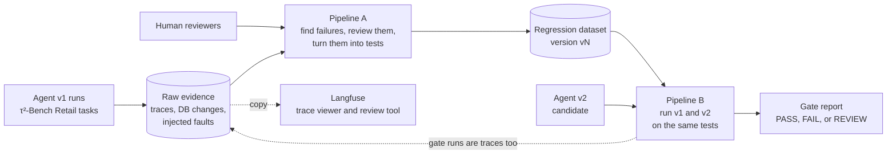

Read the diagram from left to right. Agent runs make raw evidence. Pipeline A, with help from human reviewers, turns failures in that evidence into tests. Pipeline B uses the tests to compare v1 and v2. Langfuse is an open-source trace viewer that we host ourselves. We use it to look at traces and to do human review. It holds only copies, and the pipeline logic never reads from it. A full diagram with every component is in [Appendix A](#appendix-a-full-component-diagram).

**Words you will see often.** The [glossary](#appendix-g-glossary-and-abbreviations) has the full list.

| Word | Meaning |
|---|---|
| run | One τ²-Bench conversation: one task, one trial, one random seed. |
| trace | The record of one run, as a tree of timed steps called spans. |
| span | One step in a trace: an agent turn, a model call, or a tool call. |
| incident | A failure that a reviewer (a rule or a human) confirmed and labelled. |
| eval case | An incident in the form of a test that we can run again. In this document, "test" and "eval case" mean the same thing. |
| dataset version | A numbered, frozen set of eval cases. |
| arm | One side of a comparison: the baseline v1 or the candidate v2. |
| gate | The rules that turn the comparison into PASS, FAIL, or REVIEW. |

### 1.3 Why τ²-Bench Retail is the test environment

The system runs on the Retail domain of τ²-Bench (tau-squared bench), pinned at commit `5ade54e`. τ²-Bench is a public benchmark for customer-service agents from Sierra Research. The Retail domain gives us everything a release gate needs, in a form that we can control:

- **Tasks:** 114 customer requests, such as returns, exchanges, and order changes. A fixed test split has 40 of them.
- **A policy:** written rules that the agent must follow, for example "get explicit user confirmation before a write".
- **Tools:** Python functions that read and change orders, users, and products.
- **A resettable DB:** an in-memory JSON database (DB) that is built fresh from one file, `db.json`, for each run.
- **A user simulator:** a large language model (LLM) that plays the customer.
- **An outcome grader:** it compares the final DB with the DB that the correct actions ("gold actions") produce.

The most important property: τ²-Bench knows the correct answer for each task. Production never gives us that. So we can measure each automatic step against a known truth.

τ²-Bench also differs from production. The design does not hide these gaps. It exposes them:

| τ²-Bench fact | Production reality | How the design responds |
|---|---|---|
| Each task has a known starting state and gold actions | A production trace has no answer key | The converter writes tests from the trace only, and uses the τ²-Bench task only to score itself |
| All 114 tasks start from the same `db.json` | Each customer has different, changing data | State evidence records only the records that a write changes |
| Tools are deterministic Python over an in-memory DB | Services time out, fail partly, and return stale data | A fault injector adds realistic tool failures |
| The customer is an LLM with about 12% critical errors | Customers are real people | Reviewers label simulator faults, and those runs never become tests |
| Success is mostly a final-DB match, so policy violations can pass | No automatic success signal exists | Detectors check policy behavior apart from the outcome |
| Volume is hundreds to low thousands of runs | Volume can be millions of traces | Storage stays file-based and local |
| Data is synthetic and MIT-licensed | Traces contain personal data | Full trace text is safe to publish here; this must be checked again for real traces |

## 2. What we found before designing

**In short:** Research before the design showed what τ²-Bench gives and lacks, what production teams really automate, and how weak LLM judges still are at fine-grained work. These facts shaped every decision.

**About τ²-Bench.**

- It saves the full conversation of each run, with tool calls, results, error flags, and cost. It does **not** save the starting or final DB. Its grader rebuilds the state by replaying the conversation.
- Success is mostly a final-DB-hash match. Only 40 of 114 Retail tasks define natural-language (NL) assertions, and the other 72 score 1.0 on that part. So a policy violation that reaches the correct DB still passes.
- It has no OpenTelemetry, no callback interface, and no fault injection. But all tool calls pass through one function, `Environment.get_response()`, and τ²-Bench accepts a wrapped environment as a new domain.
- Its strict replay raises an error when a recorded write result differs from the real one. So it cannot grade runs with injected faults.
- Results vary a lot. Current models pass about 74–84% of Retail tasks in one trial (pass^1), but only 52–61% in all 4 trials (pass^4).
- The user simulator makes critical errors in about 12% of Retail conversations ([τ²-bench paper](https://arxiv.org/abs/2506.07982)).
- It runs 3 tasks in parallel threads. It passes a seed to model calls, but we did not verify that providers honor it.

**About tracing tools.**

- The OpenTelemetry (OTel) GenAI conventions define agent, model, and tool spans. All GenAI parts are still in "Development" status, and content capture is off by default.
- LiteLLM, the model client in τ²-Bench, can emit model spans, but tools run outside it, so tool spans are probably missing.
- Langfuse is open source (MIT outside its enterprise folder) and self-hostable with Postgres, ClickHouse, Redis, and S3-compatible storage. It accepts OTLP over HTTP, links dataset items to traces, versions item changes, and has annotation queues.

**About production practice.**

- Practitioners describe one loop ([Hamel Husain and Shreya Shankar](https://hamel.dev/blog/posts/evals-faq/); [Anthropic](https://www.anthropic.com/engineering/demystifying-evals-for-ai-agents)). Sample traces, note the first failure, group notes into a taxonomy, write a check or a validated judge per failure mode, and promote traces to linked dataset items.
- No company describes a fully automated trace-to-test pipeline. Humans stay in four places: finding new failure modes, labelling data to validate judges, confirming promotion to a blocking suite, and checking an audit sample.
- Vendors run rules on all traces, judges on a sample, and send a capped stream to humans. No source automatically promotes an LLM-judged failure into a blocking suite.
- Replay has no standard. Teams combine environment reset, recorded tool responses, and re-simulated users.

**About LLM judges.**

- With a fixed taxonomy and few-shot examples, an LLM labeller reaches Cohen's kappa (κ) 0.77 against humans ([MAST](https://arxiv.org/abs/2503.13657)).
- Finding the failing step is much harder: 14.2% in [Who&When](https://arxiv.org/abs/2505.00212), 5–18% in [TRAIL](https://arxiv.org/abs/2505.08638), and about 28–46% for newer methods.
- No published precision or recall exists for rule detectors.
- Judges are measured by true positive rate (TPR) and true negative rate (TNR) on held-out human labels.

**About release gates and drift.**

- Release guidance is staged: offline regression, simulation, shadow mode, then canary. No numeric gate standard exists.
- ["Adding Error Bars to Evals"](https://arxiv.org/abs/2411.00640) recommends paired differences, clustered standard errors, several samples per question, and a power analysis.
- Drift tools test tabular or embedding data, not agent signals, and none measures an LLM noise floor. Providers have changed model behavior without changing the model name ([Chen, Zaharia, and Zou](https://arxiv.org/abs/2307.09009)).

## 3. One failure, from trace to release decision

**In short:** This section follows one failure through both pipelines. The example is invented, but each step uses the real design.

1. **A tool call times out after it commits.** Agent v1 helps a customer who wants a refund. We wrap each tool with a fault injector. In this run, the injector makes the refund tool time out *after* the refund is already written to the DB. A file called the fault manifest records this fault and marks it as committed.

2. **The agent retries.** v1 sees the timeout and calls the refund tool again. The second call succeeds. The customer now has two refunds for one order.

3. **The trace shows the evidence.** For each write, the environment records a fingerprint (hash) of the DB before and after the call. It also records a diff of the changed records. The diff for this run shows two refund records for one order.

4. **A rule fires.** The first reviewer layer is a set of fixed rules in code. The duplicate-write rule fires. It points to the second refund call as its evidence.

5. **The router picks the automatic lane.** The router decides what happens to each failed run. By this point, the team has a first taxonomy, and this failure mode is in it. The rule evidence is hard evidence. The failure also comes back in 2 of 4 new trials on v1. So the router sends the run to the automatic lane for new cases (`AUTO_CANDIDATE`), and the run skips the human queue.

6. **The converter writes a test.** The converter reads only the trace. It writes a customer scenario, the expected result (one refund record, not two), and checks. A scorer then compares the test with the real τ²-Bench task.

7. **The test proves that it can run again.** The validator rebuilds the test from the test alone. A correct solution passes the checks. v1 fails again in 2 of 4 trials. The test enters the dataset as a candidate.

8. **The test becomes blocking.** A rule found the failure, and the failure reproduces. These two facts promote the test to the blocking tier with no human step. A blocking test can fail a release. Humans check a random sample of these automatic promotions later.

9. **A new dataset version.** The team publishes dataset v4 with the new test. v4 has a hash and never changes after publication.

10. **The team builds v2.** v2 checks the order state before it retries a write after a timeout.

11. **Pipeline B runs the gate.** Each test runs 4 times per agent version, with the same seeds for v1 and v2. The 40 τ²-Bench Retail test tasks also run. The new test has an injected fault, so the grader compares the final DB with the correct DB. v2 passes all 4 trials. v1 fails 2 of 4. Nothing else gets worse.

12. **The gate says PASS.** No safety rule fails, neither suite drops, and the cost stays in limits. The report names dataset v4, its hash, and the evidence archive. Each reason links to the source traces. The gate runs are also traces, so Pipeline A reads them as well.

This v1 and v2 pair is the "fix pair" in [section 6.3](#63-agent-pairs-with-known-answers). We know the correct answer is PASS, so we can check the gate.

## 4. How a failure becomes a test (Pipeline A)

**In short:** Pipeline A records each run, finds failures with rules, an LLM, and humans, and turns the confirmed failures that we can reproduce into versioned tests.

### 4.1 The flow at a glance

Rectangles are automatic steps. Cylinders are stores. Diamonds are decisions. Orange boxes are human steps. Each arrow names the data that it carries.

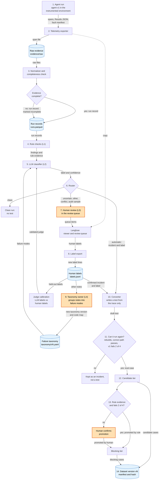

1. **Run.** The agent runs one Retail task in our instrumented environment, which can inject faults and records each DB change.
2. **Export.** The exporter writes the trace to a local file and sends a copy to Langfuse. τ²-Bench's results file and the fault manifest go next to it.
3. **Normalize and check.** The normalizer joins the three files into one run record. The completeness check marks a run as incomplete when spans or tool calls are missing.
4. **Rule checks.** Fixed rules check each run. Each rule that fires writes a finding with the span that proves it.
5. **LLM classifier.** An LLM gives one label for the first failure, with a confidence value.
6. **Route.** The router sends each run to one lane: clean, automatic test, or human review. A random audit sample also goes to human review.
7. **Human review.** A reviewer labels the first failure of each queued run in Langfuse, and marks simulator faults and task defects.
8. **Export labels.** A script copies new labels into a file in git. It only adds lines.
9. **Grow the taxonomy.** The taxonomy owner groups free-text notes into named failure modes. Each new version maps old codes to new codes.
10. **Convert.** The converter turns each confirmed incident into a draft test, from the trace only. A scorer compares the draft with the τ²-Bench task.
11. **Validate.** The validator checks that the test can run again. A test that fails stays an incident.
12. **Candidate.** A valid test enters the candidate tier. Candidate tests are reported but never fail a release.
13. **Promote.** A test becomes blocking when a rule found the failure and v1 fails in 2 of 4 trials. Otherwise, a human confirms the promotion.
14. **Publish.** The dataset step publishes a new numbered version with a hash, and copies it to a Langfuse dataset.

### 4.2 What we record for each run

**In short:** Each run leaves three files: the trace, τ²-Bench's own results file, and the fault manifest. Together they let us check each other.

**Our own agent and environment.** We write our own agent as a subclass of the τ²-Bench agent class. We also wrap the τ²-Bench environment in a new domain, `retail_ttg`. All tool calls go through one function in that wrapper. That is where we emit one span per tool call, inject faults, and record DB changes.

**The trace.** The trace follows the OpenTelemetry (OTel) conventions for generative AI, at one pinned version. Project fields use the `ttg.` prefix. The trace keeps the full text of messages and tool calls. The root span of each run states the number of spans that it expects. The completeness check uses this number. The exact fields are in [Appendix C](#appendix-c-data-contracts).

**State evidence.** Text alone cannot prove what the agent did to the DB. So for each tool call that writes, the environment records a hash of the DB before and after the call. It also records a diff of the changed records. The run also records the hash of the starting DB. This is the identity of the starting state, and a test cannot be rebuilt without it.

**Fault injection.** Natural agent errors alone are rare and random. The fault injector adds failures with a known cause. A fault profile says which faults to apply to each tool:

- an error before the write commits,
- a timeout after the write commits,
- added latency,
- a partial or malformed result,
- a stale read.

The profile `none` is the control and injects nothing. The injector writes each fault to the fault manifest. Later, we will also inject faults into the telemetry itself, such as dropped, duplicate, or reordered spans. These test the completeness check.

**An independent record.** τ²-Bench writes its own results file for each batch of runs. It does not depend on our telemetry. If spans go missing, this file shows the difference.

### 4.3 Who decides that a run failed: four reviewer layers

**In short:** Cheap, exact rules check every run. An LLM labels what the rules cannot see. Humans handle the uncertain cases and own the list of failure modes.

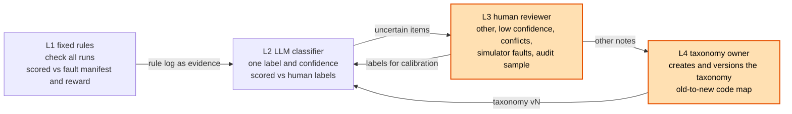

| Layer | Who | What it does | How we check its accuracy |
|---|---|---|---|
| L1 | Fixed rules in code | Finds schema errors, unknown IDs, writes without user confirmation, duplicate writes, a second modify, bad DB diffs, and τ²-Bench reward = 0. A rule that fires wins over the LLM label. | Against the fault manifest and the τ²-Bench reward |
| L2 | LLM classifier | Gives one label for the first failure. It uses the taxonomy, a few examples, the rule evidence, and an `other` option. It gives a confidence value. | Against a frozen set of human labels, per failure mode |
| L3 | Human reviewer | Labels `other` items, low-confidence items, conflicts, suspected simulator faults, and the audit sample. | Two reviewers label the same sample, and we measure agreement |
| L4 | Human taxonomy owner | Builds the first taxonomy from about 100 failing traces. Approves each new version with a code map. | No new failure mode appears in the last 20 traces |

Rules are exact, but they miss policy violations that still reach the correct DB, such as a skipped confirmation. The LLM covers these. LLMs find the exact failing step poorly, so the LLM gives the label and the rules give the evidence.

The taxonomy is the versioned list of failure modes. The owner builds it in two passes. First, they write free-text notes on the first failure in each trace ("open coding"). Then they group the notes into named modes ("axial coding"). Only this human creates, merges, splits, or renames a mode.

An LLM judge is **validated** only after it reaches a set true positive rate (TPR) and true negative rate (TNR) on human labels that it never saw. TPR is the share of real failures that it catches. TNR is the share of good runs that it correctly passes. Until a judge is validated, its decisions go to humans.

### 4.4 How the router picks a lane

**In short:** The router lets a run skip human review only when the evidence is strong and the failure reproduces. Everything else goes to a human.

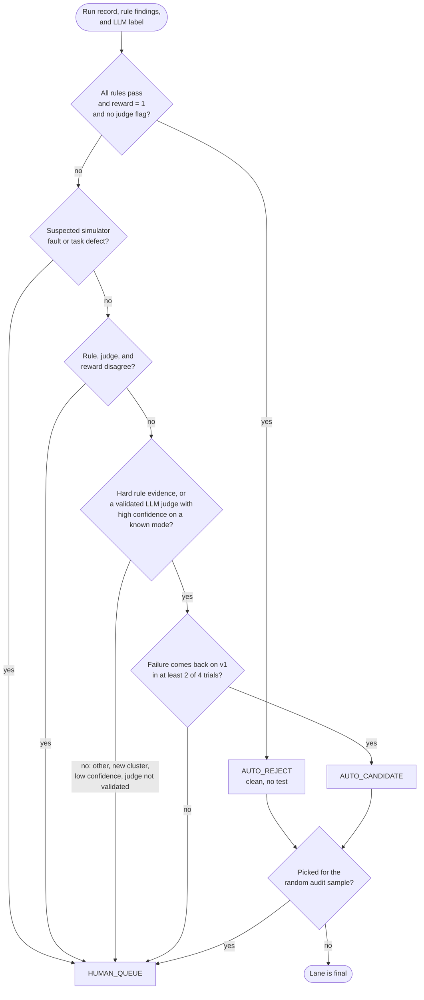

At the start, no taxonomy and no validated judge exist. So all of the first failing runs go to the human queue. The automatic share grows as judges pass validation.

The two automatic lanes do not have the same threshold. Accepting a run as clean uses a stricter threshold than rejecting it, because a false pass hides a failure. Human labels from the audit sample flow back into judge calibration and router thresholds. We report the automatic share and the audit error rate for each lane.

### 4.5 How an incident becomes a test

**In short:** The converter writes the test from the trace alone, as it would have to in production. A test counts only if it rebuilds, accepts a correct solution, and fails on v1.

**Two kinds of test.**

- **Re-simulate** (`resimulate`, the default). The test keeps the scenario, the starting DB identity, and the fault profile. The runner starts a new conversation with the simulated customer. This adapts when the agent acts differently. It adds simulator noise, so it needs several trials.
- **Fixed prefix** (`prefix`). The test loads the conversation up to the step before the failure, and the agent continues live. This aims at the exact failure point and costs fewer turns. It tests recovery from a bad state, not avoidance of it.

Pipeline B reports results for each kind separately.

**Fixture-blind conversion.** A production trace has no answer key. To be honest about this, the converter writes the scenario, expected result, and checks from the trace only. A scorer then compares its output with the τ²-Bench task. This tells us how many traces become valid tests. If the blind version fails the score, the test can still enter the dataset in a form built from the τ²-Bench task. It then carries the label `fixture_source=privileged`.

**Replayable.** A draft test is replayable when all three conditions are true:

1. The runner can rebuild the setup from the test alone.
2. The correct solution (the "gold path") passes all checks of the test. This proves that the checks accept a correct answer.
3. The failure comes back on v1 in at least 2 of 4 trials.

A draft that fails stays an incident and does not enter the dataset. A run with no recorded starting DB stays an incident too. If every agent fails a test in every trial, we flag the test as probably broken.

**Runs that never become tests.** Sometimes the simulated customer behaves wrongly, or the τ²-Bench task itself has a defect. Reviewers label these runs. They stay incidents, but they never become tests of the agent.

### 4.6 Tiers, promotion, and dataset versions

**In short:** New tests start as non-blocking candidates. Only tests with strong evidence become blocking. Each change makes a new frozen dataset version.

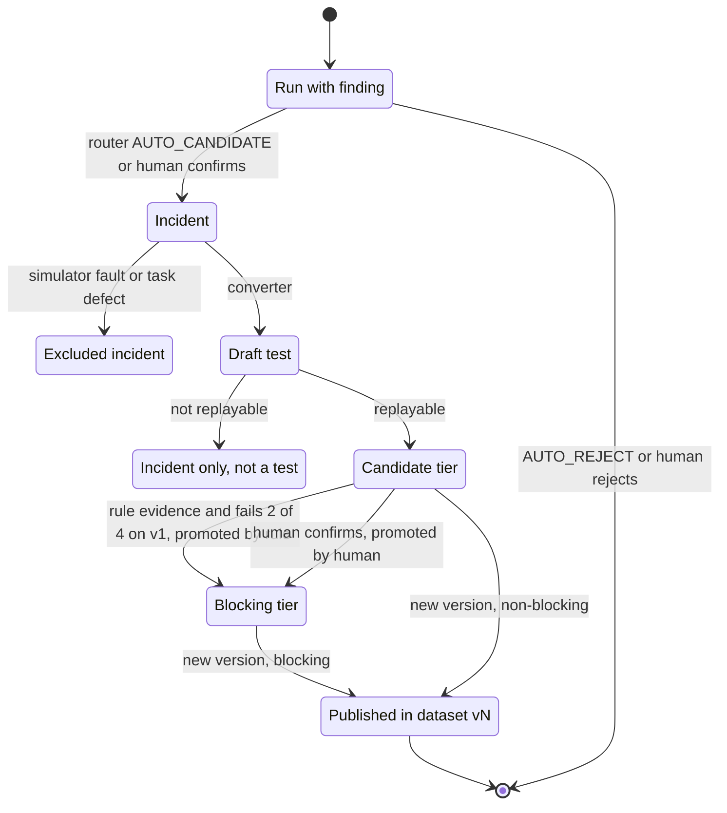

The dataset has two tiers. **Candidate** tests appear in the gate report but never cause FAIL. **Blocking** tests can cause FAIL.

The promotion rule is strict. A test becomes blocking with no human only when a fixed rule found the failure *and* v1 fails in at least 2 of 4 trials. A failure that only the LLM found always needs a human to confirm. No published source uses this automatic rule, so it is our own research choice. We measure it with an audit sample of tests that the rule promoted.

A published dataset version never changes. A change to a test, a tier, or a check makes a new version with a new hash. Each version also gets a copy in Langfuse, where each item links back to its source trace.

## 5. How the gate decides (Pipeline B)

**In short:** Pipeline B runs v1 and v2 several times on the same tests with the same seeds. It compares the results with error bars and applies a fixed list of rules to say PASS, FAIL, or REVIEW.

### 5.1 The flow at a glance

The shapes and colors have the same meaning as in section 4.1.

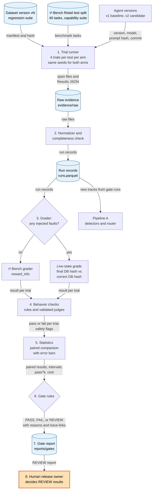

1. **Run trials.** The trial runner runs each test in two suites with both agent versions. The regression suite is the dataset version from Pipeline A. The capability suite is the 40-task τ²-Bench Retail test split. Each test gets 4 trials per version, and both versions use the same seeds.
2. **Normalize.** The normalizer and the completeness check make run records from the raw files, as in Pipeline A.
3. **Grade.** The grader scores each trial. Runs with no injected faults use the τ²-Bench grader. Runs with faults compare the final DB hash with the correct DB hash.
4. **Check behavior.** Rules and validated judges check each trial. They flag hard-safety failures, for example a write without user confirmation.
5. **Compare.** The statistics step compares v1 and v2 test by test, with error bars.
6. **Apply the gate rules.** An ordered list of rules turns the statistics into PASS, FAIL, or REVIEW. The first rule that fires sets the result.
7. **Write the report.** The report goes into git. It names the dataset version, its hash, and the evidence archive. Each reason links to source traces.
8. **Decide REVIEW results.** A human release owner reads each REVIEW result and decides. The gate runs are traces too, so Pipeline A analyzes them and can make new tests.

### 5.2 How the trials run

**In short:** Single runs are too noisy to trust, so each test runs 4 times per version, with paired seeds.

On τ²-Bench Retail, the chance to pass a task once and the chance to pass it 4 times in a row differ by 20 to 30 points. One run per test would give more noise than most real effects. So each test runs 4 times for each version. Trial 1 of v1 and trial 1 of v2 use the same seed, so the two versions see the same conditions.

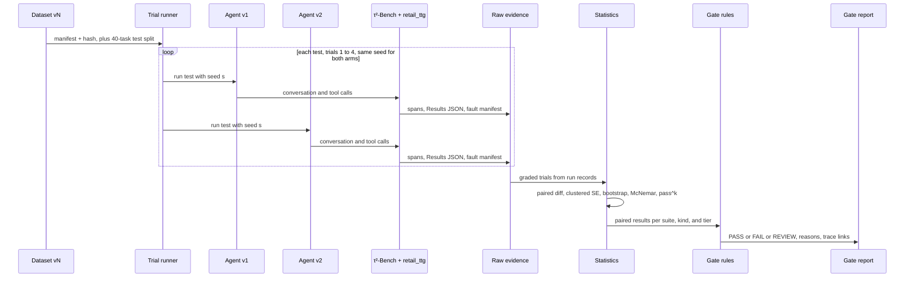

A test can be rebuilt from the dataset alone, for both test kinds. A power analysis from a pilot run checks that 4 trials are enough.

### 5.3 How each trial is graded

**In short:** Normal runs use the τ²-Bench grader. Runs with injected faults use our own grade, because the τ²-Bench grader cannot handle them.

The τ²-Bench grader replays the recorded tool calls and compares the result. When we inject a fault, a recorded result differs from the real tool result, and the strict replay raises an error. So for faulted runs, we compare the final DB hash with the hash of the correct DB. We get the correct DB by applying the task's gold actions. We call this the **live-state grade**. Each result records which grade it used. The exact rule is in [Appendix C.8](#c8-grade-rule).

The outcome always comes from the DB, never from what the agent says. An agent that says "your refund is done" when the DB disagrees still fails.

### 5.4 How v1 and v2 are compared

**In short:** We compare each test against itself, across the two versions, and we put honest error bars on the difference.

For each test, we take the mean score over its 4 trials, per version. Then we take the difference, v2 minus v1, test by test. This "paired" difference removes the effect of easy and hard tests.

Several tests can come from one τ²-Bench task, so their results are not independent. We therefore compute the standard error (SE) clustered by τ²-Bench task. We get the confidence interval (CI) from a bootstrap that resamples whole tasks. McNemar's test on per-test pass or fail is a cross-check. We also report pass^k for each version: the chance that all k trials of a task pass. It measures consistency.

We report all results per suite, per test kind, and per tier. Agent-eval sources do not prescribe the task bootstrap or McNemar's test, so the report states them as our own choice. The formulas are in [Appendix D](#appendix-d-measurement-details).

### 5.5 The gate rules

**In short:** The gate checks rules in a fixed order. The first rule that fires sets the result, and incomplete evidence can never give PASS.

```text
gate(v1, v2, dataset_version)
  if evidence incomplete (missing spans, failed runs > limit)        -> REVIEW
  if any hard-safety check fails on v2 in any trial                 -> FAIL
  if paired diff upper bound < -margin on either suite              -> FAIL
  if a graduated regression case falls below its pass threshold    -> FAIL
  if pass^k drop on regression suite > k_margin                     -> FAIL
  if cost or latency ratio > limit                                  -> REVIEW
  if a decisive metric depends on an LLM judge                      -> REVIEW
  if confidence interval crosses -margin (inconclusive)             -> REVIEW
  else                                                              -> PASS
```

In plain words:

- **Missing evidence** gives REVIEW. A gate cannot pass what it did not see.
- **A safety failure** in any v2 trial gives FAIL.
- **A clear drop** on either suite gives FAIL. "Clear" means that even the top of the error bar is below the allowed margin.
- **A blocking test** (a "graduated" regression case) that drops below its pass threshold gives FAIL.
- **A drop in consistency** (pass^k) beyond its margin gives FAIL.
- **Too much cost or latency** gives REVIEW. Cost counts as much as quality.
- **A decision that depends on an LLM judge** gives REVIEW, because the judge could be wrong.
- **An unclear result**, where the error bar crosses the margin, gives REVIEW.

Candidate tests never cause FAIL. The margins (`margin`, `k_margin`) and limits are configuration. We set them from two agent pairs with known answers: a pair with no real difference and a pair with a planted defect. No numeric industry standard for gate margins exists.

The report also lists the release stages that the gate does not cover: shadow mode, canary rollout, and online A/B tests. These are the next steps in a real production release.

### 5.6 How the two pipelines feed each other

**In short:** The two pipelines form a loop. Failures make tests, tests check fixes, and gate runs can show new failures.

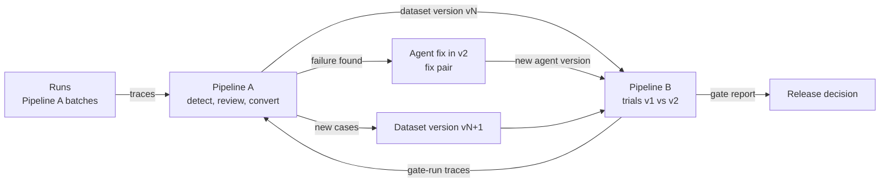

A failure that a gate run shows can become a new test. A fix for a Pipeline A failure becomes the "fix pair" for Pipeline B, as in the example in section 3.

## 6. How we know each step works

**In short:** Every automatic step has a known right answer to compare against. We report how often each step agrees with it.

### 6.1 Our sources of truth

| Truth | Where it comes from | What it lets us score |
|---|---|---|
| Outcome | The τ²-Bench grader, or the live-state grade for faulted runs | Outcome detectors; the gate's outcome metric |
| Cause | The fault manifest from the fault injector | Fault detectors; root-cause labels; the converter's rebuilt setup |
| Behavior | Human labels in `labels.jsonl` | The LLM classifier and judges; policy detectors; router audit |
| Task | The τ²-Bench task (scenario and gold actions) | The converter's blind output |
| Gate answer | Agent pairs with known answers | Gate accuracy; margin calibration |
| Drift answer | Run windows with one known change, and windows with no change | Drift detection power and false alarm rate |

### 6.2 How we score each layer

Each fixed rule is scored against the fault manifest or the τ²-Bench outcome. The LLM classifier is scored against human labels it never saw. The router is scored on its audit sample. The converter is scored against the τ²-Bench task. The gate is scored on agent pairs with known answers. The full table is in [Appendix D](#appendix-d-measurement-details).

We report TPR and TNR separately, because raw agreement misleads when failures are rare. We correct judge-based failure rates with the Rogan-Gladen estimator, and we measure judges only on a frozen test split of human labels. The 0.90 TPR and 0.90 TNR in Langfuse's calibration guide is an example threshold; the build plan sets ours.

### 6.3 Agent pairs with known answers

**In short:** To test the gate, we build v1 and v2 pairs where we already know the correct answer.

| Pair | What v2 changes | Correct gate answer |
|---|---|---|
| Fix pair | Fixes a failure that Pipeline A found, for example: check the order state before a retried write | PASS |
| Planted regression | Skips the user confirmation before a write | FAIL |
| Null pair (A/A) | A cosmetic change, or only a new seed | No difference |
| Model swap | Only the model, for example GPT-4.1 versus GPT-4.1-mini | Unknown |

The planted regression is useful because the τ²-Bench outcome grade may not catch it. The DB can still end up correct. Only the behavior checks can catch it. The null pair measures how often the gate raises a false alarm. The model swap shows how the gate acts when nobody knows the answer.

We define each agent version by a version string, a model, a prompt hash, and a code commit. These values go into every trace.

### 6.4 Drift experiments

**In short:** We test drift detection on runs where we caused the change ourselves, so we know when an alarm is right.

We make two windows of runs. The second window has one known change: the task mix, the fault rate, the customer persona, or a silent model change. A/A windows (same setup, new seeds) show how much the signals move from noise alone.

We watch these signals:

- the mix of tools used and the reasons that runs end (χ² test or Jensen-Shannon divergence),
- trajectory length and latency (Kolmogorov-Smirnov test),
- the failure rate (two-proportion test).

We watch many signals at once, so we correct for multiple testing. We build this part only after the first gate works.

## 7. Where the data lives and how we share it

**In short:** Each kind of data has one true copy. Raw evidence never changes, everything else is either rebuilt from it or versioned in git, and Langfuse holds only copies.

### 7.1 Six storage rules

| Rule | What it says |
|---|---|
| Rule 1 | Each kind of data has one true copy (the system of record). All other places hold copies. When copies disagree, the true copy wins. |
| Rule 2 | Raw evidence is written once and never changed or deleted. It has no time limit. |
| Rule 3 | Run records come only from raw evidence. We can delete them and build them again at any time. |
| Rule 4 | Curated data (eval cases, datasets, labels, taxonomy) changes only by a new numbered version. Each version has a hash. Gate reports name the version and the hash. |
| Rule 5 | Each item keeps the IDs of its sources: test → incident → trace → raw files. |
| Rule 6 | The pipeline logic reads only the true copy. A trace platform is a viewer and a review tool. |

### 7.2 The stores

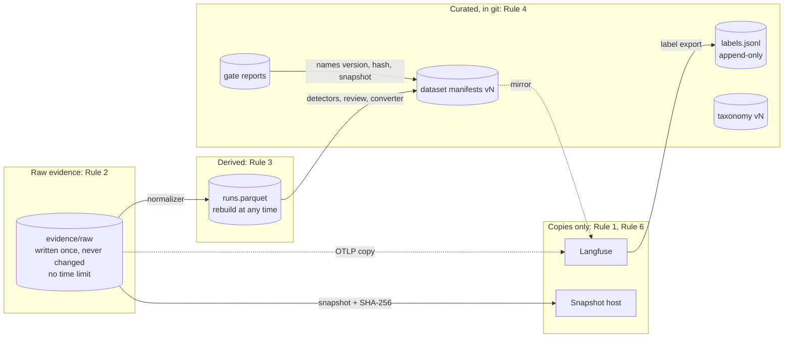

There are four groups:

- **Raw evidence** lives in local files under `evidence/raw`. These are the span files, the τ²-Bench results files, and the fault manifests. They are too large for git. One run with full text is about 50–200 KB, so 10,000 runs are about 0.5–2 GB (an estimate).
- **Run records** live in one Parquet file, `runs.parquet`, with one row per run and its steps nested inside. We query it with SQL through DuckDB. We can delete and rebuild it at any time.
- **Curated data** lives in git: dataset versions, human labels, taxonomy versions, gate reports, and the snapshot lock file.
- **Copies** live in Langfuse and on the archive host. Nothing reads from them for decisions.

Human labels need care. Reviewers enter them in Langfuse, but Langfuse is not the true copy. A script exports them to `labels.jsonl` in git and only adds lines. A correction is a new line with a later time, and the newest line wins. This keeps our ground truth safe if the Langfuse server goes away.

[Appendix C.10](#c10-where-each-kind-of-data-lives) lists the true copy, the copies, and the change policy of each kind of data.

### 7.3 How someone else can reproduce our results

**In short:** We share in three layers: a small sample in git, one archive per experiment, and scripts that run everything again.

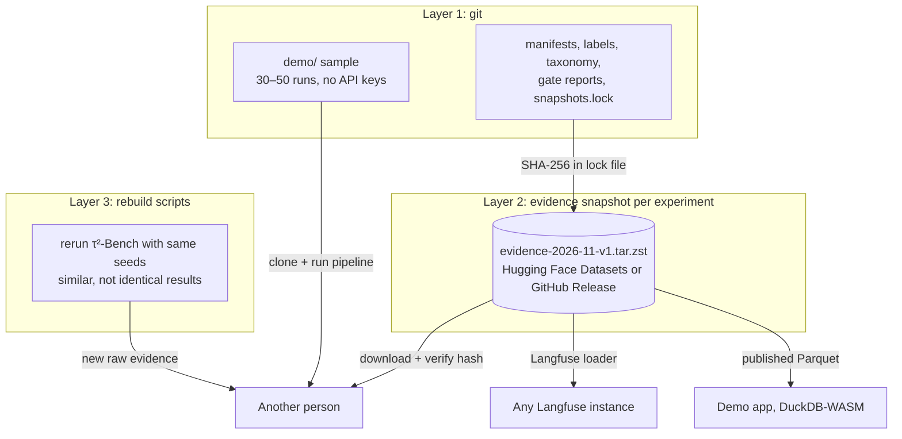

1. **The demo sample** is about 30–50 runs with their raw files, a few MB, in git. Anyone can clone the repo and run the pipeline on it with no API keys.
2. **The evidence snapshot** packs the raw evidence of one experiment into one archive, for example `evidence-2026-11-v1.tar.zst`. We publish it on Hugging Face Datasets or as a GitHub Release. Its SHA-256 checksum goes into `snapshots.lock` in git, and the loader checks it.
3. **The rebuild scripts** run τ²-Bench again with the same seeds and agent versions. LLMs are not deterministic, so the results are similar, not identical. The snapshot holds the exact numbers.

Two tools sit on top. The **Langfuse loader** replays raw span files into any Langfuse instance, so others can browse our traces. The **demo app** reads published Parquet and gate reports in the browser, for example as a static site with DuckDB-WASM. The build plan decides where to host it.

## 8. What carries over to production

**In short:** The pipeline core does not know about τ²-Bench. Four adapters connect it to τ²-Bench today and could connect it to a production system later.

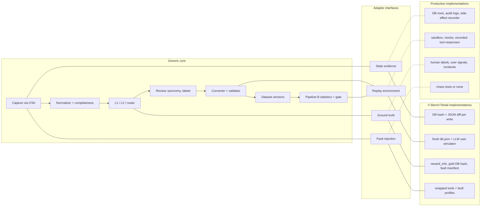

Each adapter answers one question. State evidence: what did the agent change? Replay environment: where can a test run again? Ground truth: how do we know the right answer? Fault injection: how do we cause known failures? The diagram shows the τ²-Bench answer and a production answer for each. The largest gap is ground truth: production has no correct DB, so human labels, user signals, and incident reports must replace it.

Only the adapters import τ²-Bench. So the same core can run on another τ²-Bench domain or on production traces.
## 9. Technology stack and services

**In short:** Everything runs in Python on one developer machine, with Langfuse in Docker Compose. Only the LLM providers, GitHub, and the archive host are external.

"Build plan" means that the build plan will fix the choice or the version.

| Technology | Role | Version or pin | Why |
|---|---|---|---|
| τ²-Bench | Tasks, policy, tools, resettable DB, user simulator, grader | Commit `5ade54e282a4555e4d6c52d6b9b861ea8872afa6` | Known correct answers for every task |
| Python | Agent, environment wrapper, all pipeline jobs | Build plan (must match τ²-Bench) | τ²-Bench is a Python package |
| LiteLLM | Client for all model calls; reports token cost | As pinned by τ²-Bench | τ²-Bench sends every LLM call through it |
| LLM providers | Three roles: agent, user simulator, L2 judge | Build plan (examples: GPT-4.1, GPT-4.1-mini) | Agent pairs need at least two models |
| OpenTelemetry Python SDK | Creates the spans of each run | Build plan | Industry standard; Langfuse accepts it |
| OTLP/HTTP exporter | Sends a copy of spans to Langfuse | Build plan | Langfuse accepts OTLP over HTTP only |
| File exporter | Writes the true copy, `spans.otlp.json` | Build plan | Local files are the true copy |
| OTel GenAI conventions | Span names and fields; project fields under `ttg.*` | One pinned version, written as `ttg.semconv.version`; exact version: build plan | Unstable standard, so we pin it |
| Docker Compose | Runs the Langfuse stack | Build plan | Supported way to self-host Langfuse |
| Langfuse (self-hosted) | Trace viewer, review queue, dataset copy | Build plan | Open source, OTLP input, trace-linked datasets |
| Postgres, ClickHouse, Redis, S3-compatible storage (for example MinIO) | Langfuse's own stores | As set by the Langfuse Compose file | Required by Langfuse; we never read them |
| Parquet | File format of the run records | — | Compact, columnar, readable in the browser |
| DuckDB | SQL over Parquet, in process | Build plan | No server to operate |
| git and GitHub | Manifests, labels, taxonomy, gate reports, lock file | — | Each version is a reviewable commit |
| `.tar.zst` archives on Hugging Face Datasets or GitHub Releases | One evidence snapshot per experiment | Host: build plan | Raw evidence is too large for git |
| SHA-256 lock file | Name, URL, and checksum of each snapshot | — | Proves an archive is unchanged |
| DuckDB-WASM static site | Read-only demo app | Hosting: build plan | Runs in the browser, no backend |
| Statistics methods | Paired differences, SE clustered by task, cluster bootstrap, McNemar's test, pass^k, Rogan-Gladen correction; drift tests with multiple-testing correction | Library: build plan | Published guidance for noisy, clustered eval data |

## 10. Deployment and runtime view

**In short:** One machine runs the agent, the environment, the exporters, the pipeline jobs, and the Langfuse stack. It calls out to LLM providers, and it publishes to GitHub and the archive host.

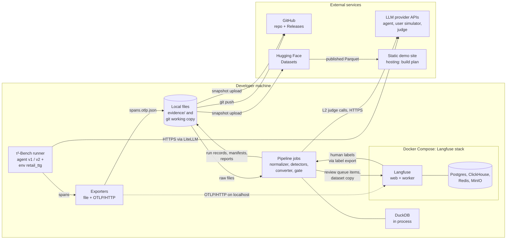

What runs where:

- **In one Python process per batch:** the τ²-Bench runner, our agent, the wrapped environment with its fault injector and state recorder, and both exporters. τ²-Bench runs 3 tasks in parallel threads, so the span context is set per run, not per process.
- **In Docker Compose:** the Langfuse web server and worker, with Postgres, ClickHouse, Redis, and S3-compatible storage. The exporter sends spans to Langfuse on localhost.
- **As command-line jobs:** the normalizer, detectors, router, label export, converter, validator, dataset publisher, trial runner, statistics, gate, drift experiments, snapshot publisher, and Langfuse loader. They read and write local files, and DuckDB runs inside them.
- **Outside the machine:** LLM provider APIs (called over HTTPS through LiteLLM), GitHub, and Hugging Face Datasets. The demo site is static, so it needs no server of ours.

If Langfuse is down, runs still complete. The local file is the true copy, and the loader can fill Langfuse later.

## 11. Key design decisions

**In short:** Each decision states the choice, the main reason, and the alternatives that we rejected. Sections 4 to 8 show how each choice works in the system.

| # | Decision | Choice | Main reason | Rejected alternatives |
|---|---|---|---|---|
| 1 | Trace capture | Our own agent (a `HalfDuplexAgent` subclass) and a wrapped environment `retail_ttg`. τ²-Bench's results file stays as an independent record. Published τ²-Bench results come later, tagged `source=imported`. | All tool calls pass through one function, so the wrapper sees them all. Live export makes export failures visible. | Saved results files only (no live spans). The LiteLLM callback (model spans only; tools run outside LiteLLM). Published trajectories now (no spans, state evidence, or fault manifest). |
| 2 | Trace platform | Langfuse self-hosted, as viewer and review tool only. | OTLP input, dataset items linked to traces, annotation queues, no retention limit. We accept four extra local services. | Langfuse Cloud free tier (50,000 units per month, 30-day access). Braintrust free tier (14-day retention, snapshots only on paid tiers, closed source). No platform (no review interface). |
| 3 | Trace contract | OTel GenAI conventions at one pinned version, `ttg.*` project fields, content capture on, expected span count on the root span. | The conventions are unstable, so a pin keeps traces comparable. | OpenInference (not the official standard). Our own schema only (loses viewer support). |
| 4 | State evidence | DB hash before and after each write, a diff of changed records, and the `db.json` hash as starting-state identity. | Per-step proof of side effects that also works with injected faults. All tasks start from the same DB. | Rebuild state after the run (fails for faulted runs). Full DB snapshots (store the DB twice per run, no per-step proof). |
| 5 | Storage and versioning | Local files are the true copy. Run records in one rebuildable Parquet file. Dataset versions as hashed JSONL manifests in git. Six storage rules (section 7.1). | Logic stays independent of any vendor. Each dataset version is a reviewable commit. No server at this volume. | Langfuse as true copy (no schema versioning, no public endpoint to create experiment runs, a collector failure loses the only copy). One Postgres database (one more service, no benefit). |
| 6 | Label export | Copy human labels from Langfuse to `labels.jsonl` in git, append-only. | Ground truth must not live only in a vendor database. | Labels only in Langfuse. |
| 7 | Sharing | Demo sample in git, one hashed archive per experiment, rebuild scripts (section 7.3). | Raw evidence is too large for git, and LLMs are not deterministic. | All raw evidence in git (gigabytes). Git Large File Storage (extra service and quotas, no gain over a hashed archive). |
| 8 | Failure creation | Natural failures plus a tool fault injector with profiles and a `none` control. Telemetry faults come after the normalizer. Faulted runs use the live-state grade. | Natural failures have no known cause and no infrastructure faults. Injected faults are realistic and have a known cause. | Natural failures only. Telemetry faults in the first build (nothing to measure them yet). LLM-simulated tool faults (no reproducible cause). |
| 9 | Failure detection | Four reviewer layers, a router, and a promotion rule: automatic blocking only with rule evidence and reproduction (sections 4.3 to 4.6). | No source lets an LLM replace human review. Rules miss policy violations with a correct end state. LLMs find the failing step poorly. The promotion rule is our own research choice, measured by an audit. | Rules only. One LLM judge over the whole trace. Human review only (does not scale). A human for every promotion (industry default, less automation). Automatic promotion of all candidates (highest risk). |
| 10 | Test design | Re-simulation by default, fixed prefix as a second kind. Fixture-blind conversion with a privileged fallback. The three-part "replayable" check (section 4.5). | Re-simulation adapts when the agent acts differently. Fixture-blind conversion shows the real production difficulty. | Recorded tool responses (break when the agent sends a different request). Prefix only (a v1 prefix may not fit v2). Tests built from the τ²-Bench task only (teaches nothing about production). |
| 11 | Drift | Two windows with one known change, A/A windows for the noise floor, multiple-testing correction. Built after the first gate. | Known changes give known answers. | No drift work now. Continuous daily monitoring (daily cost; natural drift may not happen). |
| 12 | Gate testing | Fix pair, planted regression, null pair, and model swap (section 6.3). | Known answers measure gate accuracy and calibrate margins. | A model swap only (no known answer). |
| 13 | Statistics and gate rules | 4 trials with matched seeds, paired differences, SE clustered by task, cluster bootstrap, McNemar's test, pass^k, two suites, and an ordered rule list (sections 5.2 to 5.5). | Follows published error-bar guidance. Several tests can share one task, so clustering is required. No numeric gate standard exists. | One run per test (noise exceeds most real effects). Adaptive trial counts (repeated looks raise false alarms). |
| 14 | Generic core | The core never imports τ²-Bench. Four adapters connect it (section 8). | The same core can run on another domain or on production traces. | — |

## 12. Non-functional concerns

**In short:** The main costs are LLM calls. The volume is small enough for local files. Reproducibility comes from frozen data and hashed archives, and the pipeline guards against its own failures.

### 12.1 Cost

LLM API calls are the main cost. Each run calls the agent model on each turn and the user simulator model on each turn. One gate costs:

```text
runs per gate = (regression tests + 40 capability tasks) × 4 trials × 2 versions
```

For example, with 60 regression tests, one gate is (60 + 40) × 4 × 2 = 800 runs **(illustration)**. The L2 judge and the behavior judges add calls per trial. Pipeline A adds 4 trials on v1 for each run that the router checks for reproduction, and 4 more in the validator. LiteLLM reports token cost per call, and each run record stores tokens, cost, and latency. The gate report shows the cost ratio of v2 to v1. Model prices and the cost budget are decided in the build plan.

The demo sample in git runs with no API keys and costs nothing.

### 12.2 Scale

The volume is hundreds to low thousands of runs. One run with full text is about 50–200 KB of spans, so 10,000 runs are about 0.5–2 GB **(estimate)**. This is why raw evidence stays out of git and goes into archives. Local files, one Parquet file, and in-process DuckDB are enough. The design has no message queues, distributed processing, or managed databases.

### 12.3 Reproducibility

- Raw evidence never changes, and run records rebuild from it.
- Each dataset version is frozen and hashed. Each gate report names the dataset version, its hash, the evidence archive, and the agent versions (version string, model, prompt hash, code commit).
- Each archive has a SHA-256 checksum in `snapshots.lock`, and the loader checks it.
- Each trace records the τ²-Bench commit and the pinned convention version.
- Rebuild scripts give similar, not identical, results, because LLMs are not deterministic and providers may not honor seeds.

### 12.4 Data privacy

τ²-Bench data is synthetic and MIT-licensed. So we capture full message text in traces, and we can publish evidence archives. If the system ever uses real production traces, we must check this decision again and add redaction before any export. Langfuse has masking hooks that can help. Every run records whether it is live or imported, so analyses never mix the two.

### 12.5 Security of keys

The system holds three kinds of secrets: LLM provider API keys, Langfuse project keys, and publishing tokens for GitHub and Hugging Face. The build plan must follow these rules:

- Keep secrets in environment variables or a local file that git ignores. Never write them into traces, run records, reports, or archives.
- Bind the Langfuse stack to localhost.
- Use publishing tokens only in the snapshot publisher.
- The demo sample and the demo app need no keys.

### 12.6 Failures of the pipeline itself

The pipeline can fail too: spans can be lost, a judge can drift, a dataset can change, or noise can look like a regression. Three ideas protect against most of these failures. Count what you expect. Never change raw evidence. Send unclear cases to REVIEW or to a human. [Appendix E](#appendix-e-pipeline-failure-modes-full-list) lists all 23 failure modes, each with its effect and its protection.

## 13. Risks and open items

**In short:** Some numbers and choices wait for the build plan or for pilot data. Some design bets may not work, and we plan to measure them.

**To decide in the build plan:**

- Exact model names for the agent versions, the user simulator, and the judges.
- The Python version, library versions, and the pinned OTel GenAI convention version.
- The TPR and TNR threshold for a validated judge (0.90 and 0.90 is a published example from Langfuse's calibration guide).
- Gate margins (`margin`, `k_margin`) and cost and latency limits. These are calibrated on the null pair and the planted regression.
- Exact column names of the run record, and module names.
- The snapshot host (Hugging Face Datasets or GitHub Releases) and the demo app host.
- The cost budget per gate.
- Unit tests and fixtures. The known-answer checks in section 6 are the main verification method, and the demo sample is the first fixture.

**Risks to measure:**

- **Seeds may not fix conditions.** We did not verify that providers honor seeds, so matched seeds may reduce noise less than expected.
- **Four trials may be too few.** A pilot run and a power analysis check this. With an assumed spread of 0.3 and 114 tests, the smallest detectable effect is about 8 points **(inference)**.
- **The fixture-blind converter may make few valid tests.** The scorer measures this, and the privileged fallback keeps the dataset usable.
- **Automatic promotion may admit bad tests.** No source uses this rule. An audit sample of promoted tests measures the risk.
- **Simulator noise.** About 12% of Retail conversations have critical simulator errors, which add noise to reproduction and to the gate.
- **Unstable conventions.** The pin and the `ttg.semconv.version` field limit the damage when the OTel GenAI conventions change.
- **The judge correction becomes unstable** when TPR + TNR − 1 is close to 0.
- **Local resources.** The Langfuse stack runs four services on the developer machine.

**Planned later:**

- Telemetry fault injection, after the normalizer exists.
- Drift experiments, after the first gate works.
- Import of published τ²-Bench results, tagged `source=imported`. Public access to the published trajectory bucket is not yet tested.
- Adaptive trial counts, with a correction for repeated looks.
- Shadow mode, canary rollout, and online A/B tests are the next release stages in real production. Each gate report lists them as not covered.

---

## Appendix A. Full component diagram

This diagram shows every component and store. Cylinders are stores. Dotted lines are copies to Langfuse.

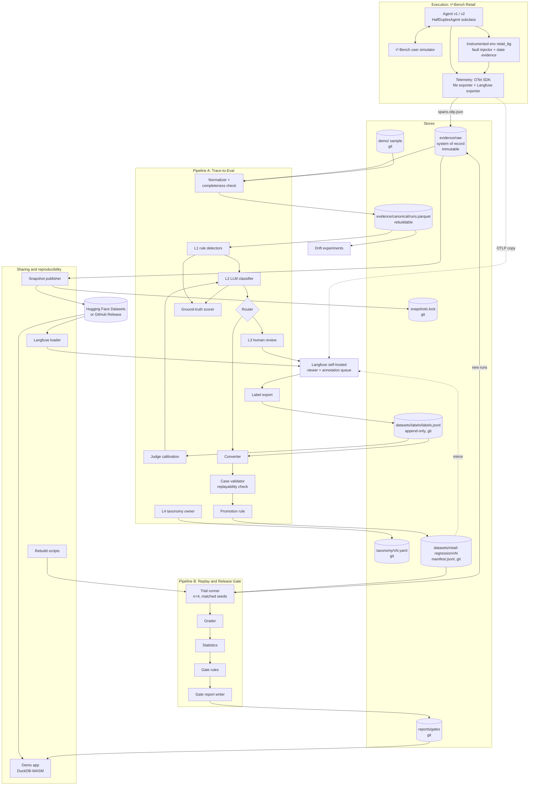

## Appendix B. Component catalogue

Each card names one component: what it does, what it reads, and what it writes and where. [Section 11](#11-key-design-decisions) explains why each component exists.

### B.1 Execution and capture

**Agent v1 / v2**
Handles the customer conversation. It is a subclass of `HalfDuplexAgent` and emits `invoke_agent` and `chat` spans. Each version has a version string, model, prompt hash, and code commit.
*Reads:* task, user messages, tool results, seed. *Writes:* assistant messages, tool calls, spans → `evidence/raw`.

**Instrumented environment `retail_ttg`**
Wraps `Environment.get_response()` and emits one `execute_tool` span per tool call. It is registered with `register_domain()` and `register_tasks()`.
*Reads:* tool calls. *Writes:* tool results, tool spans → `evidence/raw`.

**Fault injector**
Applies the fault profile per tool: error before commit, timeout after commit, added latency, partial or malformed result, stale read. Profile `none` is the control.
*Reads:* fault profile, tool call. *Writes:* faulted tool result, `ttg.fault.injected` event, fault manifest → `evidence/raw/<run_id>/fault_manifest.json`.

**State evidence recorder**
Records the DB hash before and after each mutating tool call, and a JSON diff of changed records. Records the `db.json` hash as the identity of the initial state.
*Reads:* mutating tool calls, DB. *Writes:* `ttg.state.hash_before`, `ttg.state.hash_after`, `ttg.state.diff` event → inside spans.

**Telemetry and exporter**
Sets the OTel span context per run, because τ²-Bench runs 3 threads. Writes the full span set to a local file, sends a copy over OTLP to Langfuse, and writes `ttg.span_count` on the root span.
*Reads:* spans. *Writes:* `spans.otlp.json` → `evidence/raw` (true copy); OTLP stream → Langfuse (copy).

**τ²-Bench runner record**
The Results JSON from τ²-Bench. It is an independent record of each run.
*Reads:* runs. *Writes:* `results.json` per batch → `evidence/raw/<batch_id>/results.json`.

**Langfuse (self-hosted)**
Shows traces, holds the annotation queue for human review, and holds mirrored dataset versions with `sourceTraceId`. Pipeline logic never reads it.
*Reads:* OTLP spans, queue items, dataset mirror. *Writes:* human labels → Langfuse Postgres and ClickHouse (copy only).

### B.2 Pipeline A: ingest and detection

**Normalizer**
Joins spans, Results JSON, and fault manifest into one canonical run record per run, with nested steps. Deduplicates spans by span ID. Orders steps by parent IDs and `ttg.turn_idx`.
*Reads:* raw files. *Writes:* run records → `evidence/canonical/runs.parquet`.

**Completeness check**
Compares received spans with `ttg.span_count`, and tool calls in spans with the Results JSON. Marks `evidence_incomplete`.
*Reads:* raw files, run records. *Writes:* completeness flags, span loss rate → `runs.parquet`.

**Run records store**
One row per run with nested steps. DuckDB queries it with SQL. It can be deleted and rebuilt at any time.
*Reads:* normalizer output. *Writes:* SQL query results. *Lives in:* `runs.parquet`.

**L1 rule detectors**
Deterministic checks: schema error, unknown ID, write without confirmation, duplicate write, second modify, state-diff checks, reward = 0. A rule that fires wins over the L2 label.
*Reads:* run records. *Writes:* findings with rule ID and evidence span → `runs.parquet` (findings table).

**L2 LLM classifier**
Gives one primary label for the first failure. Uses the fixed taxonomy, few-shot examples, L1 evidence, and an `other` option. Gives a confidence value.
*Reads:* run records, L1 findings, taxonomy. *Writes:* label, rationale, confidence → findings table.

**Router**
Sends each run to `AUTO_REJECT`, `AUTO_CANDIDATE`, or `HUMAN_QUEUE`. Adds a random audit sample to `HUMAN_QUEUE`. Uses only validated judges for automatic lanes.
*Reads:* L1 findings, L2 labels, reward, reproduction result. *Writes:* lane per run → findings table; queue items → Langfuse.

**Ground-truth scorer**
Scores L1, L2, router lanes, and the converter against the fault manifest, reward, human labels, and the τ²-Bench task.
*Reads:* findings, ground truth. *Writes:* accuracy tables (TPR, TNR, κ, localization) → analysis reports.

### B.3 Pipeline A: review and curation

**L3 human review**
Labels `other` items, low-confidence items, conflicts, suspected simulator faults, task defects, and the audit sample. Labels only the first failure.
*Reads:* queue items in Langfuse. *Writes:* human labels → Langfuse, then exported.

**L4 taxonomy owner**
Builds the first taxonomy by open coding and axial coding on about 100 failing traces. Approves new versions with an old-to-new code map. Only this human creates, merges, splits, or renames modes.
*Reads:* labels, `other` notes. *Writes:* taxonomy version → `taxonomy/vN.yaml`.

**Label export**
Copies new human labels from Langfuse to git. Only adds lines.
*Reads:* Langfuse labels. *Writes:* label lines → `datasets/labels/labels.jsonl`.

**Judge calibration**
Splits human labels into train 10–20%, dev 40–45%, and test 40–45%. Measures TPR, TNR, and κ per failure mode on the frozen test split. Marks a judge as validated and tunes router thresholds.
*Reads:* `labels.jsonl`, L2 outputs. *Writes:* validated judge list, thresholds, corrected rates → analysis reports, config.

**Converter**
Turns a confirmed incident into an `EvalCase`. Works fixture-blind: writes a user scenario, expected outcome, and checks from the trace only. Falls back to the τ²-Bench task with `fixture_source=privileged`.
*Reads:* incident, label, run record. *Writes:* `EvalCase` draft → working area.

**Case validator (replayability check)**
Rebuilds the case from the case alone, runs the gold path, and runs v1 for 4 trials.
*Reads:* `EvalCase` draft. *Writes:* `validation` fields, pass or fail → `EvalCase`.

**Dataset store, tiers, and promotion**
Holds `candidate` and `blocking` cases. Promotes by rule (L1 evidence and 2 of 4 reproduction) or by a human. Publishes immutable numbered versions with a hash, and mirrors each version to Langfuse.
*Reads:* validated cases. *Writes:* dataset version, manifest hash → `datasets/retail-regression/vN/manifest.jsonl`.

### B.4 Pipeline B and drift

**Trial runner**
Calls `run_single_task(task, trial, seed)` for each case, trial, and arm, with 4 trials and matched seeds. Runs the regression suite and the capability suite. Rebuilds `resimulate` and `prefix` cases.
*Reads:* dataset version, test split, agent versions. *Writes:* runs (traces) → `evidence/raw`.

**Grader**
Uses τ²-Bench `reward_info` for runs with profile `none`, and the live-state grade for faulted runs. Records `grade_source`.
*Reads:* run records, gold DB hash. *Writes:* outcome per trial → `runs.parquet`.

**Statistics**
Per-case mean, paired differences, SE clustered by τ²-Bench task, cluster bootstrap CI, McNemar cross-check, and pass^k per arm. Reports results per case kind and per tier.
*Reads:* graded trials. *Writes:* paired results → gate report.

**Gate rules**
Applies the ordered rule list. Margins come from the null and planted pairs. Candidate cases never cause FAIL.
*Reads:* paired results, completeness flags, safety flags, cost. *Writes:* PASS, FAIL, or REVIEW with reasons → gate report.

**Gate report**
Records the result, each reason, trace links, dataset version and hash, snapshot name, agent versions, and the production stages not covered.
*Reads:* gate rule output. *Writes:* report file → `reports/gates/`.

**Drift experiments**
Compares two windows with one known shift, and A/A windows. Uses χ² or JSD, KS, and a two-proportion test, with multiple-testing correction. Built after the first gate works.
*Reads:* run records of two windows. *Writes:* drift report with power and false alarm rate → analysis reports.

### B.5 Sharing and reproducibility

**Demo sample**
About 30–50 runs with raw files (a few MB). Lets anyone run the pipeline with no API keys.
*Reads:* selected raw runs. *Writes:* fixture → `demo/` in git.

**Snapshot publisher**
Packs the raw evidence of one experiment into one archive, for example `evidence-2026-11-v1.tar.zst`. Publishes it to Hugging Face Datasets or a GitHub Release. Writes the SHA-256 to the lock file.
*Reads:* `evidence/raw`. *Writes:* archive → external host; lock entry → `snapshots.lock` in git.

**Langfuse loader**
Replays raw OTLP files into any Langfuse instance.
*Reads:* snapshot or `evidence/raw`. *Writes:* traces → Langfuse (copy).

**Rebuild scripts**
Run τ²-Bench again with the same seeds and agent versions. Results are similar, not identical, because LLMs are not deterministic.
*Reads:* seeds, versions, dataset version. *Writes:* new raw evidence → `evidence/raw`.

**Demo app**
Reads published Parquet and gate reports in the browser, for example a static site with DuckDB-WASM. The build plan decides hosting.
*Reads:* published Parquet, gate reports. *Writes:* read-only views; no store.

## Appendix C. Data contracts

The build plan fixes the exact field and column names. These contracts fix the content.

### C.1 Trace contract

The trace uses the OTel GenAI semantic conventions at one pinned version. Project fields use the `ttg.*` namespace. Content capture is on.

```text
trace (root span "ttg.run")
  required: ttg.run.id, ttg.task.id, ttg.trial, ttg.seed, ttg.source (live|imported),
            gen_ai.agent.name, gen_ai.agent.version, ttg.semconv.version,
            ttg.tau2.commit, ttg.env.db_hash_initial, ttg.fault_profile.id
  at end:   ttg.termination_reason, ttg.env.db_hash_final, ttg.span_count
span chat
  required: gen_ai.operation.name, gen_ai.provider.name, gen_ai.request.model,
            gen_ai.usage.input_tokens, gen_ai.usage.output_tokens, ttg.turn_idx
span execute_tool
  required: gen_ai.tool.name, gen_ai.tool.call.id, ttg.tool.mutates_state, ttg.tool.error
  if mutating: ttg.state.hash_before, ttg.state.hash_after, event ttg.state.diff
  if faulted:  event ttg.fault.injected (fault_id, kind, committed: true|false)
```

Span tree shape:

```text
ttg.run
└── invoke_agent retail_agent            (INTERNAL)
    ├── chat gpt-4.1                     (CLIENT)   → response with tool_calls [c1, c2]
    ├── execute_tool get_order_details   (INTERNAL) gen_ai.tool.call.id=c1
    └── execute_tool get_user_details    (INTERNAL) gen_ai.tool.call.id=c2
```

Tool spans link to the model call through `gen_ai.tool.call.id`, not through timestamps. Evaluation results use the `gen_ai.evaluation.result` event, parented to the evaluated span.

### C.2 Fault manifest

```text
fault_manifest.json (one per run)
  run_id, fault_profile.id, seed
  faults[]: fault_id, tool_name, gen_ai.tool.call.id, kind
            (error_before_commit | timeout_after_commit | latency | partial | malformed | stale_read),
            committed (true|false), injected_at
  telemetry_faults[] (later): kind (drop | duplicate | reorder | outage | crash), span_ids
```

### C.3 Run record

One row per run in `runs.parquet`.

```text
RunRecord
  identity:  run_id, trace_id, batch_id, task_id, trial, seed, source (live|imported)
  agent:     agent.name, agent.version, model, prompt_hash, code_commit
  env:       tau2_commit, semconv_version, fault_profile_id, db_hash_initial, db_hash_final
  outcome:   termination_reason, reward, grade_source (tau2|live_state), db_ok
  evidence:  span_count_expected, span_count_received, evidence_incomplete, duplicate_spans
  steps[]:   turn_idx, kind (chat|execute_tool), tool_name, tool_call_id, args, result,
             error, mutates_state, hash_before, hash_after, state_diff, fault_id
  cost:      input_tokens, output_tokens, cost_usd, latency_ms
  findings[]: layer (L1|L2), rule_or_judge_id, version, label, confidence, step_ref
  route:     lane (AUTO_REJECT|AUTO_CANDIDATE|HUMAN_QUEUE), audit_sample (true|false)
```

### C.4 Label line

One JSON object per line in `datasets/labels/labels.jsonl`. The file only gets new lines.

```text
{trace_id, run_id, label, reviewer, labelled_at, taxonomy_version}
```

A correction is a new line with a later `labelled_at`. The newest line for a trace and reviewer wins.

### C.5 EvalCase

```text
EvalCase
  case_id, dataset_version, kind (resimulate | prefix)
  source: run_id, trace_id, incident_id, failure_mode (from taxonomy)
  setup:  tau2_task_id, db_hash_initial, fault_profile, message_prefix (prefix kind only)
  user:   scenario (fixture-blind or privileged), fixture_source
  checks: outcome (gold DB hash or expected state diff)
          behavior (rule ids, judge ids + judge versions)
  validation: reproduced_on_v1 = c/n trials, gold_path_passes = true
  tier:   candidate | blocking, promoted_by (rule | human), promoted_at
```

The `prefix` kind loads its message prefix through τ²-Bench `initial_state.message_history`. Its tool results replay through `set_state`, so faulted prefixes need the live-state grade. The three replayability conditions are in [section 4.5](#45-how-an-incident-becomes-a-test).

### C.6 Dataset manifest

```text
datasets/retail-regression/vN/manifest.jsonl
  one line per EvalCase (fields of C.5)
manifest hash = SHA-256 of the manifest file bytes
version metadata: version, parent_version, created_at, taxonomy_version,
                  case_count per tier and kind, manifest_hash
```

A published manifest never changes. The Langfuse mirror sets `sourceTraceId` on each item.

### C.7 Gate report

```text
GateReport
  result: PASS | FAIL | REVIEW
  reasons[]: rule, metric, value, threshold, trace links (trace_id list)
  inputs: dataset_version, manifest_hash, evidence_snapshot (name + SHA-256),
          v1 and v2 (version, model, prompt hash, code commit),
          trials per case = 4, seeds, suites (regression, capability)
  statistics per suite, per case kind, per tier:
          pass rate per arm, paired diff, clustered SE, bootstrap CI,
          McNemar result, pass^k per arm, cost and latency ratio
  evidence: runs expected, runs received, evidence_incomplete count
  config: margin, k_margin, limits
  not covered: shadow, canary, online A/B
```

The ordered gate rules are in [section 5.5](#55-the-gate-rules).

### C.8 Grade rule

```text
grade(run)
  if run.fault_profile == none:
    use tau2 reward_info                      # default evaluator, strict replay
  else:
    db_ok = (run.db_hash_final == gold_db_hash(task))   # gold from task actions
    use db_ok, plus NL assertions if the task has them
    record grade_source = "live_state"
```

Faulted runs need this rule. Strict replay raises an error when a recorded write result differs from the real tool result.

### C.9 Router rule

```text
route(run)
  if all L1 checks pass and reward == 1 and no judge flag     -> AUTO_REJECT   (no case)
  if (L1 hard evidence or validated L2 judge with high confidence on a known mode)
     and failure reproduces on v1 in >= 2 of 4 trials          -> AUTO_CANDIDATE
  else                                                         -> HUMAN_QUEUE
  also: a random audit sample from AUTO_REJECT and AUTO_CANDIDATE -> HUMAN_QUEUE
```

### C.10 Where each kind of data lives

| Data | True copy | Copies | How it changes |
|---|---|---|---|
| Spans, Results JSON, fault manifests | `evidence/raw` (local files) | Langfuse, evidence snapshot | Never |
| Run records | `runs.parquet` | Published Parquet for the demo app | Rebuilt from raw |
| Human labels | `datasets/labels/labels.jsonl` | Langfuse (where they are entered) | New lines only |
| Taxonomy | `taxonomy/vN.yaml` | None | New version with code map |
| Dataset versions | `datasets/<name>/vN/manifest.jsonl` | Langfuse dataset copy | New version with hash |
| Gate reports | `reports/gates/` | Demo app | Never |
| Snapshot identity | `snapshots.lock` | None | One new entry per snapshot |

## Appendix D. Measurement details

### D.1 What each component is scored against

| Component | Scored against | Metrics |
|---|---|---|
| Completeness check | Telemetry fault manifest (later) | Detection rate per pipeline fault kind; span loss rate |
| L1 fault detectors | Fault manifest | TPR, TNR, step localization accuracy |
| L1 outcome detectors | τ²-Bench reward or live-state grade | TPR, TNR |
| L2 classifier and judges | Human labels, split train 10–20% / dev 40–45% / test 40–45% | TPR, TNR, κ per failure mode on the frozen test split |
| Router lanes | Human labels on the audit sample | Audit error rate per lane; automatic share |
| L3 human reviewers | A second reviewer on a sample | Inter-reviewer agreement |
| L4 taxonomy | New traces | Saturation (no new mode in the last 20 traces); `other` rate |
| Converter | τ²-Bench task | Share of correct goal and outcome; share of valid cases; share of `privileged` fallbacks |
| Promotion rule | Audit sample of auto-promoted cases | Share of bad blocking cases |
| Gate | Agent pairs with known answers | Correct answer on fix (PASS), planted (FAIL), and null (no difference) pairs |
| Drift experiments | Known shifts and A/A windows | Power per signal; false alarm rate after correction |

### D.2 Measurement rules

- Report TPR and TNR separately. Raw agreement misleads when failures are rare.
- Use the Rogan-Gladen correction for judge-based failure rates when TPR + TNR − 1 is not close to 0.
- An L2 judge is "validated" only after it passes the TPR and TNR threshold on held-out human labels. The Langfuse calibration guide uses 0.90 TPR and 0.90 TNR as an example. The build plan sets the project threshold.
- κ (Cohen's kappa) measures agreement between the judge and human labels beyond chance.

### D.3 Gate statistics

- Per-case score is the mean over 4 trials.
- Paired difference: `d_i = s_i^v2 − s_i^v1`.
- SE is clustered by τ²-Bench task. The CI comes from a cluster bootstrap. McNemar's test on per-case pass or fail is a cross-check.
- Power: `n ≈ ((z_{1−α/2} + z_power) · sd_d / δ)²`. With an assumed SD of the difference of 0.3 and 114 cases, the minimum detectable effect (MDE) is about 8 points at 80% power **(inference)**.
- A power analysis from a pilot run checks n = 4.
- Adaptive trial counts can come later, with a correction for repeated looks at the data.

### D.4 Drift statistics

- χ² or JSD on tool-usage mix and termination reasons.
- KS on trajectory length and latency.
- Two-proportion test on failure rate.
- A multiple-testing correction across all signals.

## Appendix E. Pipeline failure modes, full list

Each row names one way the pipeline itself can fail, its effect, and how the design detects or prevents it.

### E.1 Capture and ingest

| Failure mode | Effect | Detection or prevention |
|---|---|---|
| Spans are dropped | Incomplete history; a missed tool call | Completeness check compares received spans with `ttg.span_count` and the Results JSON. Run gets `evidence_incomplete`. Gate gives REVIEW. |
| Agent crashes before export | Final spans missing | The runner record (Results JSON) is kept separately. Exporter flushes on shutdown. Completeness check marks the run. |
| Duplicate spans arrive | False retry or false duplicate-write finding | Normalizer deduplicates by span ID. Duplicate writes come from state diffs, not span counts. |
| Spans arrive out of order | Wrong first-failure step | Normalizer orders by parent IDs and `ttg.turn_idx`, not by arrival time. |
| Collector or Langfuse is down | Lost or late copy in the viewer | The local file is the true copy (Rule 1). The loss shows as a difference. Telemetry does not block the run. |
| Instrumentation misses a tool call | Unsafe action not detected | All tool calls pass through `get_response()`. Completeness check compares tool calls with the Results JSON. |
| Normalizer has a bug | Wrong run records | Raw evidence never changes (Rule 2). Rebuild `runs.parquet` (Rule 3). |
| Imported runs mix with live runs | Wrong drift or detector figures | Every run has `ttg.source`. Analyses filter on it. |

### E.2 Detection and labelling

| Failure mode | Effect | Detection or prevention |
|---|---|---|
| Agent reports success, but state is wrong | False success label | Outcome comes from the DB hash, not from the agent text. |
| Faulted run graded by strict replay | Grader error or wrong grade | Faulted runs use the live-state grade with `grade_source=live_state`. |
| L1 rule flags normal behavior | False alerts | Rules are scored on runs with profile `none` and reward = 1. TNR is reported. |
| L2 classifier is wrong or drifts | Wrong labels; bad automatic cases | Only validated judges feed automatic lanes. Audit sample measures error per lane. Labels re-calibrate the judge. |
| LLM groups different failures together | Misleading root cause | Only the L4 human changes the taxonomy. Each item keeps its own evidence. Reviewers can relabel. |
| Simulator fault looks like an agent failure | Bad eval case | Router sends suspected simulator faults to humans. Label excludes the run from eval cases. |
| Labels exist only in Langfuse | Lost ground truth; vendor lock | Label export to `labels.jsonl` in git. |

### E.3 Tests and datasets

| Failure mode | Effect | Detection or prevention |
|---|---|---|
| Case cannot be replayed | Test that never fails or always fails | Replayability check: rebuild, gold path passes, 2 of 4 on v1. A case that every agent always fails is flagged as broken. |
| Trace lacks initial state | Invalid replay test | `ttg.env.db_hash_initial` is required. A run without it stays an incident. |
| Dataset changes silently | Pass rate changes with no agent change | Versions never change (Rule 4). Gate report names version and hash. |
| Bad case auto-promoted to blocking | False FAIL in the gate | Auto-promotion needs L1 evidence and reproduction. Audit sample of auto-promoted cases. |

### E.4 Gate, drift, and sharing

| Failure mode | Effect | Detection or prevention |
|---|---|---|
| Gate noise looks like a regression | False FAIL | 4 trials, paired seeds, clustered SE, bootstrap CI. Margins calibrated on the null pair. |
| Decision depends only on an LLM judge | Unverified FAIL or PASS | Gate rule gives REVIEW. |
| Drift alarm from noise | False drift alarm | A/A windows set the noise floor. Multiple-testing correction. |
| Snapshot file is changed or corrupted | Results cannot be reproduced | SHA-256 in `snapshots.lock`. The loader checks the hash. |
| Rerun gives different results | Others cannot match the numbers | Snapshots hold the exact evidence. Rebuild scripts state that results are similar, not identical. |
| Sensitive data enters traces | Privacy incident | Data is synthetic now. The design requires a new check and redaction before any production trace. |

## Appendix F. Folder layout

The build plan can change module names. It keeps the stores and the git rules.

```text
trace-to-gate/
├── ttg/agent/        # agent v1/v2 (HalfDuplexAgent subclasses)
├── ttg/env/          # instrumented env retail_ttg, fault injector, state evidence
├── ttg/telemetry/    # OTel setup, span helpers, file exporter, Langfuse exporter
├── ttg/ingest/       # normalizer, completeness check, canonical records
├── ttg/detect/       # L1 rules, L2 classifier, router, ground-truth scorer
├── ttg/curate/       # label export, converter, case validator, promotion
├── ttg/dataset/      # dataset versions, manifests, Langfuse mirror
├── ttg/gate/         # trial runner, grader, paired statistics, gate rules, report
├── ttg/drift/        # window comparison experiments
├── ttg/share/        # snapshot publisher, Langfuse loader, rebuild scripts
├── evidence/                              # NOT in git (large); system of record for raw evidence
│   ├── raw/<run_id>/spans.otlp.json           # Rule 2: never changed
│   ├── raw/<run_id>/fault_manifest.json       # Rule 2: never changed
│   ├── raw/<batch_id>/results.json            # Rule 2: never changed
│   └── canonical/runs.parquet                 # Rule 3: can be rebuilt at any time
├── datasets/                              # in git
│   ├── retail-regression/v3/manifest.jsonl    # Rule 4: never changed after publication
│   └── labels/labels.jsonl                    # Rule 4: only new lines are added
├── taxonomy/                              # in git
│   └── v2.yaml                                # Rule 4: with a map from v1 codes to v2 codes
├── reports/gates/                         # in git; names dataset version, hash, snapshot
├── demo/                                  # in git; 30–50 runs with raw files (a few MB)
│   └── raw/<run_id>/...
└── snapshots.lock                         # in git; snapshot name, URL, SHA-256
```

Size estimate **(inference)**: one run with content capture is about 50–200 KB of spans. 10,000 runs are about 0.5–2 GB. This is why `evidence/` stays out of git.

## Appendix G. Glossary and abbreviations

### G.1 Abbreviations

| Abbreviation | Meaning |
|---|---|
| CI | Confidence interval |
| DB | Database |
| JSD | Jensen-Shannon divergence |
| KS | Kolmogorov-Smirnov test |
| LLM | Large language model |
| MDE | Minimum detectable effect |
| OTel | OpenTelemetry |
| OTLP | OpenTelemetry Protocol |
| SE | Standard error |
| SHA-256 | Secure Hash Algorithm with 256 bits |
| TNR | True negative rate |
| TPR | True positive rate |
| κ | Cohen's kappa |

### G.2 Terms

| Term | Meaning |
|---|---|
| arm | One agent version in a comparison: baseline v1 or candidate v2. |
| audit sample | A random share of automatic router decisions that a human checks. |
| axial coding | Grouping of free-text failure notes into named failure modes. |
| blocking tier | Eval cases that can cause FAIL in the gate. |
| candidate tier | Eval cases that Pipeline B reports but never uses for FAIL. |
| capability suite | The τ²-Bench Retail test split of 40 tasks, run in every gate. |
| case kind | `resimulate` (new conversation from the scenario) or `prefix` (fixed conversation prefix, then live). |
| completeness check | The check that compares received spans with `ttg.span_count` and the runner record. |
| content capture | Recording of message and tool content in spans. |
| dataset version | An immutable, numbered set of eval cases with a manifest hash. |
| demo sample | About 30–50 runs with raw files in git. The pipeline runs on it with no API keys. |
| eval case | A reviewed incident in the form of a test that a runner can execute again. |
| evidence snapshot | One versioned archive of the raw evidence of one experiment, outside git, with its SHA-256 in `snapshots.lock`. |
| fault manifest | The file that lists each fault that the injector applied to a run. |
| fault profile | The configuration that says which faults the injector applies. `none` is the control. |
| finding | An automatic flag that a detector puts on a run. |
| fixture-blind | Conversion from the trace only, with no access to the τ²-Bench task. |
| gate | The rules that turn comparison results into PASS, FAIL, or REVIEW. |
| gold DB hash | The DB hash after the gold actions of a task. |
| gold path | The correct sequence of actions for a task. A valid test must accept it. |
| graduated regression case | A case in the blocking tier. |
| incident | One or more findings that a reviewer confirmed and labelled. |
| L1, L2, L3, L4 | Reviewer layers: rules, LLM classifier, human reviewer, taxonomy owner. |
| live-state grade | Grade of a faulted run by comparison of the final DB hash with the gold DB hash. |
| matched seeds | The same seed for the same case and trial in both arms. |
| null pair | A v1 and v2 pair with no real difference. It measures false alarms. |
| open coding | Free-text notes on the first failure of each trace. |
| pass^k | The probability that all k trials of a task pass. |
| planted regression | A deliberate defect in v2 with a known gate answer: FAIL. |
| regression suite | The current dataset version from Pipeline A. |
| replayable | A case that rebuilds from itself, passes on the gold path, and fails on v1 in at least 2 of 4 trials. |
| router | The component that sends each run to `AUTO_REJECT`, `AUTO_CANDIDATE`, or `HUMAN_QUEUE`. |
| run | One τ²-Bench simulation of one task, one trial, one seed. |
| run record | One canonical row per run in `runs.parquet`. |
| span | One timed operation in a trace: agent turn, model call, or tool call. |
| state evidence | DB hashes before and after a write, and a JSON diff of changed records. |
| system of record | The one true copy of a kind of data. |
| taxonomy | The versioned list of failure modes in `taxonomy/vN.yaml`. |
| trace | The tree of spans that one run produces. |
| validated judge | An L2 judge that passed the TPR and TNR threshold on held-out human labels. |

