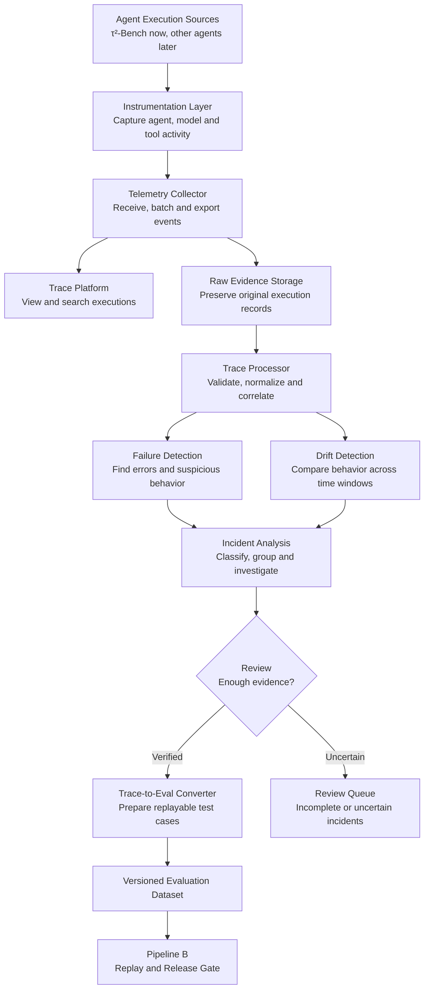

# TraceToGate — Project Overview

## Motivation

I am building TraceToGate to gain practical experience with evaluations for agentic AI systems. The skills should transfer to client projects involving AI agents and help me prepare for AI engineering and agent-infrastructure roles.

The problem is that an agent can appear to work during initial testing but fail later because of tool errors, incorrect actions, changing inputs, or unexpected side effects. Teams need a way to learn from agent executions and to test changes before deployment. Many teams build pipelines that convert their agentic systems' production traces and logs into eval datasets or regression tests. I want to learn how to do that too, which is why we have introduced Pipeline A.

## What We Aim to Achieve

TraceToGate is planned as one project with two connected capabilities:

- **Pipeline A — Trace-to-Eval:** Collect and analyze agent execution traces; detect failures, unusual behavior, and drift; investigate incidents; and convert verified, replayable failures into a versioned evaluation dataset. *This is the pipeline we are currently designing.*
- **Pipeline B — Replay and Release Gate:** Use approved evaluation cases to compare a current agent with a changed agent and produce evidence for a **PASS / FAIL / REVIEW** release recommendation. *Its architecture has not yet been confirmed.*

The goal is to understand how an agent's execution evidence can support continuous improvement and safer deployment — not merely to build an evaluation dashboard.

## What I Plan to Learn

- **Agent engineering:** Tool calling, execution harnesses, state management, and error handling.
- **Observability:** Instrumentation, OpenTelemetry, trace collection, normalization, storage, and monitoring; using tools such as Langfuse or Braintrust where appropriate.
- **Failure analysis:** Detecting and classifying tool failures, incorrect actions, loops, incomplete tasks, and unintended side effects; investigating root causes.
- **Drift detection:** Identifying changes in inputs, agent behavior, tool usage, latency, and failure rates across runs or time windows.
- **Trace-to-eval engineering:** Turning reviewed incidents into test cases with known inputs, starting state, expected outcomes, and evaluators.
- **Evaluation engineering:** Outcome and safety checks, evaluator reliability, false positives and false negatives, and regression testing.
- **Replay infrastructure:** Isolated execution, controlled tool behavior, state restoration, and baseline-versus-candidate comparisons.
- **Production engineering:** Evidence management, reproducible experiments, CI integration, reliability, and safe release decisions.

## Dataset and Test Environment

**Primary source:** τ²-Bench Retail.

It provides customer-support tasks, business policies, tools, a controlled environment, and task evaluation mechanisms. We will run an agent against those tasks and collect the resulting execution traces. The traces will supply examples for failure analysis and for creating reviewed regression tests.

Initially, the data will come from benchmark executions, not real customer production traffic. For drift experiments, we may compare runs over time or introduce controlled distribution changes.

---

# TraceToGate — Pipeline A Architecture Proposal

**Recommendation:** Use existing observability libraries for collecting and viewing traces, but build our own failure-analysis and trace-to-evaluation infrastructure.

That is a practical, production-style architecture. We learn the difficult engineering parts without rebuilding tools that already work.

## 1. Proposed Architecture



> This is a logical architecture, not a requirement to deploy every component as a separate service.

### Component Responsibilities

| Component | What it does | Build or reuse? |
|---|---|---|
| Agent source | Runs benchmark tasks and produces execution data | Reuse τ²-Bench |
| Instrumentation | Captures agent, model, tool, and workflow events | Reuse SDKs + custom hooks |
| Telemetry collector | Receives, buffers, and forwards traces | Reuse OpenTelemetry |
| Trace platform | Stores, searches, and visualizes traces | Langfuse or Braintrust |
| Raw evidence storage | Retains original records for investigation | Build integration |
| Trace processor | Validates schemas, joins events, checks completeness | Build |
| Failure detector | Identifies errors and suspicious behavior | Build |
| Drift detector | Detects meaningful behavioral changes | Build |
| Incident analyzer | Classifies, groups, and investigates failures | Build |
| Review and curation | Verifies incidents and prepares test cases | Build integration/workflow |
| Evaluation dataset | Stores approved, reproducible regression cases | Build contract; reuse storage where suitable |

The key separation: **observability** tells us what happened; **our analysis system** determines what requires investigation; **curation** determines what can become a valid test.

## 2. Langfuse, Braintrust, or Build Everything Ourselves?

Both Langfuse and Braintrust are appropriate.

**Langfuse**
- Supports OpenTelemetry tracing, searchable executions, evaluations, and datasets linked to traces.
- Open source and self-hostable.
- Particularly useful if we want to inspect infrastructure internals and retain control over our trace data.

**Braintrust**
- Provides agent tracing, monitoring, evaluation datasets, and tools for analyzing production behavior.
- Its SDK also supports OpenTelemetry exports.
- Useful for studying an integrated production monitoring and evaluation workflow.

### Proposed Approach

- Use **OpenTelemetry** as the instrumentation standard and choose **one** platform for trace visualization and exploration.
- Do **not** build our own distributed tracing backend, trace viewer, or generic metrics dashboard.
- **Do** implement the domain-specific events that normal instrumentation cannot reliably provide, such as a refund's actual database side effect, benchmark task outcome, or confirmed permission violation.
- OpenTelemetry has GenAI semantic conventions for model calls, agent invocations, and tool execution. Some conventions are still under development, so we must **pin and document** the schema version we adopt.

I lean toward **Langfuse + OpenTelemetry** as the first candidate, but would validate that choice with a small experiment instead of treating it as final.

## 3. What Traces Must We Collect?

A production agent generates more than one kind of evidence.

| Evidence type | What we capture | Why |
|---|---|---|
| Agent run | Run ID, task ID, timestamps, agent version | Identify each execution |
| Model calls | Requested model, messages permitted for logging, output, tokens, latency, errors | Investigate model behavior and cost |
| Tool calls | Tool name, call ID, arguments, result, duration, error | Detect wrong or failed tool actions |
| State transitions | Before/after state or verified changes to business records | Confirm actual side effects |
| Workflow events | Retries, decisions, transitions, termination, escalation | Identify loops and premature stops |
| Retrieval events | Search query, document IDs, data version, retrieval results | Diagnose retrieval failures (when retrieval is used) |
| Infrastructure events | Timeouts, rate limits, crashes, retries, dropped telemetry | Separate infrastructure failures from agent failures |
| Evaluation and feedback | Benchmark outcome, reviewer labels, user feedback | Establish whether the task succeeded |

### Example Trace

```text
Trace: refund request (run_1042)

1. User request       Customer requests a refund for order #123.
2. Model call         Agent selects get_order.
3. Tool execution     get_order returns eligible order details.
4. Tool execution     issue_refund times out AFTER the service commits the refund.
5. Retry              Agent calls issue_refund again.
6. State verification Two refund records found → duplicate side effect detected.
```

This example shows why tool outputs alone are insufficient. If we only observe a timeout, we cannot tell whether the operation failed or completed. We need **state evidence** to determine that.

### Minimum Trace Contract

- **Every trace** must carry: trace ID, task/run ID, source, timestamps, and agent version.
- **Each step** must have: operation type, span ID, parent relationship, status, and appropriate tool/model metadata.
- **For replayable tasks**, we also need: benchmark revision, task fixture identity, evaluator version, and state evidence.
- **For concurrent tool calls**, we need actual parent-child relationships and tool-call IDs. We must not infer execution order from timestamps alone.

## 4. Where Can Pipeline A Fail?

This is where the production engineering becomes interesting.

| Failure mode | Consequence | Guardrail |
|---|---|---|
| Trace events get dropped | Incomplete execution history | Monitor ingestion losses; mark evidence incomplete |
| Agent crashes before exporting | Final events missing | Flush on shutdown; retain runner outcome separately |
| Duplicate events arrive | False retry or duplicate-action detection | Deduplicate using stable event IDs |
| Events arrive out of order | Incorrect failure diagnosis | Use parent IDs and ordering metadata |
| Instrumentation misses a tool call | Unsafe action goes undetected | Instrument tool execution boundaries |
| Sensitive values enter traces | Privacy or security incident | Redact before export and restrict access |
| Trace contains huge prompts or outputs | Storage and processing overload | Set content limits; store approved large artifacts separately |
| Collector becomes unavailable | Lost or delayed telemetry | Bounded buffering, retries, and failure metrics |
| Agent reports success incorrectly | False success label | Verify state independently |
| Detector flags normal behavior | Excessive false alerts | Test against successful and alternate-valid runs |
| Different failures get clustered together | Misleading root-cause analysis | Preserve individual evidence; allow reviewer correction |
| Trace lacks initial environment state | Invalid replay test | Keep incident, but do not approve it for replay |

> **Important distinction:** Production telemetry collection usually must *not* block an active customer request just because the monitoring system is unavailable. But an evaluation system must *not* silently approve a run when required evidence is missing. Operational telemetry availability and release-evidence completeness therefore need **different policies**.

## 5. Known vs. Unknown

We should explicitly separate what current tools already establish from decisions that require experiments.

### What We Know

| Known | Supporting basis |
|---|---|
| τ²-Bench can run custom agents and save simulations | Its runner supports custom agents, saved results, detailed logs, and evaluation results |
| We do not need to invent a tracing protocol | OpenTelemetry defines agent and tool tracing conventions |
| Existing platforms support trace inspection and evaluation datasets | Langfuse and Braintrust provide these features |
| A failed trace is not necessarily a replayable test | A test may need controlled tool behavior and initial state that the trace does not preserve |

### What We Do Not Know Yet

| Unknown | How we should resolve it |
|---|---|
| Do τ²-Bench logs contain all the evidence we need? | Inspect real saved runs and compare with our trace contract |
| Should we use Langfuse or Braintrust? | Instrument the same task with each and compare |
| Which tool actions need manual instrumentation? | Run controlled tool failures and check trace coverage |
| Can we detect useful failures with simple rules? | Compare against independently labeled traces |
| Can drift detection work with benchmark-generated traces? | Create controlled shifts and measure detection accuracy |
| How many traces become valid evaluation cases? | Review a labeled sample and test replayability |

We should not choose databases, message queues, or distributed processing infrastructure before we know the expected data volume and reliability needs.

## 6. First Architectural Experiments

Three experiments before finalizing the components:

| Experiment | What we do | Decision it informs |
|---|---|---|
| **A-01: Trace completeness** | Run a handful of τ²-Bench tasks, including tool errors, retries, and agent failures. Compare the saved benchmark records with instrumented traces. | Required trace schema and custom instrumentation |
| **A-02: Observability platform** | Send the same traces to Langfuse and Braintrust. Compare trace structure, export access, redaction, operational complexity, and cost. | Which platform to adopt |
| **A-03: Failure-to-test feasibility** | Select known successful and failed executions. Try to diagnose failures and reconstruct replayable tests using available evidence. | Which data and state must be captured from the start |

Drift detection deserves a separate experiment once we have enough controlled runs. For example, we could deliberately shift the proportion of refund requests, change tool-error rates, or modify task complexity across two windows, then measure whether the drift detector identifies the change without confusing it with random variation.

## 7. Current Architectural Recommendation

**Proposed technology direction — not finalized**

| Area | Direction |
|---|---|
| Agent environment | τ²-Bench Retail |
| Instrumentation | OpenTelemetry + custom hooks |
| Trace viewer | Langfuse or Braintrust |
| Evidence preservation | Separate raw artifact storage |
| Processing | Our own trace validation and normalization logic |
| Failure analysis | Our own detection, classification, and investigation workflow |
| Drift monitoring | Our own comparison and alert logic |
| Trace-to-eval | Our own case preparation and validation workflow |

The main learning opportunity is not building another Langfuse. It is designing a reliable system that consumes execution evidence, finds meaningful failures, and produces trustworthy regression tests.

## Next Step

Settle the **trace contract**: exactly which fields we need, which must come from the agent, which must come from the environment, and how we verify that none of the critical evidence is missing. Once that is clear, run the first τ²-Bench experiment (A-01) and let its results guide the implementation.
